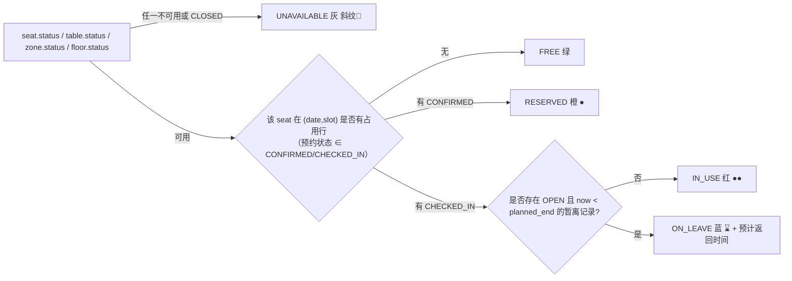

# 图书馆座位预约与占位管理系统 — 系统设计文档 V2

| 项目信息 | 内容 |
| --- | --- |
| 上游文档 | `docs/PRD-V2.md`（五块增量能力 + 四角色 + 26 条验收基准） |
| 基线 | V1（`docs/DESIGN.md`，已于 2026-09-21 独立回归收口：mvn 120/120 + 端到端全通过，git 基线 `f17f4cf`） |
| 技术栈 | 沿用 V1：Spring Boot 3.2.5 / Java 21 / JPA / H2(默认)+MySQL / JWT / Vite+React18+AntD5+ECharts |
| 文档版本 | v2.0 设计稿（待评审） |
| 范围 | 分区规则、暂离保留、组队学习、高峰调控、信用约束、巡查看板、规则可配、移动优先 |

---

## 0. 一句话架构

> **在 V1 单体之上做"规则外置 + 状态派生"扩展：新增分区/桌位两级空间模型与 30 分钟时段格，把全部业务阈值从代码常量迁到规则配置表；暂离、组队、候补、违规、巡查全部作为"预约记录的派生与账本"落地，座位表依旧不存占用字段，并发防重依旧只靠 `uk_slot_seat_date_idx` 唯一索引。**

**刻意保持不变的 V1 架构约定**（改动它们就是破坏 V1 已验证的正确性）：
1. 占用状态**由预约实时派生**，`t_seat` 不写"是否被占用"；
2. 并发防重靠**数据库唯一索引 + 事务 + `saveAllAndFlush`**，不靠先查后插；
3. 统一响应 `{code,message,data}` + 集中异常处理；
4. JWT + 拦截器鉴权 + `UserContext`（ThreadLocal，Filter 兜底清理）；
5. 前后端分离 + 构建产物内嵌 + **SPA 显式路由白名单**（新增前端顶层路由必须同步 `WebConfig.SpaFallbackController`，否则刷新白屏）；
6. 不引入 MQ / 微服务 / WebSocket / 容器编排；实时性靠轮询。

---

## 1. 角色与权限模型升级

### 1.1 枚举与迁移映射

```java
// enums/UserRole.java（V2 替换 V1 的 USER / ADMIN）
public enum UserRole { STUDENT, TEACHER, LIBRARIAN, SYS_ADMIN }
```

| V1 值 | V2 值 | 迁移 SQL（顺序敏感，两条互不冲突） |
| --- | --- | --- |
| `USER` | `STUDENT` | `UPDATE t_user SET role='STUDENT' WHERE role='USER';` |
| `ADMIN` | `SYS_ADMIN` | `UPDATE t_user SET role='SYS_ADMIN' WHERE role='ADMIN';` |

演示账号：`admin/admin123`→SYS_ADMIN；`student1..3/123456`→STUDENT；V2 新增 `teacher1/123456`→TEACHER、`librarian1/123456`→LIBRARIAN。

**旧 Token 处理（决策）**：V2 上线后 JWT 里 `role=USER/ADMIN` 一律视为非法 → `4010` 强制重登。理由：V1 的 `JwtAuthInterceptor` 已对 `role` 解析失败返回 4010，无需为演示项目做双版本兼容层（引入 `fromLegacy` 反而会让"哪些 token 有效"变成隐式规则）。上线步骤里写明"重启即全员重登"。

### 1.2 权限判定：路径前缀 → 角色集合（单一来源）

V1 把"是否 ADMIN"硬编码在拦截器里（`uri.startsWith("/api/admin/")`）。V2 角色增至 4 个、命名空间增至 3 个，改为**一张显式矩阵**，避免 if-else 散落（V1 CODE-AUDIT 的 B1 教训：同一信息写两处必然漂移）。

```java
// security/RolePermission.java —— 唯一事实来源
Map<String, Set<UserRole>> RULES = Map.of(
  "/api/auth/",     Set.of(),                                    // 白名单（login/register）
  "/api/public/",   Set.of(),                                    // 开放数据（如分区余量预览，可选）
  "/api/",          EnumSet.allOf(UserRole.class),               // 登录即可
  "/api/staff/",    EnumSet.of(LIBRARIAN, SYS_ADMIN),            // 馆员作业面
  "/api/admin/",    EnumSet.of(SYS_ADMIN)                        // 系统管理面
);
// 匹配方式：按「最长前缀」命中；未命中 → 4030
```

| 面 | 角色 | 典型能力 |
| --- | --- | --- |
| 学生面 `/api/**` | STUDENT / TEACHER | 预约、签到、暂离、结束、组队、候补、信用与申诉、本人记录 |
| 馆员面 `/api/staff/**` | LIBRARIAN / SYS_ADMIN | 实时监控、巡查处置、强制释放、违规确认/撤销、申诉复核、座位与分区 CRUD |
| 管理面 `/api/admin/**` | SYS_ADMIN | 规则配置、开放日历、账号与角色、空间建模、导出、审计 |

**细粒度规则不放路径矩阵**（会退化成第二套权限系统）：教师专区可见性、考研专座资格、单日累计上限等，一律在 Service 层用规则配置显式校验并返回带原因的中文错误。

### 1.3 数据权限红线（沿用并加强）

- 学生面任何接口**不得返回**他人姓名/学号/手机号；平面图只返回状态枚举。
- 馆员面可返回 `realName + studentNo + phoneMasked`（现场核对需要），手机号一律 `BizConstants.maskPhone`。
- 所有"我的…"查询强制 `user_id = UserContext.getUserId()`，禁止接受前端传入的 userId。

---

## 2. 空间模型：楼层 → 分区 → 桌位 → 座位

### 2.1 DDL（新增两张表 + 座位加列）

```sql
-- ============ 分区表（★ 规则载体：座位继承分区规则，不给单座配规则） ============
CREATE TABLE IF NOT EXISTS t_zone (
    id                BIGINT GENERATED BY DEFAULT AS IDENTITY PRIMARY KEY,
    floor_id          BIGINT       NOT NULL,
    name              VARCHAR(50)  NOT NULL,
    code              VARCHAR(20)  NOT NULL,                 -- 楼层内唯一，如 1F-SILENT
    zone_type         VARCHAR(30)  NOT NULL,                 -- SILENT/SEMINAR/E_READING/LOUNGE/EXAM_PREP/TEACHER_ONLY
    status            VARCHAR(20)  NOT NULL DEFAULT 'OPEN',  -- OPEN/CLOSED
    max_duration_min  INT          NOT NULL DEFAULT 240,     -- 单次时长上限（分钟）
    daily_cap_min     INT          NULL,                     -- 该分区单日累计上限；NULL=不设分区上限
    advance_days      INT          NOT NULL DEFAULT 3,       -- 可提前预约天数（含当天）
    allow_discuss     VARCHAR(10)  NOT NULL DEFAULT 'NO',    -- NO/LOW/YES
    allow_leave       BOOLEAN      NOT NULL DEFAULT TRUE,    -- 是否可暂离
    leave_max_min     INT          NOT NULL DEFAULT 60,      -- 本区暂离封顶
    leave_daily_limit INT          NOT NULL DEFAULT 3,       -- 本区每日暂离次数
    allow_group       BOOLEAN      NOT NULL DEFAULT FALSE,
    group_required    BOOLEAN      NOT NULL DEFAULT FALSE,   -- 研讨协作区：仅整组预约
    visible_roles     VARCHAR(100) NOT NULL DEFAULT 'STUDENT,TEACHER,LIBRARIAN,SYS_ADMIN',
    eligible_roles    VARCHAR(100) NOT NULL DEFAULT 'STUDENT,TEACHER,LIBRARIAN,SYS_ADMIN',
    sort_order        INT          NOT NULL DEFAULT 0,
    remark            VARCHAR(200) NULL,
    create_time       TIMESTAMP    NOT NULL DEFAULT CURRENT_TIMESTAMP,
    update_time       TIMESTAMP    NOT NULL DEFAULT CURRENT_TIMESTAMP
);
CREATE UNIQUE INDEX IF NOT EXISTS uk_zone_floor_code ON t_zone (floor_id, code);
CREATE INDEX IF NOT EXISTS idx_zone_floor ON t_zone (floor_id);

-- ============ 桌位表（组队预约的最小单位） ============
CREATE TABLE IF NOT EXISTS t_table (
    id         BIGINT GENERATED BY DEFAULT AS IDENTITY PRIMARY KEY,
    zone_id    BIGINT      NOT NULL,
    floor_id   BIGINT      NOT NULL,                        -- 冗余，便于按楼层统计
    table_no   VARCHAR(20) NOT NULL,                        -- 分区内唯一，如 T05
    seat_count INT         NOT NULL DEFAULT 4,              -- 4~6
    status     VARCHAR(20) NOT NULL DEFAULT 'AVAILABLE',    -- AVAILABLE/MAINTENANCE/DISABLED
    remark     VARCHAR(200) NULL,
    create_time TIMESTAMP NOT NULL DEFAULT CURRENT_TIMESTAMP,
    update_time TIMESTAMP NOT NULL DEFAULT CURRENT_TIMESTAMP
);
CREATE UNIQUE INDEX IF NOT EXISTS uk_table_zone_no ON t_table (zone_id, table_no);
CREATE INDEX IF NOT EXISTS idx_table_zone ON t_table (zone_id);

-- ============ 座位归属分区 / 桌位 ============
ALTER TABLE t_seat ADD COLUMN IF NOT EXISTS zone_id  BIGINT NULL;
ALTER TABLE t_seat ADD COLUMN IF NOT EXISTS table_id BIGINT NULL;
CREATE INDEX IF NOT EXISTS idx_seat_zone  ON t_seat (zone_id);
CREATE INDEX IF NOT EXISTS idx_seat_table ON t_seat (table_id);
```

- `visible_roles` / `eligible_roles` 用 CSV（角色枚举小而稳定，关联表收益为负），写入时校验每段必须是合法 `UserRole`。教师专区：`visible_roles='TEACHER,LIBRARIAN,SYS_ADMIN'`。
- 座位的旧 `zone`（VARCHAR 文本）列**保留一个大版本**只做展示兼容，V2 稳定后由独立提交删除；新代码一律读 `zone_id`。
- `table_id` 允许为空：非组队区域（电子阅览、休闲阅览）不必建模桌位。

### 2.2 分区规则矩阵落地（PRD §3.1 → 数据）

| zone_type | max_duration_min | allow_leave | leave_max_min | allow_group | group_required | advance_days | allow_discuss |
| --- | --- | --- | --- | --- | --- | --- | --- |
| SILENT 静音自习 | 240 | ✅ | 60 | ✅ | ❌ | 3 | NO |
| SEMINAR 研讨协作 | 180 | ✅ | 60 | ✅ | **✅** | 3 | LOW |
| E_READING 电子阅览 | 120 | **❌** | — | ❌ | ❌ | 1 | NO |
| LOUNGE 休闲阅览 | 60 | ❌ | — | ❌ |  | 1 | LOW |
| EXAM_PREP 考研专座 | 全天（见 §4.4） | ✅ | **120** | ❌ | ❌ | 按学期 | NO |
| TEACHER_ONLY 教师专区 | 360 | ✅ | 60 | ❌ |  | 3 | LOW |

**取值优先级**：`有效上限 = min(分区上限, 当日全局上限, 高峰压缩上限)`，教师角色用 `max_duration_teacher_min` 覆盖分区上限（规则配置项，见 §9）。

### 2.3 批量生成的行列冲突（V1 遗留缺陷，V2 必修）

V1 的 `POST /api/admin/seats/batch` 只校验 `seat_no` 唯一，不校验 `(floor_id,row_no,col_no)` 占位，导致同格叠多个座位（回归中实测 A01/Z01/Z488 同在 1 行 1 列）。V2 修法（两条都做）：
1. 生成前做**冲突预览**：`POST /api/admin/zones/{zoneId}/seats/batch-preview` 返回将冲突的行列清单；
2. 正式生成时默认 `skipConflicting=true` 并在响应里返回 `skippedPositions`；
3. 加**软唯一约束**：`CREATE UNIQUE INDEX uk_seat_pos ON t_seat (floor_id, row_no, col_no)`（迁移前先跑一次冲突清理脚本；若历史数据存在有意重叠，则该索引降级为 Service 校验并在文档标注）。

---

## 3. 座位状态派生模型（V2 含暂离）



- 唯一入口仍是 `OccupancyService`，V2 返回值从 `Map<Long, ReservationStatus>` 升级为
  `Map<Long, SeatOccupancy>`，其中 `SeatOccupancy{seatId, reservationStatus, reservationId, leaveUntil, groupFlag}`。
  **平面图 / 楼层余量 / 分区余量 / 利用率 / 候补触发点全部复用这一个方法**（V1 原则不变）。
- `SeatDisplayStatus` 枚举新增 `ON_LEAVE`；前端色板新增 `ON_LEAVE:'#1677ff'`，第二重标识 `⌛` + 文案「暂离中 · 预计 14:35 返回」（PRD §13.3：文案比颜色更重要）。
- **违约不是座位状态**：违规写入后预约进入终态并物理删除 slot 行 → 座位立即回 `FREE`。

---

## 4. 时段模型：30 分钟粒度 + 开放日历

### 4.1 slot 编码（唯一口径，全链路一致）

```
slot = (hour * 60 + minute) / 30          // 0..47
slotToTime(slot) = LocalTime.ofMinute(slot * 30)   // 15 → 07:30
```
- `t_reservation.start_slot/end_slot` 与 `t_reservation_slot.slot_index` 一律使用该编码，`end_slot` 为开区间。
- **内部格长固定 30 分钟**，60 分钟只是"可选时长"层面的限制。理由：若格长可配，唯一索引语义与占用查询会随配置漂移，属于隐藏的正确性风险。
- 时长选项由规则生成：`duration ∈ {30,60,90,...}` 且 `≤ 有效上限`；`BizConstants.ALLOWED_DURATIONS` 从常量降级为兜底默认值。

### 4.2 V1 → V2 数据迁移

```sql
UPDATE t_reservation      SET start_slot = start_slot * 2, end_slot = end_slot * 2;
UPDATE t_reservation_slot SET slot_index = slot_index * 2;
```
（V1 的 8~21 整点 → V2 的 16~42；迁移脚本必须在 `V6__open_time.sql` 内一次性完成，并在同版本里更新所有历史统计口径。）

### 4.3 开放时间与日型（后台可配，不发版）

```sql
CREATE TABLE IF NOT EXISTS t_open_profile (
    id                BIGINT GENERATED BY DEFAULT AS IDENTITY PRIMARY KEY,
    day_type          VARCHAR(20) NOT NULL,             -- WEEKDAY/WEEKEND/EXAM/CUSTOM
    open_time         TIME        NOT NULL,             -- 07:30
    close_time        TIME        NOT NULL,             -- 22:30（闭馆时刻=最大 end_slot）
    max_duration_min  INT         NOT NULL DEFAULT 240,
    teacher_duration_min INT      NOT NULL DEFAULT 360,
    daily_cap_min     INT         NOT NULL DEFAULT 360, -- 单日累计上限（6h）
    advance_days      INT         NOT NULL DEFAULT 3,
    peak_compress_min INT         NOT NULL DEFAULT 120, -- 高峰时段单次上限
    exam_week         BOOLEAN     NOT NULL DEFAULT FALSE,
    enabled           BOOLEAN     NOT NULL DEFAULT TRUE,
    create_time TIMESTAMP NOT NULL DEFAULT CURRENT_TIMESTAMP,
    update_time TIMESTAMP NOT NULL DEFAULT CURRENT_TIMESTAMP
);
CREATE UNIQUE INDEX IF NOT EXISTS uk_profile_day_type ON t_open_profile (day_type);

CREATE TABLE IF NOT EXISTS t_open_calendar (           -- 逐日覆盖：寒暑假、临时闭馆
    id BIGINT GENERATED BY DEFAULT AS IDENTITY PRIMARY KEY,
    biz_date   DATE NOT NULL,
    day_type   VARCHAR(20) NOT NULL,
    open_time  TIME NULL, close_time TIME NULL,       -- NULL=沿用 profile
    closed     BOOLEAN NOT NULL DEFAULT FALSE,        -- 临时闭馆
    reason     VARCHAR(100) NULL,
    create_time TIMESTAMP NOT NULL DEFAULT CURRENT_TIMESTAMP,
    update_time TIMESTAMP NOT NULL DEFAULT CURRENT_TIMESTAMP
);
CREATE UNIQUE INDEX IF NOT EXISTS uk_calendar_date ON t_open_calendar (biz_date);

CREATE TABLE IF NOT EXISTS t_peak_window (             -- 高峰时段定义（可配）
    id BIGINT GENERATED BY DEFAULT AS IDENTITY PRIMARY KEY,
    day_type   VARCHAR(20) NOT NULL,
    start_slot INT NOT NULL, end_slot INT NOT NULL,    -- 30 分钟格编码，[start,end)
    enabled    BOOLEAN NOT NULL DEFAULT TRUE,
    create_time TIMESTAMP NOT NULL DEFAULT CURRENT_TIMESTAMP
);
CREATE INDEX IF NOT EXISTS idx_peak_day_type ON t_peak_window (day_type);
```

**某日生效规则解析链**（`OpenRuleService.resolve(date)`）：
`t_open_calendar(biz_date)` → 按 `day_type` 取 `t_open_profile` → 与分区规则求交（§2.2 优先级）。结果对象当日缓存（§9 缓存策略）。

### 4.4 考研专座"全天"

`zone_type=EXAM_PREP` 时 `max_duration_min` 置为 `NULL` 语义 → 用 `full_day BOOLEAN` 表达更清楚：

```sql
ALTER TABLE t_zone ADD COLUMN IF NOT EXISTS full_day BOOLEAN NOT NULL DEFAULT FALSE;
```
`full_day=TRUE` 时有效时长 = 当日 `open_slot..close_slot` 整段，且仍受 `daily_cap_min` 与"不跨闭馆"约束；学期分配用 `t_zone_grant`（§7.4）表达资格，不靠角色。

---

## 5. 暂离机制（V2 最关键新能力）

### 5.1 DDL

```sql
CREATE TABLE IF NOT EXISTS t_leave_reason (
    code        VARCHAR(30)  NOT NULL PRIMARY KEY,     -- MEAL/CLASS/PHONE/REST/PICKUP/OTHER
    name        VARCHAR(50)  NOT NULL,
    max_min     INT          NOT NULL,                 -- 就餐60/上课60/接电20/短休20/取物15/其他15
    daily_limit INT          NOT NULL DEFAULT 3,       -- 该原因各自的每日次数（PRD §6.2：就餐 2，其余 3）
    need_note   BOOLEAN      NOT NULL DEFAULT FALSE,   -- 上课/会议需填事由
    enabled     BOOLEAN      NOT NULL DEFAULT TRUE,
    sort_order  INT          NOT NULL DEFAULT 0
);

CREATE TABLE IF NOT EXISTS t_leave_record (
    id                BIGINT GENERATED BY DEFAULT AS IDENTITY PRIMARY KEY,
    reservation_id    BIGINT      NOT NULL,
    user_id           BIGINT      NOT NULL,
    seat_id           BIGINT      NOT NULL,
    reason_code       VARCHAR(30) NOT NULL,
    note              VARCHAR(100) NULL,
    start_time        TIMESTAMP   NOT NULL,
    planned_end_time  TIMESTAMP   NOT NULL,            -- 已按「剩余使用时间」与「分区封顶」双重截断
    actual_return_time TIMESTAMP  NULL,
    status            VARCHAR(20) NOT NULL,            -- OPEN/RETURNED/TIMEOUT
    open_flag         SMALLINT    NULL,                -- ★ OPEN 时=1，结束置 NULL
    create_time       TIMESTAMP   NOT NULL DEFAULT CURRENT_TIMESTAMP,
    update_time       TIMESTAMP   NOT NULL DEFAULT CURRENT_TIMESTAMP
);
-- 一条预约同时至多一条 OPEN 暂离（NULL 不参与唯一约束 → 天然允许历史多条）
CREATE UNIQUE INDEX IF NOT EXISTS uk_leave_open ON t_leave_record (reservation_id, open_flag);
CREATE INDEX IF NOT EXISTS idx_leave_user_date ON t_leave_record (user_id, start_time);
CREATE INDEX IF NOT EXISTS idx_leave_status    ON t_leave_record (status, planned_end_time);
```

`open_flag` 技巧同时用于巡查任务与候补队列的"活动行唯一"约束——这是 H2/MySQL 都支持的可移植写法（无部分索引依赖）。

### 5.2 规则与校验顺序（`LeaveService.start`）

1. 预约存在且 `user_id` 为本人，状态 = `CHECKED_IN` → 否则 `4093`；
2. 所属分区 `allow_leave=TRUE` → 否则 `4095 该分区不支持暂离（离座即释放）`；
3. 本人无 `OPEN` 暂离 → 否则 `4097 当前已在暂离中`；
4. **当日暂离次数**：两条**独立**规则，不要合成一个 `min()`——
   ① 总次数 < `zone.leave_daily_limit`（静音区 3、**考研专座放宽至 5**；座位无分区时兜底 3）→ 否则 `4096 今日暂离次数已用完（上限 N 次）`；
   ② 该原因各自次数 < `reason.daily_limit`（PRD §6.2 表：就餐 2、其余 3）→ 否则 `4096「就餐」今日已用完 2 次，请换一个原因`。
   早期版本写成 `min(原因, 分区)` 当总数用：六个原因都种成 3，考研专座的 5 因此永远不可达（PRD §12-13 落空），
   就餐的 2 次也从未生效，而「我的预约」的按钮只看分区值 —— 第 4 次点亮着按钮提交却被拒。
   拆分后 `LeaveService#dailyLimitOf` 是提交与按钮的**同一处**判定（V15 数据 + 代码同步，用例 `dailyTotalLimitFollowsZone`）；
5. `need_note` 的原因必须填事由 → 否则 `4001`；
6. `planned_end = min(now + reason.max_min, zone.leave_max_min 封顶, reservation 结束时间)` —— **剩余不足按剩余封顶，不报错**（PRD §6.2-4）；
   ★ 分区在这里是**天花板**而不是放宽倍数：考研专座的 120 只有在原因本身允许得更久时才生效
   （六个种子原因最长 60，所以日常看到的仍是 60）。用例 `zoneLeaveCeilingIsLiveConstraint`
   把某原因临时放宽到 180 来证明 120 与静音区 60 的差别真实存在。
   「就餐在考研专座是否应直接给满 120」是产品口径问题，见 `.workbuddy/regression-v2-s7/S7-24-GATE.md` 的 B8；
7. 写记录（`status=OPEN, open_flag=1`）+ 写站内通知（暂离到期前 5 分钟提醒）。

**原因字典** `GET /api/leaves/reasons` 除配置项外还带本人当日各原因计数
（`todayUsed / exhausted / exhaustedReason`）：原因级的次数只在提交时才判，
如果字典里不告诉前端，用户就会选到一个必然被拒的原因（PRD §13「不可用必须说明原因」）。

**返回**：`LeaveVO{leaveId, reasonText, plannedEndTime:"14:35", remainMin, returned:false}`。
`LeaveService.returnBack`：置 `RETURNED`、`open_flag=NULL`、`actual_return_time=now`；**剩余使用时间不顺延**（PRD §6.2-7，界面必须讲清楚）。

### 5.3 定时扫描（并入 §10 任务清单）

`ON_LEAVE` 超时 → 复用 V1 的事务边界教训：写操作放 `LeaveStateService`（独立 Bean，`@Transactional`），扫描器只做判定 + 经代理调用，逐条 try-catch。动作：预约置 `VIOLATED`、删除该预约全部 slot 行、写 `t_violation(LEAVE_TIMEOUT, -10)` + 信用账本 + 处罚评估 + 通知。

### 5.4 主动结束使用

`POST /api/reservations/{id}/finish`：仅 `CHECKED_IN`（或暂离中返回后）可用 → 状态 `COMPLETED`、删 slot、累计 `active_finish_streak`；连续 5 次 → 信用 +5（PRD §6.3）。

```sql
ALTER TABLE t_user ADD COLUMN IF NOT EXISTS credit_score      INT NOT NULL DEFAULT 100;
ALTER TABLE t_user ADD COLUMN IF NOT EXISTS student_no        VARCHAR(30) NULL;   -- 学号/教工号
ALTER TABLE t_user ADD COLUMN IF NOT EXISTS active_finish_streak INT NOT NULL DEFAULT 0;
CREATE UNIQUE INDEX IF NOT EXISTS uk_user_student_no ON t_user (student_no);
```

---

## 6. 违规、信用分、处罚与申诉

### 6.1 DDL

```sql
CREATE TABLE IF NOT EXISTS t_violation (
    id             BIGINT GENERATED BY DEFAULT AS IDENTITY PRIMARY KEY,
    user_id        BIGINT      NOT NULL,
    reservation_id BIGINT      NULL,
    type           VARCHAR(30) NOT NULL,   -- NO_SHOW/LEAVE_TIMEOUT/GROUP_ABSENT/LEADER_ABSENT/ON_SITE_OCCUPY/NO_CANCEL
    score_delta    INT         NOT NULL,   -- 负数
    evidence       CLOB        NOT NULL,   -- ★ JSON：{rule,triggerTime,checkInDeadline,leaveDeadline,patrolTaskId,operatorId,photoUrl}
    status         VARCHAR(20) NOT NULL,   -- ACTIVE/APPEALING/REVOKED
    created_by     VARCHAR(20) NOT NULL,   -- SYSTEM/LIBRARIAN
    creator_id     BIGINT      NULL,
    revoke_time    TIMESTAMP   NULL,
    revoke_reason  VARCHAR(200) NULL,
    create_time    TIMESTAMP   NOT NULL DEFAULT CURRENT_TIMESTAMP
);
CREATE INDEX IF NOT EXISTS idx_viol_user_status ON t_violation (user_id, status);

CREATE TABLE IF NOT EXISTS t_credit_log (   -- 只追加的账本，信用分的可追溯来源
    id BIGINT GENERATED BY DEFAULT AS IDENTITY PRIMARY KEY,
    user_id BIGINT NOT NULL, kind VARCHAR(20) NOT NULL,   -- PENALTY/WEEKLY_BONUS/STREAK_BONUS/RESTORE/INIT
    delta INT NOT NULL, balance_after INT NOT NULL,
    ref_type VARCHAR(20) NULL, ref_id BIGINT NULL, reason VARCHAR(100) NULL,
    create_time TIMESTAMP NOT NULL DEFAULT CURRENT_TIMESTAMP
);
CREATE INDEX IF NOT EXISTS idx_clog_user ON t_credit_log (user_id, create_time);

CREATE TABLE IF NOT EXISTS t_penalty (
    id BIGINT GENERATED BY DEFAULT AS IDENTITY PRIMARY KEY,
    user_id BIGINT NOT NULL,
    type   VARCHAR(30) NOT NULL,            -- PEAK_BAN/BOOK_BAN_3D/BOOK_BAN_7D/SEMESTER_BAN
    start_time TIMESTAMP NOT NULL, end_time TIMESTAMP NULL,   -- SEMESTER_BAN 需人工解除 → end_time NULL
    status VARCHAR(20) NOT NULL,            -- ACTIVE/RELEASED
    reason VARCHAR(100) NULL, released_by BIGINT NULL, release_note VARCHAR(200) NULL,
    create_time TIMESTAMP NOT NULL DEFAULT CURRENT_TIMESTAMP
);
CREATE INDEX IF NOT EXISTS idx_penalty_user_status ON t_penalty (user_id, status);

CREATE TABLE IF NOT EXISTS t_appeal (
    id BIGINT GENERATED BY DEFAULT AS IDENTITY PRIMARY KEY,
    violation_id BIGINT NOT NULL, user_id BIGINT NOT NULL,
    reason VARCHAR(500) NOT NULL,
    status VARCHAR(20) NOT NULL,            -- PENDING/APPROVED/REJECTED/ESCALATED/FINAL_JUDGED
    handler_id BIGINT NULL, handler_role VARCHAR(20) NULL, reply VARCHAR(500) NULL,
    create_time TIMESTAMP NOT NULL DEFAULT CURRENT_TIMESTAMP, handle_time TIMESTAMP NULL
);
CREATE UNIQUE INDEX IF NOT EXISTS uk_appeal_violation ON t_appeal (violation_id);  -- 一条违规一次申诉
```

### 6.2 信用分写入的唯一入口

`CreditService.applyViolation(userId, type, scoreDelta, evidenceJson, refReservationId)`，`@Transactional` 内顺序完成：
1. 写 `t_violation`（含证据，缺证据直接抛异常——PRD §12-22「无证据不得裁定」）；
2. 扣减：`credit_score = max(0, credit_score + delta)`，同时写 `t_credit_log`（`balance_after` 必填）；
3. 评估阶梯并生成 `t_penalty`（幂等：同 `user_id + type` 已有 ACTIVE 则只延长 `end_time`，不重复插入）；
4. 写站内通知（含申诉入口 deeplink）。

| 信用分 | 处罚（自动） | 实现 |
| --- | --- | --- |
| 90–100 | 无 | — |
| 70–89 | 高峰时段不可预约 | `PEAK_BAN`（`end_time=NULL`，随分数回升由 `CreditService` 在加分路径上解除） |
| 50–69 | 暂停预约 3 天 | `BOOK_BAN_3D`，`end_time=now+3d` |
| 1–49 | 暂停预约 7 天 + 到馆签承诺书 | `BOOK_BAN_7D`，`end_time=now+7d`，馆员 `POST /api/staff/penalties/{id}/release` 提前解除 |
| 0 | 暂停至学期末 | `SEMESTER_BAN`，`end_time=NULL`，仅 SYS_ADMIN 可解除 |

**预约创建时的闸门顺序**（`ReservationService` 校验链新增两步，位置见 §8.3）：先查 ACTIVE 且未过期的 `t_penalty` → `4100/4101`（带恢复时间），再查单日累计 → `4098`。

★ "单日累计"是**两道独立的检查**，不是一道取小（2026-10-05 对账 PRD §12-3 后补齐）：
① 分区口径 `t_zone.daily_cap_min` 管"本区今天被坐了多久"（NULL = 本区不设分区级上限）；
② 全馆口径 `book.daily-cap-min`（默认 360 分钟）管"这个人今天一共坐了多久"，跨分区累加。
只留 ① 的话，换区预约可以无限叠加 —— 五个区各 4 小时，没有一道闸门会响，
而 PRD 把这条规则写在**人**身上。报错文案必须写明"全馆口径、换分区也一样计入"，
否则用户的下一动作就是换个区再试一次，白跑一趟。

### 6.3 申诉闭环

`POST /api/violations/{id}/appeal`（24h 内、每违规一次、`uk_appeal_violation` 兜底）→ 违规置 `APPEALING` →
馆员 `POST /api/staff/appeals/{id}/judge {approve, reply}`：成立则撤销违规、按 `t_credit_log` 反向补分（写 `RESTORE` 流水，不改历史）、解除因本次扣分产生的处罚；驳回则 `REJECTED`；
学生升级 `POST /api/violations/{id}/appeal/escalate` → `ESCALATED` → SYS_ADMIN 终审 `FINAL_JUDGED`（终态）。
全链路写 `t_audit_log`。

### 6.4 周恢复与证据

`WeeklyCreditTask`（每周一 03:00）：上一自然周无新增违规 → +5（上限 100，写 `WEEKLY_BONUS` 流水）。
证据 JSON 由触发方组装（规则名 + 关键时间戳 + 操作人 + 巡查任务号 + 可选照片 URL），**申诉裁定页直接渲染该 JSON 的可读版本**。

---

## 7. 组队预约（按桌）

### 7.1 DDL

```sql
CREATE TABLE IF NOT EXISTS t_group (
    id BIGINT GENERATED BY DEFAULT AS IDENTITY PRIMARY KEY,
    leader_id   BIGINT      NOT NULL,
    floor_id    BIGINT      NOT NULL,
    zone_id     BIGINT      NOT NULL,
    table_id    BIGINT      NULL,             -- 研讨协作区必填
    reserve_date DATE       NOT NULL,
    start_slot  INT         NOT NULL,
    end_slot    INT         NOT NULL,         -- 30 分钟格，开区间
    invite_code VARCHAR(10) NULL,             -- 6 位，10 分钟有效
    invite_expire_time TIMESTAMP NULL,
    min_members INT NOT NULL DEFAULT 2,
    max_members INT NOT NULL DEFAULT 6,        -- ★ 上限是流程口径（BizConstants.GROUP_MAX_MEMBERS），
                                                --   省略时取 min(本桌座位数, 6)：桌位 seatCount 可到 12，
                                                --   让家具决定一队人数等于放弃 PRD §12-6/16
    lock_time   TIMESTAMP   NOT NULL,         -- 开始前 30 分钟
    status      VARCHAR(20) NOT NULL,         -- FORMING/LOCKED/RESERVED/CHECKED_IN/COMPLETED/CANCELLED/FAILED
    create_time TIMESTAMP NOT NULL DEFAULT CURRENT_TIMESTAMP,
    update_time TIMESTAMP NOT NULL DEFAULT CURRENT_TIMESTAMP
);
CREATE UNIQUE INDEX IF NOT EXISTS uk_group_invite ON t_group (invite_code);
CREATE INDEX IF NOT EXISTS idx_group_leader ON t_group (leader_id, status);

CREATE TABLE IF NOT EXISTS t_group_member (
    id BIGINT GENERATED BY DEFAULT AS IDENTITY PRIMARY KEY,
    group_id BIGINT NOT NULL, user_id BIGINT NOT NULL,
    member_role   VARCHAR(10) NOT NULL,       -- LEADER/MEMBER
    invite_status VARCHAR(20) NOT NULL,       -- INVITED/CONFIRMED/DECLINED/EXPIRED
    confirm_time  TIMESTAMP NULL,
    seat_id       BIGINT NULL,                -- 锁定后分配
    attend_status VARCHAR(20) NOT NULL DEFAULT 'UNKNOWN',  -- UNKNOWN/PRESENT/ABSENT
    create_time TIMESTAMP NOT NULL DEFAULT CURRENT_TIMESTAMP,
    update_time TIMESTAMP NOT NULL DEFAULT CURRENT_TIMESTAMP
);
CREATE UNIQUE INDEX IF NOT EXISTS uk_group_user ON t_group_member (group_id, user_id);

ALTER TABLE t_reservation ADD COLUMN IF NOT EXISTS group_id BIGINT NULL;
CREATE INDEX IF NOT EXISTS idx_resv_group ON t_reservation (group_id);

-- 分区/座位资格授予（考研专座等需要名单的场景）
CREATE TABLE IF NOT EXISTS t_zone_grant (
    id BIGINT GENERATED BY DEFAULT AS IDENTITY PRIMARY KEY,
    user_id BIGINT NOT NULL, zone_id BIGINT NOT NULL,
    term VARCHAR(20) NOT NULL,                -- 如 2026-2027-1
    status VARCHAR(20) NOT NULL DEFAULT 'ACTIVE',
    create_time TIMESTAMP NOT NULL DEFAULT CURRENT_TIMESTAMP
);
CREATE UNIQUE INDEX IF NOT EXISTS uk_grant ON t_zone_grant (user_id, zone_id, term);
```

### 7.2 关键决策：组队复用 `reservation + reservation_slot`，不新建占用表

流程：组长建队（`FORMING`）→ 邀请（码/学号）→ 成员 10 分钟内确认 → `lock_time` 到达且人数 ≥ `min_members` → **锁定并按桌位座位逐条创建 reservation（同一 `group_id`）** → 并发防重继续由 `uk_slot_seat_date_idx` 保证；若桌位中任一座位已被抢，整单在该事务内回滚并返回 `4091`（队伍要么整桌成功，要么不动）。人数不足 → `FAILED` 并通知全员。

- **组长签到 = 全队签到**：`POST /api/groups/{id}/check-in`（仅 LEADER）→ 批量把该组全部 reservation 置 `CHECKED_IN`，成员 `attend_status` 保持 `UNKNOWN` 等待入座确认。
- **成员缺席**：签到后 30 分钟仍 `UNKNOWN` → 定时任务标 `ABSENT` + `t_violation(GROUP_ABSENT,-10)`，**不删 slot**（座位保留给队伍，PRD §7.2 的理由）。
- **组长缺席**：组长未在窗口签到 → 全队 reservation 置 `CANCELLED` 并删 slot，组长 `LEADER_ABSENT,-20`。
- 取消/改约权仅组长；成员退出仅在 `FORMING` 且未到 `lock_time` 前允许。

---

## 8. 高峰调控与排队候补

### 8.1 高峰识别

- **静态高峰**：`t_peak_window`（按 day_type）。
- **动态高峰**：`PeakDetectTask` 每 5 分钟按分区计算当前占用率，`≥ dynamicThreshold(默认 90%)` 连续 `dynamicSustainMin(默认 15min)` → 写 `t_zone_peak_state(zone_id, until_time)`；命中动态高峰等价于静态高峰（触发时长压缩）。

### 8.2 调控手段与降级说明

| 手段 | V2 实现 | 约束说明 |
| --- | --- | --- |
| 提前开放 | 高峰时段在「前一天 22:00」开放：`advance_days` 与 `peak_open_time` 组合判定，未到点返回 `4101` 并提示开放时刻 | 纯服务端时间判定，无需调度 |
| 时长压缩 | 有效上限取 `min(分区, 当日, peak_compress_min)`；教师用 `teacher_duration_min` | 校验链一步 |
| 排队候补 | `t_waitlist` + 规则 `waitlist.offer-min`（默认 10 分钟）确认窗口 | **无 MQ/推送**：确认走站内通知 + 轮询（§8.4），窗口内用户不在场即顺延——需在 UI 明示"请保持页面打开"。原定 5 分钟在 TASKS-V2 里改为可配，落地取默认 10 分钟：无推送时 5 分钟形同"守着刷新" |
| 余座预告 | 分区余量 + 基于近 4 周同时段历史的「预计到达余座」 | 历史均值查询即可，不引入预测模型 |
| 高峰提醒 | 站内通知 | 同上降级 |

### 8.3 候补 DDL 与流转

```sql
CREATE TABLE IF NOT EXISTS t_waitlist (
    id BIGINT GENERATED BY DEFAULT AS IDENTITY PRIMARY KEY,
    user_id BIGINT NOT NULL,
    floor_id BIGINT NOT NULL, zone_id BIGINT NOT NULL, table_id BIGINT NULL,
    reserve_date DATE NOT NULL, start_slot INT NOT NULL, end_slot INT NOT NULL,
    status VARCHAR(20) NOT NULL,              -- WAITING/OFFERED/CONFIRMED/EXPIRED/CANCELLED
    active_flag SMALLINT NULL,                -- WAITING/OFFERED 时=1，终态置 NULL
    offered_time TIMESTAMP NULL, offer_expire_time TIMESTAMP NULL,
    create_time TIMESTAMP NOT NULL DEFAULT CURRENT_TIMESTAMP,
    update_time TIMESTAMP NOT NULL DEFAULT CURRENT_TIMESTAMP
);
-- 同一用户对同一（分区,日期,起始时段）只能有一条活动队列位
CREATE UNIQUE INDEX IF NOT EXISTS uk_waitlist_active ON t_waitlist (user_id, zone_id, reserve_date, start_slot, active_flag);
CREATE INDEX IF NOT EXISTS idx_waitlist_zone_state ON t_waitlist (zone_id, reserve_date, start_slot, status);
```

流转（T-V2-19 落地口径）：`join`（校验：分区开放且本人有资格、非 `group_required`、时段未过期、该排队键**当前无空位**、同人同键不重复、本人活动队列 ≤ `waitlist.max-active`(默认 2) → 否则 `4093/4106`）→ 座位释放（`ReservationService.cancel/finish`、`ReservationStateService.markNoShow`、`LeaveStateService.markTimeout`、`GroupStateService.cancelForLeaderAbsence`、`AdminUsageService.release` 都在**同一事务内**调 `WaitlistStateService.onReservationReleased`；`AdminSeatService/AdminFloorService` 的删除路径刻意不调——椅子马上就不存在了，唤醒队列只会骗人）→ 队首置 `OFFERED`（`offer_expire = now + waitlist.offer-min`）+ 通知。

★ 三条与初稿不同的实现决定，都是被具体问题逼出来的：

1. **一次释放只发一个 offer**：放出来的是「一个位置」，同时许诺两人等于注定让一人扑空；同键已有未消化 offer 时不再重复发。
2. **匹配用区间而非相等**：`startSlot` 落在 `[释放起点, 释放终点)` 内的队首都能被唤醒，否则 9:00-11:00 取消后，10:00 起排队的人永远等不到。起始格已过的候选一律跳过（预约链第 5 步会拒他，offer 是浪费）。
3. **失败即自愈，且自愈单独提交**：确认时先现挑一座再走完整校验链；无空位或校验没过（`4091/4098/4100…`）→ 该条置 `EXPIRED` 并顺延下一位（`REQUIRES_NEW`，否则外层回滚会把顺延一起吞掉），**不记违规**。

### 8.4 站内通知（替代推送）

```sql
CREATE TABLE IF NOT EXISTS t_notice (
    id BIGINT GENERATED BY DEFAULT AS IDENTITY PRIMARY KEY,
    user_id BIGINT NOT NULL, type VARCHAR(30) NOT NULL,   -- CHECK_IN_REMIND/LEAVE_OPEN/LEAVE_EXPIRE/VIOLATION/APPEAL_RESULT/WAITLIST_OFFER/GROUP_LEADER_ABSENT
    title VARCHAR(50) NOT NULL, content VARCHAR(300) NOT NULL,
    ref_type VARCHAR(20) NULL, ref_id BIGINT NULL,
    read_flag BOOLEAN NOT NULL DEFAULT FALSE, expire_time TIMESTAMP NULL,
    create_time TIMESTAMP NOT NULL DEFAULT CURRENT_TIMESTAMP
);
CREATE UNIQUE INDEX IF NOT EXISTS uk_notice_ref ON t_notice (user_id, type, ref_type, ref_id);  -- 提醒任务每分钟重跑的幂等键
CREATE INDEX IF NOT EXISTS idx_notice_user ON t_notice (user_id, read_flag, create_time);
```
前端复用平面图轮询通道拉取 `GET /api/me/notices`（15–30s），未读数进 Header；**明确记录**：本系统无第三方推送通道，"推送"= 站内通知 + 轮询（与 V1「不引入重型组件」一致）。

**T-V2-20 落地口径（与初稿的差异都写在这里）**

- 迁移编号：初稿的 `V9__peak_waitlist_notice.sql` 已被拆成 V12（候补）与 **V13（`t_notice`）** —— V9~V11 已落库，不能回改 checksum。
- 类型实际为 `CHECK_IN_REMIND / LEAVE_OPEN / LEAVE_EXPIRE / VIOLATION / APPEAL_RESULT / WAITLIST_OFFER / GROUP_LEADER_ABSENT`，
  每个类型自带前端落地路径（`NoticeType.link`）：消息的价值是"一点就到那件事"，让前端按类型猜路径必然出现死链。
- **不做 `PEAK_TIP`**：高峰唯一可操作的时刻是"还没下单之前"，那一份已由平面图与余量卡片的 `peakFlag` 交付（T-V2-18）；
  下单后再推"你预约的时段现在是高峰"用户什么也做不了，只是噪音。
- 新增 `LEAVE_OPEN`（登记暂离即时回执，正文自带应归时刻与"剩余时间不顺延"）与 `GROUP_LEADER_ABSENT`
  （组长未签到整队取消时通知**成员**：他们没被扣分，却是最需要知道的人）。
- 幂等：`uk_notice_ref (user_id, type, ref_type, ref_id)` + 服务内存在性检查。提醒任务每分钟重跑，
  去重不能靠"记得上次跑到哪儿"。`ref_id` 为 NULL 的行不参与去重（目前所有生产者都带 ref）。
- 提醒窗口：签到提醒取「窗口已开且未过签到截止」整段而不是"开启那一分钟"（重启或上一轮异常会让人永远收不到，
  去重保证只发一次）；暂离提醒取 `notice.leave-remind-min`（默认 5 分钟）。
- **通知是尽力而为的提醒，不是判定**：签到 / 确认 / 归队与否一律以业务表与规则为准；
  写通知与业务写操作同事务（宁可一起回滚，也不出现"扣分了但永远没通知"或"消息发了两次"无法区分）。
- 顶栏铃铛每 15 秒轮询、面板打开时暂停并在打开瞬间补拉一次；页面在后台标签页不发请求。
  馆员 / 管理员的布局暂无铃铛（其通知入口在馆员台队列页本身）。

---

## 9. 规则配置中心（"不发版"的落点）

```sql
CREATE TABLE IF NOT EXISTS t_rule_config (
    id BIGINT GENERATED BY DEFAULT AS IDENTITY PRIMARY KEY,
    scope     VARCHAR(20) NOT NULL,       -- GLOBAL/ZONE/DAY_TYPE
    scope_id  VARCHAR(30) NULL,           -- zoneId 或 dayType；GLOBAL 为 NULL
    rkey      VARCHAR(50) NOT NULL,
    rvalue    VARCHAR(200) NOT NULL,
    value_type VARCHAR(10) NOT NULL,      -- INT/BOOL/TIME/STRING
    rgroup    VARCHAR(30) NOT NULL,       -- OPEN/BOOK/LEAVE/CREDIT/PEAK/PATROL
    editable  BOOLEAN NOT NULL DEFAULT TRUE,
    description VARCHAR(200) NULL,
    updated_by BIGINT NULL,
    create_time TIMESTAMP NOT NULL DEFAULT CURRENT_TIMESTAMP,
    update_time TIMESTAMP NOT NULL DEFAULT CURRENT_TIMESTAMP
);
CREATE UNIQUE INDEX IF NOT EXISTS uk_rule ON t_rule_config (scope, scope_id, rkey);

CREATE TABLE IF NOT EXISTS t_audit_log (
    id BIGINT GENERATED BY DEFAULT AS IDENTITY PRIMARY KEY,
    actor_id BIGINT NULL, actor_role VARCHAR(20) NULL,
    action VARCHAR(50) NOT NULL, target_type VARCHAR(30) NOT NULL, target_id VARCHAR(30) NULL,
    detail CLOB NULL, create_time TIMESTAMP NOT NULL DEFAULT CURRENT_TIMESTAMP
);
CREATE INDEX IF NOT EXISTS idx_audit_time ON t_audit_log (create_time);
```

- `RuleConfigService`：启动加载 + 写后立即刷新（本机单实例，直接重建快照）+ 60s TTL 兜底；读路径为内存 `Map`，**不在请求里查配置表**。
- `BizConstants` 保留为**兜底默认值**（配置缺失时用），并在类注释写明"运行时以 RuleConfigService 为准"——避免 V1 CODE-AUDIT 指出的"两处表达同一约束"漂移问题重演。
- 每次配置变更写 `t_audit_log`（含新旧值），管理端提供变更历史查询。

---

## 10. 定时任务清单（V2 全量）

| 任务 | 频率 | 动作 | 事务边界 |
| --- | --- | --- | --- |
| `scanNoShow` | 1 分钟 | `CONFIRMED` 且 超开始+15min → `VIOLATED` + 删 slot + 违规 −10 | `ReservationStateService` |
| `scanLeaveTimeout` | 1 分钟 | `OPEN` 暂离且超 `planned_end` → 预约 `VIOLATED` + 删 slot + 违规 −10 | `LeaveStateService` |
| `completeExpired` | 5 分钟 | `CHECKED_IN` 且 超结束 → `COMPLETED` + 删 slot（不记违规） | `ReservationStateService` |
| `scanGroupAttendance` | 1 分钟 | 组队签到后 30 分钟未入座 → `ABSENT` + 违规（座位保留）；组长未签到 → 全队作废 + −20 | `GroupStateService` |
| `expireOffers` | 1 分钟 | `OFFERED` 超 `waitlist.offer-min` → `EXPIRED` + 顺延下一位（不记违规） | `WaitlistStateService` |
| `detectPeak` | 5 分钟 | 分区占用率 ≥ 阈值持续 N 分钟 → 写 `t_zone_peak_state` | 只读+快照写 |
| `generatePatrolTasks` | 10 分钟 | 生成疑似占座任务（**绝不自动释放**） | `PatrolService` |
| `sendReminders` | 1 分钟 | 签到前 15 分钟 / 暂离剩 5 分钟 → 写 `t_notice` | 幂等：`type+ref` 去重 |
| `weeklyCreditRecover` | 每周一 03:00 | 上周无违规 → +5 | `CreditService` |

统一约束（V1 已验证的坑）：扫描器只做判定，写操作一律放独立 `@Service` Bean 经代理调用；逐条 `try-catch`，单条失败不中断整轮。

---

## 11. 巡查任务看板

```sql
CREATE TABLE IF NOT EXISTS t_patrol_task (
    id BIGINT GENERATED BY DEFAULT AS IDENTITY PRIMARY KEY,
    floor_id BIGINT NOT NULL, zone_id BIGINT NOT NULL, seat_id BIGINT NOT NULL,
    reservation_id BIGINT NULL,
    type VARCHAR(30) NOT NULL,        -- SUSPECTED_OCCUPY/GROUP_NO_ATTEND/OVERDUE_HOLDING/MANUAL
    level VARCHAR(10) NOT NULL,       -- HIGH/MID/LOW
    reason VARCHAR(200) NOT NULL,     -- 生成依据（可读文案 + 关键时间）
    evidence CLOB NULL,
    status VARCHAR(20) NOT NULL,      -- PENDING/REMIND/RELEASED/VIOLATION/IGNORED
    open_flag SMALLINT NULL,          -- PENDING 时=1
    handler_id BIGINT NULL, handle_note VARCHAR(200) NULL, photo_url VARCHAR(200) NULL,
    create_time TIMESTAMP NOT NULL DEFAULT CURRENT_TIMESTAMP, handle_time TIMESTAMP NULL
);
CREATE UNIQUE INDEX IF NOT EXISTS uk_patrol_open ON t_patrol_task (seat_id, open_flag);
CREATE INDEX IF NOT EXISTS idx_patrol_status ON t_patrol_task (status, level, create_time);
```

生成规则（阈值全部来自 `t_rule_config.rgroup=PATROL`）：
1. `SUSPECTED_OCCUPY`：`CHECKED_IN` 且 无 OPEN 暂离 且 连续使用 ≥ `suspectMin`(默认 120) 且 剩余 ≥ 30min；
2. `GROUP_NO_ATTEND`：组队成员签到后 30 分钟仍 `UNKNOWN`；
3. `OVERDUE_HOLDING`：已过结束时间但馆员此前标记"仍在座"；
4. `MANUAL`：馆员现场扫码登记（含无预约占用）。

处置：`POST /api/staff/patrol/{id}/handle {action, note, photoUrl}`，`action ∈ REMIND/RELEASE/VIOLATION/IGNORE`；`RELEASE` 走强制释放（必填原因 + 通知学生）、`VIOLATION` 走 `CreditService.applyViolation(ON_SITE_OCCUPY,-15)` 并把本次证据链固化。**机器永不自动释放无时间证据的座位**（PRD §12-25 红线）。

---

## 12. 接口设计（增量清单）

统一响应 `{code,message,data}`、分页 `{list,total,page,size}`、时间格式沿用 V1。

### 12.1 学生面 `/api/**`

| # | 方法 | 路径 | 说明 |
| --- | --- | --- | --- |
| S1 | GET | `/api/zones?date&slot` | 分区余量卡片（含预计到达余座、高峰标记、可见性过滤） |
| S2 | GET | `/api/seats/map?floorId&zoneId&date&slot` | 平面图（新增 `zoneId` 过滤 + `ON_LEAVE` 与 `expectedReturnAt`） |
| S3 | GET | `/api/config/slots?date` | 30 分钟时段选项（`bookable` 含信用/高峰/提前开放判定） |
| S4 | POST | `/api/reservations` | 预约（校验链扩展，见 §12.5） |
| S5 | POST | `/api/reservations/{id}/check-in` | 签到（含座位码 `qrToken` 可选校验） |
| S6 | POST | `/api/reservations/{id}/finish` | 主动结束使用（守约累计） |
| S7 | POST | `/api/reservations/{id}/leave` | 登记暂离 `{reasonCode, note}` |
| S8 | POST | `/api/leaves/{id}/return` | 我已返回 |
| S9 | GET | `/api/me/seat` | 「我的座位」当前态卡片（后端算好全部按钮可用性 + 原因文案） |
| S10 | GET | `/api/me/credit` | 信用分、当前处罚、恢复进度 |
| S11 | GET | `/api/me/violations` | 违规明细（含证据可读版） |
| S12 | POST | `/api/violations/{id}/appeal` | 提交申诉 |
| S13 | POST | `/api/violations/{id}/appeal/escalate` | 升级终审 |
| S14 | POST | `/api/groups` | 建队 `{zoneId,tableId,date,startSlot,duration}` |
| S15 | POST | `/api/groups/{id}/invite` | 生成/使用邀请码、按学号邀请 |
| S16 | POST | `/api/groups/join` | `{inviteCode}` 或扫码加入 |
| S17 | POST | `/api/groups/{id}/confirm` | 成员确认 |
| S18 | POST | `/api/groups/{id}/check-in` | 组长签到 = 全队签到 |
| S19 | POST | `/api/groups/{id}/attend` | 成员入座确认（扫码） |
| S20 | POST | `/api/waitlist` | 加入候补 `{zoneId,date,startSlot,duration}` |
| S21 | POST | `/api/waitlist/{id}/confirm` | 窗口（`waitlist.offer-min`）内确认，服务端现挑座位 |
| S22 | POST | `/api/waitlist/{id}/quit` | 退出队列；手里正拿着 offer 时当场顺延 |
| S23 | GET | `/api/me/notices` / POST `/api/me/notices/{id}/read` | 站内通知 |

### 12.2 馆员面 `/api/staff/**`（LIBRARIAN / SYS_ADMIN）

| # | 方法 | 路径 | 说明 |
| --- | --- | --- | --- |
| F1 | GET | `/api/staff/dashboard` | 全馆热力 + 各分区占用率 + 异常座位数（大屏聚合，单接口） |
| F2 | GET | `/api/staff/patrol?status&floorId&level` | 巡查任务清单 |
| F3 | POST | `/api/staff/patrol/{id}/handle` | 处置（REMIND/RELEASE/VIOLATION/IGNORE） |
| F4 | POST | `/api/staff/patrol/manual` | 现场登记（扫码） |
| F5 | GET | `/api/staff/usage?floorId&zoneId&date&slot` | 使用情况（V1 扩展：含占用人姓名+学号+脱敏手机、暂离中列） |
| F6 | POST | `/api/staff/reservations/{id}/release` | 强制释放（必填原因，V1 迁移） |
| F7 | POST | `/api/staff/reservations/{id}/adjust` | 延长/缩短预约 |
| F8 | GET/POST | `/api/staff/violations` `/api/staff/violations/{id}/revoke` | 违规查询/撤销（需理由，写审计） |
| F9 | GET | `/api/staff/appeals?status` / POST `/api/staff/appeals/{id}/judge` | 申诉复核 |
| F10 | POST | `/api/staff/penalties/{id}/release` | 承诺书解除处罚 |
| F11 | CRUD | `/api/staff/zones`、`/api/staff/tables`、`/api/staff/seats`（含批量生成 + 冲突预览） | 空间管理 |

### 12.3 管理面 `/api/admin/**`（SYS_ADMIN）

| # | 方法 | 路径 | 说明 |
| --- | --- | --- | --- |
| A1 | GET/PUT | `/api/admin/rules?rgroup` | 规则配置读写（写后刷新缓存 + 审计） |
| A2 | CRUD | `/api/admin/open-profiles`、`/api/admin/open-calendar`、`/api/admin/peak-windows` | 开放时间与高峰 |
| A3 | CRUD | `/api/admin/leave-reasons` | 暂离原因与上限 |
| A4 | GET/POST | `/api/admin/accounts`、`/api/admin/accounts/{id}/role` | 馆员/管理员账号创建与角色分配 |
| A5 | CRUD | `/api/admin/zone-grants` | 考研专座等资格名单 |
| A6 | GET | `/api/admin/audit?from&to&action` | 审计日志 |
| A7 | POST | `/api/admin/export/{type}` | CSV 导出（预约/违规/巡查/信用） |

### 12.4 错误码扩展

| code | HTTP | 含义 |
| --- | --- | --- |
| 4031 | 403 | 角色不符（细分于 4030，用于教师专区等） |
| 4095 | 409 | 该分区不支持暂离 |
| 4096 | 409 | 今日暂离次数已用完 |
| 4097 | 409 | 当前不在暂离中 / 已在暂离中 |
| 4098 | 409 | 单日累计时长超限（返回已用/上限） |
| 4100 | 409 | 信用受限（返回处罚类型与恢复时间） |
| 4101 | 409 | 高峰时段限制（不可预约或时长被压缩 / 未到开放时刻） |
| 4102 | 409 | 该分区仅支持组队预约 |
| 4103 | 409 | 队伍人数不足，无法锁定 |
| 4104 | 409 | 队伍已锁定，不可增减成员 |
| 4105 | 409 | 邀请码无效或已过期 |
| 4106 | 409 | 候补队列已满或已在队列中 |
| 4107 | 409 | 候补确认窗口已过期 |
| 4108 | 409 | 申诉已存在或超出 24 小时时限 |
| 4109 | 409 | 分区/桌位存在有效预约，禁止删除 |
| 4291 | 429 | 高峰过载：预约请求排队中，请稍后重试（**查看余座不受影响**，见 §15） |

### 12.5 预约校验链（V2 完整版，顺序即优先级）

```
1 座位/桌位/分区/楼层可用 → 4093
2 角色资格 eligible_roles + t_zone_grant → 4031
3 日期在开放范围（calendar/profile）且非闭馆日 → 4001
4 时段未开始、不跨闭馆 → 4001
5 时长 ∈ 允许值 且 ≤ min(分区, 当日, 高峰压缩) → 4001/4101
6 无 ACTIVE 处罚（BOOK_BAN_*；PEAK_BAN 仅当目标时段命中高峰） → 4100/4101
7 单日累计 + 本次 ≤ daily_cap_min → 4098
8 同一用户时段重叠（跨分区） → 4092
9 group_required 分区必须带 group_id → 4102
10 事务写入 reservation + N×slot（saveAllAndFlush，唯一索引兜底） → 4091
```

---

## 13. 代码结构增量

### 13.1 后端（根包 `com.libseat`）

```
新增 entity: Zone, Table, LeaveRecord, LeaveReason, Violation, CreditLog, Penalty, Appeal,
             Group, GroupMember, Waitlist, Notice, PatrolTask, RuleConfig, OpenProfile,
             OpenCalendar, PeakWindow, ZoneGrant, AuditLog
新增 enums : UserRole(改), ZoneType, ViolationType, PenaltyType, LeaveStatus, GroupStatus,
             MemberInviteStatus, AttendStatus, WaitlistStatus, PatrolType/Status, DayType, NoticeType
新增 service: RuleConfigService, OpenRuleService, ZoneService, TableService, LeaveService,
             LeaveStateService, CreditService, ViolationService, AppealService, PenaltyService,
             GroupService, GroupStateService, WaitlistService, WaitlistStateService,
             PatrolService, NoticeService, PeakService, AuditService, ExportService
改造 service: OccupancyService(返回 SeatOccupancy), ReservationService(校验链 §12.5),
             FloorService(分区余量), AdminUsageService→StaffUsageService, Auth(四角色)
新增 controller: ZoneController, StaffController, StaffPatrolController, StaffViolationController,
             AdminRuleController, AdminAccountController, GroupController, WaitlistController,
             NoticeController, CreditController
改造 security: RolePermission(路径→角色集合), JwtAuthInterceptor(改用矩阵)
改造 scheduler: 按 §10 清单，全部写操作经独立 Service Bean（V1 事务边界教训）
```

### 13.2 前端

```
学生端（移动优先，新增底部 Tab 壳 /m/*）：
  Home(分区余量+高峰提示+预计到达) / FindSeat(楼层→分区→平面图) / MySeat(签到·暂离·返回·结束)
  / Credit(分数+违规+申诉) / Mine(通知·改密·身份绑定)
管理端沿用 AdminLayout，新增：
  /admin/rules(规则配置) /admin/open(开放日历与高峰) /admin/zones(分区) /admin/tables(桌位)
  /admin/accounts(账号角色) /admin/audit(审计) /admin/export
馆员端新增 StaffLayout：
  /staff/dashboard(大屏) /staff/patrol(巡查看板) /staff/usage(实时座位) /staff/violations /staff/appeals
组件增量：SeatGrid(+ON_LEAVE 蓝⌛+预计返回) / ZoneCard / LeaveDialog / GroupPanel / WaitlistPanel /
  NoticeBell / CreditCard / AppealDialog / RuleForm(按 rgroup 分组)
常量增量：SEAT_STATUS_META.ON_LEAVE = {text:'暂离中', color:'#1677ff', marker:'⌛'}；时段改为 30 分钟生成
```

**强制约束（V1 踩过的坑）**：新增任何顶层路由必须同步 `WebConfig.SpaFallbackController` 白名单，否则刷新白屏。此条写进 V2 每个前端任务的验收项。

---

## 14. 数据库迁移方案

**决策：引入 Flyway**（`flyway-core`，Boot 3.2 原生支持；纯版本化 SQL 文件，符合 V1「DDL 可见可评审」原则）。

> **版本号纪律**：Flyway 版本必须严格递增且**一片一个版本**，禁止两个片复用同一个 `Vn__` 文件（否则后一片无法应用）。
> **★ 下表是 2026-10-05 收口时的真实清单**（初稿的 V4~V11 编号已被逐片拆开，改不动已落库脚本的 checksum）；
> 任何时候要以 `backend/src/main/resources/db/migration/{h2,mysql}/` 目录为准，文档只是抄录。

| 脚本 | 所属片 | 内容 |
| --- | --- | --- |
| `V1__baseline.sql` | S0 | 与现有 `schema-h2.sql` 逐字一致（新库直接建全） |
| `V2__role.sql` | S0 | 角色值迁移（USER→STUDENT、ADMIN→SYS_ADMIN）+ `t_user` 新列（`credit_score`/`student_no`/`active_finish_streak`） |
| `V3__rule_audit.sql` | S0 | `t_rule_config` + `t_audit_log` + 默认规则种子 |
| `V4__space_zone.sql` | S1 | `t_zone` + `t_seat.zone_id/full_day` + `uk_zone_floor_code` + 分区种子 |
| `V5__seat_table.sql` | S1 | `t_table` + `t_seat.table_id` + `uk_seat_pos`（坐标唯一，先跑冲突检测） |
| `V6__open_time.sql` | S1 | **时段 ×2 迁移** + `t_open_profile` / `t_open_calendar` / `t_peak_window` + 日型种子 |
| `V7__leave.sql` | S2 | `t_leave_reason`（含种子）/ `t_leave_record` + `uk_leave_open` |
| `V8__credit.sql` | S3 | `t_violation` / `t_credit_log` / `t_penalty` + 历史 `no_show_count` 折算为违规记录 |
| `V9__appeal.sql` | S3 | `t_appeal` + `uk_appeal_violation`（初稿把它并进 V7，实际单独一版） |
| `V10__group.sql` | S4 | `t_group` / `t_group_member` / `t_reservation.group_id` / `t_zone_grant` |
| `V11__peak.sql` | S5 | `t_zone_peak_state` + 高峰调控参数（初稿的 `V9__peak_waitlist_notice` 在此拆成三版） |
| `V12__waitlist.sql` | S5 | `t_waitlist` + `uk_waitlist_active` |
| `V13__notice.sql` | S5 | `t_notice` |
| `V14__patrol.sql` | S6 | `t_patrol_task` + `uk_patrol_open` + 巡查阈值规则种子 |
| `V15__leave_reason_limit.sql` | S7 | T-V2-24 收口：把「就餐每日 2 次」真正写进数据（暂离计次拆成两条口径后，原因表的 `daily_limit` 不再夹分区总数） |
| `V16__zone_advance_days_nullable.sql` | S7 | `t_zone.advance_days` 放开 NOT NULL：分区没配时才由全局 `book.advance-days` 兜底，否则"跟随全馆"这个状态在库里无法表达，全局规则就成了死配置 |
| `V17__global_daily_cap_rule.sql` | S7 | 新增全馆规则 `book.daily-cap-min`（360 分钟 = PRD §12-3 的 6 小时，挂在用户身上、跨分区累加），并把考研专座那个比全馆更宽的 `daily_cap_min=480` 撤成 NULL（PRD 从未给任何分区放过单日额度，留着只会误导） |
| ~~`V18__seed_demo.sql`~~ | S7 | **仍未做**：演示数据补齐（教师/馆员账号、历史违规样例）。造历史违规必须同时写 `t_violation`+`t_credit_log`+`t_user.credit_score`，否则破 `sum(delta)==credit_score` 对账不变式 |

### 14.1 全局规则值与分区值的合成口径（2026-10-05 裁定）

**分区值 = 本区口径，非空即取代全局默认；全局值只在分区没配时兜底。**
天数一律按「含当天」解释：`[今天, 今天 + N - 1]`。

★ 刻意不用 `min(全局, 分区)`：min 只能收紧、不能放宽，会让种子里所有比默认更宽的分区值
（考研专座可提前 7 天、暂离放宽到 120 分钟、单日上限 480 分钟）变成永远不生效的死配置。
本轮逐条对账 PRD §12 抓出的 B6（考研专座每日 5 次被原因的 3 夹掉）就是同一个形状。
消费点：`ZoneService#effectiveAdvanceDays`（预约闸门与建队校验共用同一处判定）。

**必须同时做的配置改动**：停用 `spring.sql.init.mode`（否则与 Flyway 双跑建表），改为 `spring.flyway.baseline-on-migrate=true` + `baseline-version=1`；MySQL/H2 双方言目录 `db/migration/{h2,mysql}`。

**零新依赖备选**：自管 `t_schema_version` + `SchemaMigrator`（`DataSourceInitializer` 之前执行）。代价是重复实现 Flyway 的校验和/并发锁，仅当"绝不新增依赖"时才选。

**回滚**：教学演示项目按「前滚」策略——每片迁移脚本必须幂等可重跑，出问题用新版本脚本修正，不写 down 脚本；`backend/data/` 可删重建（种子自动播种，V1 已验证幂等）。

---

## 15. 非功能与体验落地

| 需求 | 落地 |
| --- | --- |
| 移动优先 | `/m/*` 底部 Tab 壳 + 断点 760/1080；平面图窄屏横向滚动、热区 ≥44px（沿用 V1 做法） |
| 三次点击预约 | 平面图 → 点座位 → 确认（默认时长取规则默认值，一键调整） |
| 状态可解释 | 每个禁用按钮必须带 `disabledReason`（后端计算，前端不重复实现规则——V1 约定） |
| 色盲友好 | 颜色 + 形状双编码，新增 `ON_LEAVE` 用 ⌛ + 文案 |
| 实时性 | 15–30s 轮询；页面隐藏暂停、切回补偿刷新（V1 已实现的优化保留） |
| 高峰降级 | 查看余座接口与预约接口分线程池隔离；预约过载时返回 `4291 排队中` 而非 500 |
| 性能 | 平面图仍 2 次查询（座位 + 占用 Map）；分区余量单查询聚合；规则配置走内存快照 |
| 安全 | 密码 BCrypt、参数化查询、水平越权防护、审计日志、强制释放必填原因 |

---

## 16. 分片实施路线图（对应 `docs/TASKS-V2.md`）

> 每片都必须是「可运行、可演示、可回归」的增量，交付门槛沿用 V1：`mvn clean test` 全绿 + 冒烟脚本 + 浏览器端到端 + 清库幂等 + 独立提交。

| 片 | 内容 | 可演示效果 | 依赖 |
| --- | --- | --- | --- |
| **S0 基座** | Flyway 接入、四角色与权限矩阵、规则配置中心 + 缓存、审计日志骨架 | 四种角色分别登录看到不同界面；改一条规则立即生效 | — |
| **S1 空间与时间** | 分区/桌位建模与迁移、座位归属、30 分钟时段、开放日历与高峰窗口、平面图按分区 | 楼层→分区→平面图；时段下拉变成 30 分钟格 | S0 |
| **S2 暂离** | 暂离登记/返回/超时释放、`ON_LEAVE` 派生与展示、剩余 5 分钟通知、主动结束使用 | 核心诉求闭环：使用中→暂离（显示预计返回）→返回/超时 | S1 |
| **S3 信用** | 违规+账本+处罚阶梯+申诉闭环+馆员处理界面 | 爽约/暂离超时自动扣分并限制预约；可申诉可撤销 | S2 |
| **S4 组队** | 建队/邀请/确认/锁定/按桌下单/组长签到/入座确认/缺席处理 | 4 人整桌预约、组长签到全队生效 | S1 |
| **S5 高峰与候补** | 动态高峰、提前开放、时长压缩、候补队列 + 5 分钟确认、余座预告 | 满座分区可排队，释放后收到确认并可一键下单 | S1,S3 |
| **S6 巡查与运维** | 巡查任务生成与看板、现场处置、监控大屏、导出、变更历史 | 馆员从"巡楼"变"处理异常" | S2,S3 |
| **S7 体验收口** | 移动优先壳、无障碍、性能与降级、全量回归与文档 | 手机端主流程 3 次点击完成 | S0–S6 |

**建议裁剪**（若一轮做不完）：S0–S3 为必做（含用户最初核心诉求「暂离不被清」）；S4/S5 可延到下一轮；S6 的监控大屏可降级为表格版；S7 的 CAS 对接、地理围栏签到、照片取证为 P2。

---

## 17. 风险与取舍（必须让评审者看见）

1. **规模**：V2 增量约为 V1 的 2.5 倍（新增 ~19 张表、~20 个 Service、~15 个新页面）。不切片并行推进会长期处于"半成品"状态——因此 §16 的每片可演示是硬约束。
2. **30 分钟粒度是最大风险点**：它改的是全部时间语义（slot 编码、校验、统计、前端选择器、既有数据）。必须放在 S1 一次做完并配套数据迁移测试，禁止"部分接口先切 30 分钟"。
3. **候补确认窗口依赖用户在场**：无推送通道时 5 分钟窗口形同"守着刷新"，与 PRD 初衷有落差。方案：窗口时长可配（默认 5min，演示建议 10min）+ 页面常驻通知铃铛 + 在 UI 明示。
4. **二维码/在馆校验缺基础设施**：默认实现"座位码字符串 + 时间窗"签到，地理围栏与 Wi-Fi 校验标 P2；不引入第三方定位 SDK。
5. **资格数据源不存在**（考研专座、教师身份）：教务系统对接为 P2，V2 用 `t_zone_grant` + 管理员手工名单，PRD §15-4 的默认值。
6. **信用分自动处罚的演示风险**：演示账号一旦跌破阈值会锁死预约（V1 PRD 当年正是因此把惩罚后置）。方案：规则配置里加 `credit_enforce_enabled`（默认 TRUE），演示环境可关；并在文档写明恢复入口 `POST /api/staff/penalties/{id}/release`。
7. **双写风险回潮**：`credit_score` 是快照、`t_credit_log` 是账本——必须在同一事务写两者，并提供 `GET /api/admin/rules/consistency` 校验 `sum(log) == snapshot`，否则账本失去意义。

---

## 18. 待确认事项（含默认值，不阻塞 S0 开工）

| # | 问题 | 默认值 |
| --- | --- | --- |
| 1 | 是否引入 Flyway | **是**（零依赖备选见 §14） |
| 2 | 旧 `t_seat.zone` 文本列何时删 | S1 保留兼容，S7 统一删除 |
| 3 | 候补确认窗口时长 | 10 分钟（可配） |
| 4 | 教师专区是否对学生完全不可见 | 是（`visible_roles` 控制） |
| 5 | 单日累计上限是否含已取消预约 | 不含（只统计 `CONFIRMED/CHECKED_IN/COMPLETED/VIOLATED`） |
| 6 | 违规证据是否含照片 | 预留 `photo_url`，现场取证为 P2 |
| 7 | 移动端是新建壳还是改造现有页面 | 新建 `/m/*` 壳，PC 页面保留（演示两不误） |
