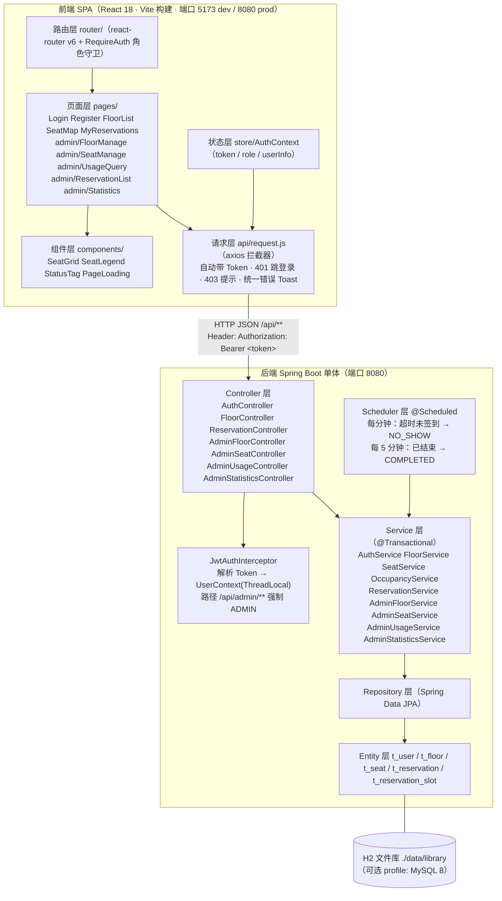
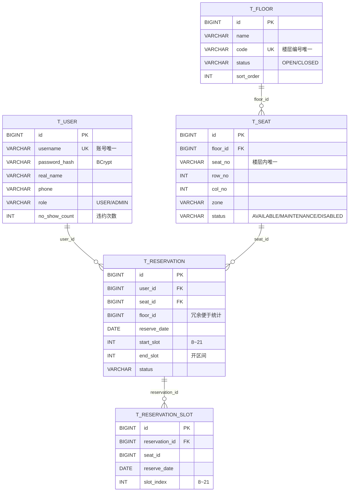
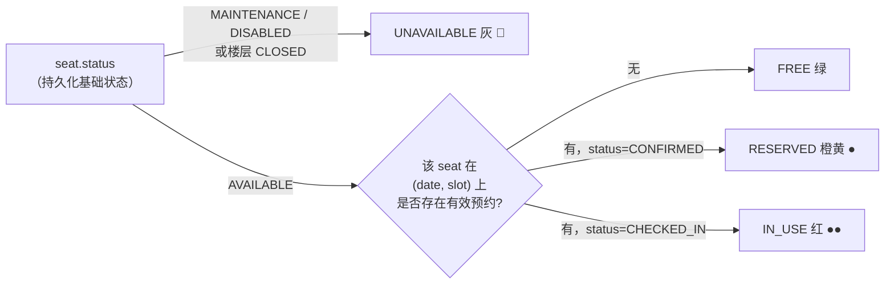
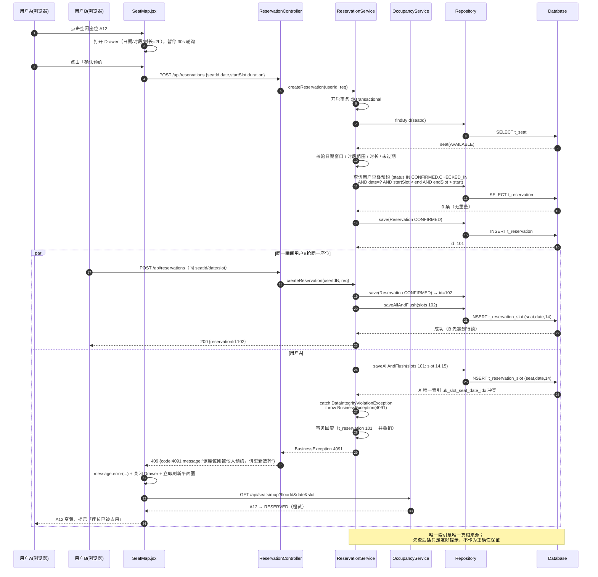
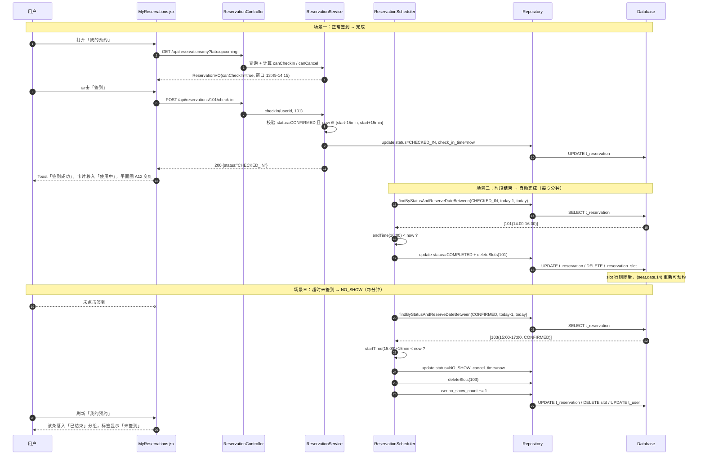
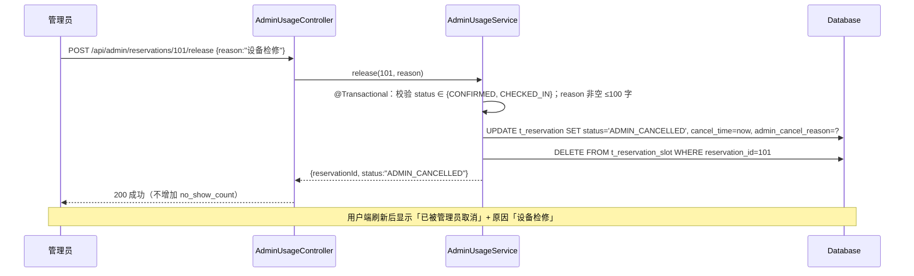

# 图书馆座位预约系统 — 系统设计文档

| 项目信息 | 内容 |
| --- | --- |
| 项目名称 | 图书馆座位预约系统（Library Seat Reservation） |
| 项目路径 | `D:\Project\LibraryReservation` |
| 后端 | Spring Boot 3.2.5 + Java 21 + Spring Data JPA(Hibernate) + H2(默认)/MySQL(可选) |
| 前端 | Vite 5 + React 18 + Ant Design 5 + ECharts 5 |
| 认证 | JWT（jjwt 0.11.5）+ 自定义 HandlerInterceptor |
| 文档版本 | v1.0（架构师：高见远） |
| 上游文档 | `docs/PRD.md`（覆盖 P0 需求 22 项：SYS-01~06 / USR-01~12 / ADM-01~13） |

---

## 0. 一句话架构

> **单体 Spring Boot 后端（RESTful JSON）+ 单页 React 前端，前端构建产物由 Spring Boot 静态托管，单端口 `8080` 一键启动即可演示。**
> 座位占用状态**不落库**，由预约记录按「日期 + 时段」实时派生；并发抢座由**数据库唯一索引 + 事务**兜底。

---

## 1. 整体架构

### 1.1 分层架构图



### 1.2 部署形态

| 阶段 | 形态 | 说明 |
| --- | --- | --- |
| 开发期 | 后端 `localhost:8080` + 前端 dev server `localhost:5173` | Vite `server.proxy` 把 `/api` 代理到 `8080`，免跨域 |
| 演示/交付 | `npm run build` → `frontend/dist/*` 复制到 `backend/src/main/resources/static/` | Spring Boot 单端口 `http://localhost:8080` 提供页面 + 接口，双击 jar 即可演示 |
| 生产可选 | 同交付形态，或 Nginx 托管 `dist` 反向代理 `/api` | 不改变任何代码 |

> **前端路由 fallback**：SPA 使用 history 路由，刷新 `/admin/statistics` 会 404。后端增加 `WelcomePage`/`ErrorPage` 转发：任意非 `/api` 且非静态资源的请求转发到 `/index.html`（在 `WebConfig` 中注册一个低优先级 `ResourceNotFoundForwardController`，见 §5.1）。

### 1.3 技术选型表（含理由）

#### 后端

| 维度 | 选型 | 版本 | 理由 |
| --- | --- | --- | --- |
| 框架 | Spring Boot | 3.2.5 | JDK 21 官方支持；自动装配省去大量 XML/配置；内嵌 Tomcat 单 jar 启动，满足"一键演示" |
| JDK | Java 21 | 21.0.2 | 机器已装；Spring Boot 3.x 基线要求 ≥17 |
| ORM | **Spring Data JPA (Hibernate 6)** | 随 Boot | ① 实体关系（user/seat/reservation）清晰，派生查询覆盖 80% 场景；② 声明式 `@Transactional` 直接满足并发防重；③ 唯一约束用 `@Table(uniqueConstraints)` + 捕获 `DataIntegrityViolationException` 即可；④ 相比 MyBatis-Plus 少一套 Mapper/XML，文件量更可控 |
| 建表 | **显式 SQL 脚本**（`schema-h2.sql` / `schema-mysql.sql`） | — | `ddl-auto=none` + `spring.sql.init` 执行脚本。DDL 对用户可见、可控、可评审，且 H2/MySQL 各一份避免方言踩坑 |
| 数据库 | **H2 文件库（默认）** + MySQL profile | H2 2.2.224 | 本机无 MySQL；H2 文件库持久化到 `./data/library.mv.db`，重启数据保留，零安装 |
| 认证 | **JWT（jjwt）** | 0.11.5 | 无状态，后端无需 Session 存储；前端 axios 拦截器统一携带，过期返回 401 统一跳登录；`role` 直接编码进 payload 便于拦截器鉴权 |
| 密码 | `spring-security-crypto` 的 `BCryptPasswordEncoder` | 随 Boot | 只引入 crypto 子模块，**不引入 spring-boot-starter-security**，避免默认登录页/CSRF 干扰 |
| 校验 | `spring-boot-starter-validation` (Jakarta Bean Validation) | 随 Boot | DTO 上 `@NotBlank/@Size/@Pattern`，配合 `@Valid` + 全局异常处理器输出中文提示 |
| 定时任务 | Spring `@Scheduled` | 随 Boot | 单机即可，不引入 Quartz/MQ |
| JSON | Jackson（Boot 默认） | 随 Boot | 统一 `yyyy-MM-dd HH:mm:ss` |
| 工具 | Lombok | 随 Boot | 减少 getter/setter 样板代码 |

#### 前端（**用户明确要求说明理由**）

| 维度 | 选型 | 版本 | 理由 |
| --- | --- | --- | --- |
| 构建 | **Vite** | ^5.4.8 | 冷启动秒级、HMR 快；`server.proxy` 一行解决开发期跨域；产物可直接被 Spring Boot `static/` 托管 |
| 框架 | **React** | ^18.3.1 | ① 与团队默认前端基线一致，生态与示例最多；② 平面图/抽屉/Drawer 这类"状态驱动局部刷新"的交互用组件化模型最自然；③ `react-router v6` 的路由守卫方案成熟，一行 `<RequireAuth role="ADMIN">` 即可隔离 `/admin/**` |
| 组件库 | **Ant Design 5** | ^5.21.0 | **① 中文中后台事实标准**：Table(分页/筛选/排序)、Form(校验)、Modal、Drawer、DatePicker、Select、message、Tag、Progress 全部开箱即用，直接覆盖 PRD §9.1 的 C1/C6 约束，7 个后台页无需手写组件；**② 视觉与交互规范**（间距、色板、文案）天然贴合"管理员端 PC 中后台"，且 PRD 平面图状态色 `#52c41a / #faad14 / #f5222d / #bfbfbf` 正是 AntD 官方语义色，零成本对齐设计稿；**③ ConfigProvider + 中文 locale** 一行搞定全站中文；**④ 与 CSS Grid 完全无耦合**：AntD 只负责外围控件，平面图主体是原生 `div + CSS Grid`（PRD C4 要求），组件库不会干扰网格布局；**⑤ 构建产物是纯静态文件**，可直接由 Spring Boot 托管（PRD C7 要求） |
| 路由 | **react-router-dom** | ^6.26.2 | 嵌套路由 + `Outlet` 天然适配"用户端 Header 布局 / 管理员端侧边栏布局"两种骨架；`<Navigate>` 实现 401/403 跳转 |
| HTTP | **axios** | ^1.7.7 | 拦截器统一注入 Token、统一解析 `{code,message,data}`、统一处理 401/403/业务错误 Toast（PRD C3） |
| 图表 | **ECharts + echarts-for-react** | ^5.5.1 / ^3.0.2 | 中文文档完善、配置项丰富；`echarts-for-react` 把 4 张统计图表压成 1 行 JSX；支持空数据占位不报错 |
| 日期 | **dayjs** | ^1.11.13 | AntD 5 内置依赖，2KB，处理"今天~+6 天"与时段标签足够 |
| 语言 | **JavaScript (JSX)**，不上 TypeScript | — | 教学/演示项目优先"能跑通、好读懂"；省去 tsconfig/类型定义/编译配置，前端文件量减少约 30% |
| CSS | **原生 CSS**（`styles/global.css` + `styles/seat.css`），**不引入 Tailwind** | — | 本项目只有"平面图网格 + 少量后台微调"两类样式需求，Tailwind 需额外配置且会让 JSX 类名冗长；原生 CSS 配合 CSS Grid 更直观，也方便工程师对照 PRD 视觉规范精调 |

### 1.4 明确不引入的组件（遵守约束）

Redis / MQ（Kafka/RabbitMQ）/ 微服务注册中心 / OAuth2 第三方登录 / Docker & K8s / WebSocket / Quartz 集群调度 / MyBatis 动态 SQL 引擎。
实时性用 **30 秒轮询** 实现，异步用 **Spring @Scheduled 单机定时任务** 实现。

---

## 2. 模块划分

### 2.1 后端包结构（根包 `com.libseat`）

```
backend/
├── pom.xml
└── src/main/
    ├── java/com/libseat/
    │   ├── LibrarySeatApplication.java      # 启动类：@SpringBootApplication + @EnableScheduling + @EnableJpaAuditing
    │   ├── common/                          # 【公共层】跨模块复用，无业务
    │   │   ├── Result.java                  # 统一响应体 {code,message,data} + 静态工厂 ok()/fail()
    │   │   ├── ErrorCode.java               # 业务错误码枚举（4001 参数错 / 4010 未登录 / 4030 无权限 / 4090 冲突 ...）
    │   │   ├── BusinessException.java       # 业务异常（携带 ErrorCode + 中文 message）
    │   │   ├── GlobalExceptionHandler.java  # @RestControllerAdvice：业务异常/参数校验/唯一约束/兜底 500
    │   │   ├── PageResult.java              # 分页包装 {list,total,page,size}
    │   │   └── BizConstants.java            # 全局业务常量（开放时段、最大时长、预约窗口、签到窗口…）
    │   ├── config/
    │   │   └── WebConfig.java               # CORS + 注册 JwtAuthInterceptor + SPA fallback 转发 + H2 console
    │   ├── security/
    │   │   ├── JwtUtil.java                 # 生成/解析/校验 Token，payload={userId,username,role}
    │   │   ├── JwtAuthInterceptor.java      # 鉴权：解析 Token → UserContext；/api/admin/** 校验 role=ADMIN
    │   │   └── UserContext.java             # ThreadLocal 存放当前登录用户，请求结束 clear()
    │   ├── entity/                          # 【实体层】与表 1:1，JPA 注解
    │   │   ├── User.java
    │   │   ├── Floor.java
    │   │   ├── Seat.java
    │   │   ├── Reservation.java
    │   │   └── ReservationSlot.java
    │   ├── enums/
    │   │   ├── UserRole.java                # USER / ADMIN
    │   │   ├── FloorStatus.java             # OPEN / CLOSED
    │   │   ├── SeatStatus.java              # AVAILABLE / MAINTENANCE / DISABLED（持久化基础状态）
    │   │   ├── ReservationStatus.java       # CONFIRMED/CHECKED_IN/COMPLETED/CANCELLED/NO_SHOW/ADMIN_CANCELLED
    │   │   └── SeatDisplayStatus.java       # FREE / RESERVED / IN_USE / UNAVAILABLE（派生展示态，不落库）
    │   ├── repository/                      # 【数据访问层】Spring Data JPA
    │   │   ├── UserRepository.java
    │   │   ├── FloorRepository.java
    │   │   ├── SeatRepository.java
    │   │   ├── ReservationRepository.java
    │   │   └── ReservationSlotRepository.java
    │   ├── dto/                             # 【传输层】按领域聚合，内部用 static class 收纳多个 DTO
    │   │   ├── AuthDTO.java                 # LoginRequest / RegisterRequest / LoginResponse / UserInfo
    │   │   ├── FloorDTO.java                # FloorVO（含座位数/空闲数/占用率）/ SlotOptionVO
    │   │   ├── SeatDTO.java                 # SeatMapVO / SeatItemVO / SeatMapStatsVO / SeatVO / SeatSaveRequest / SeatBatchRequest
    │   │   ├── ReservationDTO.java          # ReservationCreateRequest / ReservationVO / CancelRequest / ReleaseRequest
    │   │   ├── AdminDTO.java                # SeatQuery / UsageRowVO / UsageSummaryVO / AdminReservationQuery / UserVO
    │   │   └── StatsDTO.java                # OverviewVO / TrendVO / SlotHeatVO / FloorUsageVO / StatusDistVO
    │   ├── service/                         # 【业务层】不写接口，直接 @Service 类（控制文件数）
    │   │   ├── AuthService.java             # 注册/登录/获取当前用户（BCrypt + JWT）
    │   │   ├── FloorService.java            # 用户端：楼层列表（含空闲数）、楼层详情、时段选项、座位平面图
    │   │   ├── SeatService.java             # 座位查询公共能力（按楼层取座位、网点定位）
    │   │   ├── OccupancyService.java        # ★ 占用派生核心：给定 日期+时段 → Map<seatId, ReservationStatus>
    │   │   ├── ReservationService.java      # ★ 预约核心：创建（并发防重）/我的预约/取消/签到
    │   │   ├── AdminFloorService.java       # 楼层 CRUD（删除前校验未来预约）
    │   │   ├── AdminSeatService.java        # 座位 CRUD / 批量生成 / 状态切换 / 删除校验
    │   │   ├── AdminUsageService.java       # 座位使用情况查询（脱敏）/ 预约记录查询 / 强制释放
    │   │   ├── AdminStatisticsService.java  # 4 类统计聚合
    │   │   └── AdminUserService.java        # 用户列表（P1，可降级）
    │   ├── scheduler/
    │   │   └── ReservationScheduler.java    # 每分钟 NO_SHOW 扫描；每 5 分钟 COMPLETED 归档
    │   ├── seed/
    │   │   └── DataInitializer.java         # ApplicationRunner：幂等写入种子数据（管理员/演示用户/楼层/座位/历史预约）
    │   └── controller/
    │       ├── AuthController.java          # /api/auth/**
    │       ├── FloorController.java         # /api/floors/**、/api/config/slots
    │       ├── ReservationController.java   # /api/reservations/**
    │       ├── AdminFloorController.java    # /api/admin/floors/**
    │       ├── AdminSeatController.java     # /api/admin/seats/**、/api/admin/floors/{id}/seats
    │       ├── AdminUsageController.java    # /api/admin/usage、/api/admin/reservations/**
    │       ├── AdminStatisticsController.java # /api/admin/statistics/**
    │       └── AdminUserController.java     # /api/admin/users（P1）
    └── resources/
        ├── application.yml                  # 公共配置 + 默认激活 h2
        ├── application-h2.yml               # H2 数据源 + schema-h2.sql
        ├── application-mysql.yml            # MySQL 数据源 + schema-mysql.sql（注释掉的连接信息）
        └── sql/
            ├── schema-h2.sql
            └── schema-mysql.sql
```

**各包职责边界**
- `common` 不含业务逻辑，`service` 不感知 HTTP，`controller` 只做参数接收 + 调 service + 包装 `Result`。
- 所有写操作的事务边界在 `service` 方法上（`@Transactional`），controller 不开启事务。
- `OccupancyService` 是唯一的"占用状态"计算入口，任何地方（平面图 / 使用情况 / 统计利用率 / 楼层空闲数）都调用它，保证派生逻辑只有一份。

### 2.2 前端目录结构

```
frontend/
├── package.json
├── vite.config.js                # react 插件 + /api 代理到 8080 + build.outDir=dist
├── index.html
└── src/
    ├── main.jsx                  # ReactDOM 挂载 + ConfigProvider(zh_CN) + AuthProvider + RouterProvider
    ├── App.jsx                   # 根组件（仅挂载 Router）
    ├── router/
    │   ├── index.jsx             # 路由表（12 个页面）
    │   └── RequireAuth.jsx       # 角色守卫：未登录 → /login；role 不匹配 → 403 提示
    ├── api/
    │   ├── request.js            # axios 实例 + 请求/响应拦截器（Token、401、403、业务错误 Toast）
    │   ├── auth.js               # /api/auth/**
    │   ├── floor.js              # /api/floors/**、/api/config/slots
    │   ├── reservation.js        # /api/reservations/**
    │   ├── admin.js              # /api/admin/floors|seats|usage|reservations|users
    │   └── statistics.js         # /api/admin/statistics/**
    ├── store/
    │   └── AuthContext.jsx       # token/userInfo 的 localStorage 持久化 + login()/logout()
    ├── constants/
    │   └── index.js              # 状态色板、状态文案、14 个时段、时长选项、API_BASE
    ├── utils/
    │   └── datetime.js           # 日期范围生成、时段标签、slotIndex ↔ 时间字符串互转
    ├── layouts/
    │   ├── MainLayout.jsx        # 用户端：顶部 Header（品牌/楼层/我的预约/用户名/退出）+ Outlet
    │   └── AdminLayout.jsx       # 管理员端：左侧 Menu（5 项）+ 右侧内容区 Outlet
    ├── components/
    │   ├── SeatGrid.jsx          # ★ 平面图 CSS Grid 主体（行列标尺 + 座位方块 + 点击回调）
    │   ├── SeatLegend.jsx        # 常驻图例条（颜色 + 第二重标识：● / ●● / 🔧）
    │   ├── StatusTag.jsx         # 预约状态标签（颜色 + 文案）
    │   └── PageLoading.jsx       # 骨架屏/加载态
    ├── pages/
    │   ├── Login.jsx             # /login
    │   ├── Register.jsx          # /register
    │   ├── FloorList.jsx         # /floors
    │   ├── SeatMap.jsx           # /floors/:floorId/seats（核心页：日期+时段+30s 轮询+预约抽屉）
    │   ├── MyReservations.jsx    # /my/reservations（4 个 Tab + 签到/取消）
    │   ├── Profile.jsx           # /profile（P1）
    │   └── admin/
    │       ├── FloorManage.jsx       # /admin/floors
    │       ├── SeatManage.jsx        # /admin/floors/:floorId/seats
    │       ├── SeatBatchModal.jsx    # 批量生成弹窗（复用 AntD Modal + Form）
    │       ├── UsageQuery.jsx        # /admin/usage（含强制释放）
    │       ├── ReservationList.jsx   # /admin/reservations（含强制释放）
    │       ├── Statistics.jsx        # /admin/statistics（6 卡片 + 4 图表）
    │       └── UserList.jsx          # /admin/users（P1）
    └── styles/
        ├── global.css            # 全局重置、布局、卡片
        └── seat.css              # 平面图：.seat-grid / .seat-cell / 4 种状态样式 / 响应式横向滚动
```

**前端工程规模**：约 36 个文件；后端 Java 约 40 个文件 + 4 个资源文件。

---

## 3. 数据库表设计

### 3.1 ER 关系



### 3.2 完整 DDL（H2）— `backend/src/main/resources/sql/schema-h2.sql`

> 表名统一加 `t_` 前缀：`user` / `floor` 在 H2 与 MySQL 中均为关键字/函数名，避免建表踩坑。

```sql
-- ============ 用户表（普通用户 + 管理员共用） ============
CREATE TABLE IF NOT EXISTS t_user (
    id             BIGINT GENERATED BY DEFAULT AS IDENTITY PRIMARY KEY,
    username       VARCHAR(50)  NOT NULL,             -- 登录账号，唯一
    password_hash  VARCHAR(100) NOT NULL,             -- BCrypt 密文（60 位）
    real_name      VARCHAR(50)  NOT NULL,             -- 真实姓名（管理员可见）
    phone          VARCHAR(20)  NULL,                 -- 手机号（选填，管理员端脱敏展示）
    role           VARCHAR(20)  NOT NULL DEFAULT 'USER', -- USER / ADMIN
    no_show_count  INT          NOT NULL DEFAULT 0,   -- 超时未签到次数（P0 只记录不惩罚）
    status         VARCHAR(20)  NOT NULL DEFAULT 'ACTIVE', -- ACTIVE / DISABLED（P0 恒为 ACTIVE）
    create_time    TIMESTAMP    NOT NULL DEFAULT CURRENT_TIMESTAMP,
    update_time    TIMESTAMP    NOT NULL DEFAULT CURRENT_TIMESTAMP
);
CREATE UNIQUE INDEX IF NOT EXISTS uk_user_username ON t_user (username);

-- ============ 楼层表 ============
CREATE TABLE IF NOT EXISTS t_floor (
    id           BIGINT GENERATED BY DEFAULT AS IDENTITY PRIMARY KEY,
    name         VARCHAR(50)  NOT NULL,               -- 楼层名称，如「一楼自习区」
    code         VARCHAR(20)  NOT NULL,               -- 楼层编号，如「1F」，唯一
    description  VARCHAR(200) NULL,                   -- 描述
    sort_order   INT          NOT NULL DEFAULT 0,     -- 排序号，升序
    status       VARCHAR(20)  NOT NULL DEFAULT 'OPEN',-- OPEN / CLOSED
    create_time  TIMESTAMP    NOT NULL DEFAULT CURRENT_TIMESTAMP,
    update_time  TIMESTAMP    NOT NULL DEFAULT CURRENT_TIMESTAMP
);
CREATE UNIQUE INDEX IF NOT EXISTS uk_floor_code ON t_floor (code);

-- ============ 座位表（★ 不存储"是否被占用"，占用由预约派生） ============
CREATE TABLE IF NOT EXISTS t_seat (
    id         BIGINT GENERATED BY DEFAULT AS IDENTITY PRIMARY KEY,
    floor_id   BIGINT       NOT NULL,                 -- 所属楼层
    seat_no    VARCHAR(20)  NOT NULL,                 -- 座位编号（如 A12），楼层内唯一
    row_no     INT          NOT NULL,                 -- 行号（平面图 Y 轴，从 1 开始）
    col_no     INT          NOT NULL,                 -- 列号（平面图 X 轴，从 1 开始）
    zone       VARCHAR(20)  NULL,                     -- 区域名（如「A区」），可空
    status     VARCHAR(20)  NOT NULL DEFAULT 'AVAILABLE', -- 基础状态：AVAILABLE/MAINTENANCE/DISABLED
    remark     VARCHAR(200) NULL,                     -- 备注
    create_time TIMESTAMP   NOT NULL DEFAULT CURRENT_TIMESTAMP,
    update_time TIMESTAMP   NOT NULL DEFAULT CURRENT_TIMESTAMP
);
CREATE UNIQUE INDEX IF NOT EXISTS uk_seat_floor_no ON t_seat (floor_id, seat_no);
CREATE INDEX IF NOT EXISTS idx_seat_floor ON t_seat (floor_id);

-- ============ 预约主表 ============
CREATE TABLE IF NOT EXISTS t_reservation (
    id                   BIGINT GENERATED BY DEFAULT AS IDENTITY PRIMARY KEY,
    user_id              BIGINT      NOT NULL,        -- 预约人
    seat_id              BIGINT      NOT NULL,        -- 座位
    floor_id             BIGINT      NOT NULL,        -- 冗余楼层，便于统计与列表展示
    reserve_date         DATE        NOT NULL,        -- 预约日期（不跨天）
    start_slot           INT         NOT NULL,        -- 起始时段序号 8~21
    end_slot             INT         NOT NULL,        -- 结束时段序号（开区间），end = start + 时长
    status               VARCHAR(20) NOT NULL,        -- CONFIRMED/CHECKED_IN/COMPLETED/CANCELLED/NO_SHOW/ADMIN_CANCELLED
    check_in_time        TIMESTAMP   NULL,            -- 签到时间
    cancel_time          TIMESTAMP   NULL,            -- 取消/释放时间
    admin_cancel_reason  VARCHAR(100) NULL,           -- 管理员强制释放原因（≤100 字）
    create_time          TIMESTAMP   NOT NULL DEFAULT CURRENT_TIMESTAMP,
    update_time          TIMESTAMP   NOT NULL DEFAULT CURRENT_TIMESTAMP
);
CREATE INDEX IF NOT EXISTS idx_resv_user_status   ON t_reservation (user_id, status);
CREATE INDEX IF NOT EXISTS idx_resv_date_status   ON t_reservation (reserve_date, status);
CREATE INDEX IF NOT EXISTS idx_resv_seat_date     ON t_reservation (seat_id, reserve_date);

-- ============ 占用明细表（★ 并发防重核心；只保存"当前有效"的占用行） ============
CREATE TABLE IF NOT EXISTS t_reservation_slot (
    id              BIGINT GENERATED BY DEFAULT AS IDENTITY PRIMARY KEY,
    reservation_id  BIGINT NOT NULL,                  -- 所属预约
    seat_id         BIGINT NOT NULL,                  -- 座位（冗余，便于唯一约束与查询）
    reserve_date    DATE   NOT NULL,                  -- 日期
    slot_index      INT    NOT NULL,                  -- 时段序号 8~21
    create_time     TIMESTAMP NOT NULL DEFAULT CURRENT_TIMESTAMP
);
-- ★ 唯一的并发防线：一个座位在一个日期的一个时段上，最多只能有一行
CREATE UNIQUE INDEX IF NOT EXISTS uk_slot_seat_date_idx
    ON t_reservation_slot (seat_id, reserve_date, slot_index);
CREATE INDEX IF NOT EXISTS idx_slot_date_idx   ON t_reservation_slot (reserve_date, slot_index);
CREATE INDEX IF NOT EXISTS idx_slot_resv       ON t_reservation_slot (reservation_id);
```

### 3.3 MySQL 版差异 — `schema-mysql.sql`

与 H2 版**仅 3 处差异**，其余逐字相同：

| # | H2 | MySQL | 说明 |
| --- | --- | --- | --- |
| 1 | `BIGINT GENERATED BY DEFAULT AS IDENTITY PRIMARY KEY` | `BIGINT AUTO_INCREMENT PRIMARY KEY` | 自增列方言 |
| 2 | `TIMESTAMP` | `DATETIME` | MySQL `TIMESTAMP` 有 2038 问题 |
| 3 | 表尾无选项 | `) ENGINE=InnoDB DEFAULT CHARSET=utf8mb4 COLLATE=utf8mb4_general_ci COMMENT='用户表';` | 并可加内联 `COMMENT`（H2 不支持内联 COMMENT，故 H2 版用 `--` 注释） |

其余（`CREATE UNIQUE INDEX`、默认值、`CREATE INDEX`）两者语法一致，**无需改写**。

### 3.4 字段与约束说明表

| 表 | 约束 | 作用 |
| --- | --- | --- |
| `t_user.uk_user_username` | 账号唯一 | SYS-01 重复注册返回「该账号已被注册」 |
| `t_floor.uk_floor_code` | 楼层编号唯一 | ADM-01 |
| `t_seat.uk_seat_floor_no` | 楼层内座位编号唯一 | ADM-03/04 批量生成重复编号跳过 |
| `t_reservation_slot.uk_slot_seat_date_idx` | **座位+日期+时段 唯一** | ★ USR-08 并发防重的唯一真相来源 |
| `t_reservation.idx_resv_user_status` | 用户+状态 | 我的预约、用户时段重叠校验 |
| `t_reservation.idx_resv_date_status` | 日期+状态 | 定时任务扫描、统计 |
| `t_seat.idx_seat_floor` | 楼层座位 | 平面图、楼层座位数 |

> **`t_reservation_slot` 只存"当前有效"占用行**：预约被取消 / NO_SHOW / COMPLETED / 管理员释放时，**物理删除**该预约对应的 slot 行（而不是打状态标记）。这样唯一索引天然可复用，且无需在查询时过滤 slot 状态。历史统计一律基于 `t_reservation` 主表（用 `start_slot`/`end_slot` 在 Java 中展开），不依赖 slot 表。

---

## 4. 接口设计

### 4.1 统一响应结构

```jsonc
// 成功
{ "code": 0, "message": "ok", "data": { ... } }          // HTTP 200
// 失败
{ "code": 4010, "message": "登录已过期，请重新登录", "data": null }  // HTTP 401
{ "code": 4091, "message": "该座位刚被他人预约，请重新选择", "data": null } // HTTP 409
```

- 前端 `api/request.js` 拦截器统一判断 `code === 0`；非 0 时弹 `message.error(message)`，并针对 `4010` 清除 token 跳登录、`4030` 提示无权限。
- 分页统一 `data = { list, total, page, size }`。
- 时间格式：日期 `yyyy-MM-dd`，时间 `HH:mm`，日期时间 `yyyy-MM-dd HH:mm:ss`。

### 4.2 错误码定义

| code | HTTP | 含义 | 典型场景 |
| --- | --- | --- | --- |
| 0 | 200 | 成功 | — |
| 4001 | 400 | 参数错误（含 Bean Validation 失败） | 字段为空、时长非法 |
| 4010 | 401 | 未登录 / Token 失效或过期 | 无 Token、Token 解析失败 |
| 4030 | 403 | 无权限（角色不足） | USER 调 `/api/admin/**` |
| 4040 | 404 | 资源不存在 | 楼层/座位/预约不存在 |
| 4090 | 409 | 业务冲突·通用 | 账号已注册、编号重复 |
| 4091 | 409 | 座位时段冲突（并发抢座失败） | 唯一索引冲突 |
| 4092 | 409 | 用户时段重叠 | 该时段已有预约 |
| 4093 | 409 | 当前状态不允许该操作 | 已签到不可取消、不在签到窗口 |
| 4094 | 409 | 存在关联数据，禁止删除 | 座位有未来预约、楼层有座位 |
| 5000 | 500 | 系统内部错误 | 未捕获异常 |

### 4.3 接口清单

> 前缀统一 `/api`。权限列：`公开` = 无需 Token；`USER` = 登录即可；`ADMIN` = 必须管理员。

#### A. 认证 `/api/auth`（AuthController）

| # | 方法 | 路径 | 说明 | 请求参数 / Body | 响应 `data` | 权限 |
| --- | --- | --- | --- | --- | --- | --- |
| A1 | POST | `/api/auth/register` | 用户注册（SYS-01） | `{username, password, confirmPassword, realName, phone?}` | `{userId, username, realName, role}` | 公开 |
| A2 | POST | `/api/auth/login` | 登录（SYS-02） | `{username, password}` | `{token, tokenType:"Bearer", expiresIn, user:{userId,username,realName,role}}` | 公开 |
| A3 | GET | `/api/auth/me` | 当前登录用户信息 | — | `{userId, username, realName, role, phoneMasked, noShowCount}` | USER/ADMIN |

- A1：后端**强制** `role = USER`（忽略任何传入角色）；`username` 3–20 位；`password` ≥ 6 位；重复 → 4090「该账号已被注册」。
- A2：登录成功后按角色跳转由前端完成（ADMIN → `/admin/statistics`，USER → `/floors`）。

#### B. 楼层与平面图（FloorController）

| # | 方法 | 路径 | 说明 | 请求参数 | 响应 `data` | 权限 |
| --- | --- | --- | --- | --- | --- | --- |
| B1 | GET | `/api/floors` | 楼层列表 + 空闲数（USR-01） | `date`（默认今天）、`slot`（默认当前时段） | `[{floorId, name, code, description, sortOrder, status, totalSeats, freeSeats, occupiedSeats, unavailableSeats, usageRate}]` | USER/ADMIN |
| B2 | GET | `/api/floors/{floorId}` | 楼层详情 | — | 同上单条 | USER/ADMIN |
| B3 | GET | `/api/seats/map` | ★ 座位平面图（USR-02/03/04/05） | `floorId`、`date`、`slot` | 见下方结构 | USER/ADMIN |
| B4 | GET | `/api/config/slots` | 时段选项（USR-04） | `date` | `[{slotIndex, label:"08:00-09:00", start:"08:00", end:"09:00", bookable:true/false, isCurrent:true/false}]`（14 项） | USER/ADMIN |

**B3 响应结构（⚠ 不含占用人身份，遵守隐私红线）**
```jsonc
{
  "floorId": 1, "floorName": "一楼自习区", "floorCode": "1F", "floorStatus": "OPEN",
  "date": "2026-02-11", "slotIndex": 14, "slotLabel": "14:00-15:00",
  "maxRow": 6, "maxCol": 10,
  "seats": [
    { "seatId": 12, "seatNo": "A12", "rowNo": 1, "colNo": 2, "zone": "A区",
      "baseStatus": "AVAILABLE", "displayStatus": "RESERVED" }
  ],
  "stats": { "total": 60, "free": 40, "reserved": 12, "inUse": 6, "unavailable": 2, "usageRate": 30.0 }
}
```
- `displayStatus`：`FREE / RESERVED / IN_USE / UNAVAILABLE`（`SeatDisplayStatus`），派生规则见 §6.1。
- 楼层 `CLOSED` 时：列表仍返回但 `status=CLOSED` 前端置灰；平面图接口返回全部 `UNAVAILABLE`。

#### C. 预约 `/api/reservations`（ReservationController）

| # | 方法 | 路径 | 说明 | 请求参数 / Body | 响应 `data` | 权限 |
| --- | --- | --- | --- | --- | --- | --- |
| C1 | POST | `/api/reservations` | ★ 提交预约（USR-06/07/08） | `{seatId, date:"yyyy-MM-dd", startSlot:14, duration:2}` | `{reservationId, seatNo, floorName, date, startSlot, endSlot, timeRange:"14:00-16:00", status:"CONFIRMED"}` | USER |
| C2 | GET | `/api/reservations/my` | 我的预约（USR-09） | `tab`（`upcoming`/`inProgress`/`finished`/`cancelled`，默认 `upcoming`）、`page`、`size` | `{list:[ReservationVO], total, page, size}` | USER |
| C3 | GET | `/api/reservations/{id}` | 预约详情 | — | `ReservationVO` | USER（本人） |
| C4 | POST | `/api/reservations/{id}/cancel` | 取消预约（USR-10） | — | `{reservationId, status:"CANCELLED"}` | USER（本人） |
| C5 | POST | `/api/reservations/{id}/check-in` | 手动签到（USR-11） | — | `{reservationId, status:"CHECKED_IN", checkInTime}` | USER（本人） |

**`ReservationVO` 字段**
```jsonc
{
  "reservationId": 101, "userId": 3, "username": "student1",
  "seatId": 12, "seatNo": "A12", "zone": "A区",
  "floorId": 1, "floorName": "一楼自习区",
  "date": "2026-02-11", "startSlot": 14, "endSlot": 16,
  "timeRange": "14:00-16:00", "durationHours": 2,
  "status": "CONFIRMED",                 // 枚举
  "statusText": "已预约",                 // 中文文案
  "checkInTime": null, "cancelTime": null,
  "adminCancelReason": null,             // 管理员释放原因（ADMIN_CANCELLED 时展示）
  "createTime": "2026-02-11 10:23:05",
  "canCancel": true,                     // 后端算好，前端直接用
  "canCheckIn": false,
  "checkInWindowText": "13:45 后可签到"   // 或「签到窗口 13:45-14:15」
}
```
> `canCancel` / `canCheckIn` 由后端按 §6.4 规则计算，前端不重复实现业务规则（避免双写不一致）。

**C1 校验顺序（任一失败立即返回中文原因）**
1. 座位存在且 `seat.status == AVAILABLE`，楼层 `OPEN` → 否则 4093「该座位维护中/已停用，暂不可预约」
2. `date` ∈ [今天, 今天+6] → 否则 4001「只能预约今天起 7 天内的座位」
3. `startSlot` ∈ [8,21] 且 `startSlot + duration <= 22` → 否则 4001「预约时段超出开放时间（08:00-22:00）」
4. `duration` ∈ {1,2,3,4} → 否则 4001「时长只能选择 1/2/3/4 小时」
5. `date` 为今天时，`startSlot` 对应开始时间 > 当前时间 → 否则 4001「不能预约已过去的时段」
6. 该用户在 `[startSlot, endSlot)` 无重叠有效预约（CONFIRMED/CHECKED_IN） → 否则 4092「您在该时段已有预约」
7. 事务内插入 `t_reservation` + N 行 `t_reservation_slot`，捕获唯一索引冲突 → 4091「该座位刚被他人预约，请重新选择」

#### D. 管理员·楼层 `/api/admin/floors`（AdminFloorController）

| # | 方法 | 路径 | 说明 | 请求 Body | 响应 `data` | 权限 |
| --- | --- | --- | --- | --- | --- | --- |
| D1 | GET | `/api/admin/floors` | 楼层管理列表（ADM-01） | — | `[{floorId,name,code,description,sortOrder,status,seatCount,createTime}]` | ADMIN |
| D2 | POST | `/api/admin/floors` | 新增楼层 | `{name, code, description?, sortOrder?, status?}` | 楼层 VO | ADMIN |
| D3 | PUT | `/api/admin/floors/{floorId}` | 编辑楼层 | 同上 | 楼层 VO | ADMIN |
| D4 | DELETE | `/api/admin/floors/{floorId}` | 删除楼层 | — | `{deletedSeats: n}` | ADMIN |
| D5 | PUT | `/api/admin/floors/{floorId}/status` | 开放/关闭 | `{status:"OPEN"\|"CLOSED"}` | 楼层 VO | ADMIN |

- D4：存在**未来有效预约**（该楼层任意座位有 `reserve_date >= today` 且状态 ∈ {CONFIRMED, CHECKED_IN}）→ 4094「该楼层存在未完成的预约，请先释放」；否则级联删除该楼层座位及其历史预约与 slot。
- D2/D3：`code` 重复 → 4090「楼层编号已存在」。

#### E. 管理员·座位 `/api/admin/seats`（AdminSeatController）

| # | 方法 | 路径 | 说明 | 请求参数 / Body | 响应 `data` | 权限 |
| --- | --- | --- | --- | --- | --- | --- |
| E1 | GET | `/api/admin/floors/{floorId}/seats` | 座位分页列表（ADM-02） | `page`、`size`(默认20)、`seatNo?`（模糊）、`status?` | `{list:[SeatVO], total, page, size}` | ADMIN |
| E2 | POST | `/api/admin/seats` | 新增单个座位（ADM-03） | `{floorId, seatNo, rowNo, colNo, zone?, status?, remark?}` | `SeatVO` | ADMIN |
| E3 | PUT | `/api/admin/seats/{seatId}` | 编辑座位 | 同 E2 | `SeatVO` | ADMIN |
| E4 | DELETE | `/api/admin/seats/{seatId}` | 删除座位（ADM-06） | — | `{seatId}` | ADMIN |
| E5 | PUT | `/api/admin/seats/{seatId}/status` | 状态切换（ADM-05） | `{status:"AVAILABLE"\|"MAINTENANCE"\|"DISABLED"}` | `SeatVO` | ADMIN |
| E6 | POST | `/api/admin/seats/batch` | ★ 批量生成（ADM-04） | `{floorId, zone?, rows, cols, prefix, startNo, status?}` | `{created: 32, skipped: 2, skippedSeatNos:["A07","A13"], totalRequested:34}` | ADMIN |

- `SeatVO`：`{seatId, floorId, floorName, seatNo, rowNo, colNo, zone, status, statusText, remark, hasFutureReservation, createTime}`
- E6 编号规则：`前缀 + 补零序号`（序号宽度 = `String.valueOf(startNo + rows*cols - 1).length()`，至少 2 位），按**行优先**递增：`A01 A02 … A10 / A11 …`；已存在编号整行跳过（`saveAll` 前用 `existsByFloorIdAndSeatNo` 过滤），返回「成功生成 X 个，跳过 Y 个（编号重复）」。
- E4：存在未来有效预约 → 4094「该座位存在未完成的预约，请先释放」。
- E5 切换为 `MAINTENANCE/DISABLED` 后，**立即**对用户端生效（平面图派生为 `UNAVAILABLE`）；历史预约不受影响。

#### F. 管理员·使用情况 / 预约记录 `/api/admin/usage`（AdminUsageController）

| # | 方法 | 路径 | 说明 | 请求参数 / Body | 响应 `data` | 权限 |
| --- | --- | --- | --- | --- | --- | --- |
| F1 | GET | `/api/admin/usage` | 座位使用情况（ADM-07） | `floorId`、`date`、`slot`、`only?`（`all`\|`occupied`\|`free`） | 见下方 | ADMIN |
| F2 | GET | `/api/admin/reservations` | 预约记录（ADM-08） | `keyword?`（账号/姓名/座位号模糊）、`floorId?`、`dateFrom?`、`dateTo?`、`status?`、`page`、`size` | `{list:[AdminReservationVO], total, page, size}` | ADMIN |
| F3 | POST | `/api/admin/reservations/{id}/release` | ★ 强制释放（ADM-09） | `{reason}`（必填，≤100 字） | `{reservationId, status:"ADMIN_CANCELLED"}` | ADMIN |

**F1 响应**
```jsonc
{
  "floorId": 2, "date": "2026-02-11", "slotIndex": 14, "slotLabel": "14:00-15:00",
  "summary": { "total": 40, "occupied": 26, "free": 12, "unavailable": 2, "usageRate": 65.0 },
  "rows": [
    { "seatId": 41, "seatNo": "A01", "zone": "A区", "rowNo": 1, "colNo": 1,
      "baseStatus": "AVAILABLE", "displayStatus": "IN_USE",
      "occupant": { "realName": "张三", "username": "student1" },   // ★ 脱敏：无手机号
      "reservationId": 101, "startSlot": 14, "endSlot": 16, "timeRange": "14:00-16:00",
      "reservationStatus": "CHECKED_IN" },
    { "seatId": 42, "seatNo": "A02", "displayStatus": "UNAVAILABLE", "occupant": null, ... }
  ]
}
```
- F3：`reason` 必填（`@NotBlank @Size(max=100)`），写入 `t_reservation.admin_cancel_reason` + `cancel_time`，状态置 `ADMIN_CANCELLED`，删除对应 slot 行，**不加** `no_show_count`。用户在「我的预约」看到「已被管理员取消」+ 原因。

#### G. 管理员·统计 `/api/admin/statistics`（AdminStatisticsController）

| # | 方法 | 路径 | 说明 | 请求参数 | 响应 `data` | 权限 |
| --- | --- | --- | --- | --- | --- | --- |
| G1 | GET | `/api/admin/statistics/overview` | 6 大指标卡片（ADM-10） | — | 见下方 | ADMIN |
| G2 | GET | `/api/admin/statistics/trend` | 近 N 天预约量趋势（ADM-11） | `days`（默认 7） | `[{date:"2026-02-05", count: 18}]`（补齐 N 天，无数据填 0） | ADMIN |
| G3 | GET | `/api/admin/statistics/slot-heat` | 时段热度（ADM-12） | `days`（默认 7，统计窗口） | `[{slotIndex:8, label:"08:00-09:00", count: 12}]`（固定 14 项） | ADMIN |
| G4 | GET | `/api/admin/statistics/floor-usage` | 各楼层利用率（ADM-13） | `date?`、`slot?`（默认当前时段） | `[{floorId, name, code, totalSeats, occupied, usageRate}]` | ADMIN |
| G5 | GET | `/api/admin/statistics/status-distribution` | 预约状态分布（第 4 图） | `days`（默认 7） | `[{status:"CONFIRMED", statusText:"已预约", count: 30}]` | ADMIN |

**G1 `data`**
```jsonc
{
  "todayReservations": 86,     // 今日日期的全部预约记录数（含已取消）
  "currentOnSite": 42,         // 当前 CHECKED_IN 数量
  "checkInRate": 78.5,         // 今日 (CHECKED_IN+COMPLETED) / (CHECKED_IN+COMPLETED+NO_SHOW) * 100；分母 0 → 0
  "todayNoShow": 9,            // 今日 NO_SHOW 数
  "totalSeats": 124,           // 全部座位数
  "currentUsageRate": 63.2     // 当前时段占用数 / 可用座位数 * 100
}
```

#### H. 管理员·用户 `/api/admin/users`（P1，可降级）

| # | 方法 | 路径 | 说明 | 请求参数 | 响应 `data` | 权限 |
| --- | --- | --- | --- | --- | --- | --- |
| H1 | GET | `/api/admin/users` | 用户列表（ADM-15） | `keyword?`、`page`、`size` | `{list:[{userId, username, realName, phoneMasked:"138****1234", role, noShowCount, status, createTime}], total}` | ADMIN |

> **接口覆盖核对**：SYS-01→A1，SYS-02→A2，SYS-03→全局拦截器，SYS-05→`DataInitializer`，SYS-06→`Result`+`GlobalExceptionHandler`；USR-01→B1，USR-02/03/04/05→B3+B4+前端轮询，USR-06/07/08→C1，USR-09→C2，USR-10→C4，USR-11→C5，USR-12→定时任务；ADM-01→D1~D5，ADM-02→E1，ADM-03→E2/E3，ADM-04→E6，ADM-05→E5，ADM-06→E4，ADM-07→F1，ADM-08→F2，ADM-09→F3，ADM-10→G1，ADM-11→G2，ADM-12→G3，ADM-13→G4。**22 项全覆盖。**

---

## 5. 关键实现约定

### 5.1 后端配置要点（`application.yml`）

```yaml
spring:
  profiles:
    active: h2                     # 默认 H2，开箱即跑
  jpa:
    hibernate:
      ddl-auto: none               # ★ 表结构由 schema-*.sql 建立，不让 Hibernate 自动生成
    open-in-view: false
  sql:
    init:
      mode: always                 # 启动时执行 schema-locations
      continue-on-error: false
  h2:
    console:
      enabled: true                # 开发期 http://localhost:8080/h2-console
      path: /h2-console
app:
  jwt:
    secret: library-seat-reservation-demo-secret-please-change-in-production
    expire-hours: 24
server:
  port: 8080
```

`application-h2.yml`
```yaml
spring:
  datasource:
    url: jdbc:h2:file:./data/library;MODE=MySQL;DB_CLOSE_DELAY=-1;DB_CLOSE_ON_EXIT=FALSE
    driver-class-name: org.h2.Driver
    username: sa
    password: ""
  sql:
    init:
      schema-locations: classpath:sql/schema-h2.sql
```

`application-mysql.yml`
```yaml
spring:
  datasource:
    url: jdbc:mysql://localhost:3306/library_seat?useUnicode=true&characterEncoding=utf8mb4&serverTimezone=Asia/Shanghai&allowPublicKeyRetrieval=true&useSSL=false
    driver-class-name: com.mysql.cj.jdbc.Driver
    username: root
    password: root
  jpa:
    properties:
      hibernate:
        dialect: org.hibernate.dialect.MySQLDialect
  sql:
    init:
      schema-locations: classpath:sql/schema-mysql.sql
      mode: always
```

- `WebConfig` 追加：① CORS 允许 `http://localhost:5173`；② `JwtAuthInterceptor` 拦截 `/api/**`，排除 `/api/auth/login`、`/api/auth/register`、`/h2-console/**`、`/error`；③ SPA fallback：`@Controller` 内 `@RequestMapping("/{path:[^\\.]*}")` 转发 `forward:/index.html`（仅在存在 `static/index.html` 时生效）。

### 5.2 构建与运行命令（**Windows 本机，一律用 PowerShell**）

```powershell
# ---------- 后端 ----------
$env:JAVA_HOME = 'D:\JDK SE-21'
$env:PATH = "$env:JAVA_HOME\bin;$env:PATH"
& 'C:\Users\18500\.workbuddy\binaries\maven\apache-maven-3.9.9\bin\mvn.cmd' -v
cd D:\Project\LibraryReservation\backend
& 'C:\Users\18500\.workbuddy\binaries\maven\apache-maven-3.9.9\bin\mvn.cmd' clean package -DskipTests
& 'C:\Users\18500\.workbuddy\binaries\maven\apache-maven-3.9.9\bin\mvn.cmd' spring-boot:run
# 或直接运行 jar
& "$env:JAVA_HOME\bin\java.exe" -jar target\library-seat-0.0.1-SNAPSHOT.jar

# ---------- 前端 ----------
cd D:\Project\LibraryReservation\frontend
& 'D:\nodejs\npm.cmd' install
& 'D:\nodejs\npm.cmd' run dev      # http://localhost:5173
& 'D:\nodejs\npm.cmd' run build    # 产出 dist/
# 交付模式：把 dist 内所有文件复制到 backend\src\main\resources\static\
```

> ⚠ 本机 Bash 工具 PATH 初始化异常（`ls/cat/head/tail` 不可用），**所有命令一律使用 PowerShell 工具执行**；JDK 路径含空格，必须用引号包裹。

---

## 6. 关键设计决策说明

### 6.1 ★ 占用状态派生模型（禁止双写）



- `OccupancyService.getOccupiedMap(date, slot)` → `Map<Long seatId, ReservationStatus>`，**一次查询**（`t_reservation_slot` join `t_reservation`，条件 `reserve_date=? AND slot_index=? AND status IN ('CONFIRMED','CHECKED_IN')`）。
- 平面图 / 楼层空闲数 / 使用情况 / 当前利用率 **全部复用**这个方法，杜绝"定时任务没跑导致状态脏"的问题。
- 数据规模 5 层 × 200 座 = 1000，单查询 + 内存 Map 完全够用（P95 远低于 500ms）。

### 6.2 ★ 并发防重策略（唯一索引 + 事务，不靠先查后插）

```
@Transactional createReservation(userId, req):
  1. 参数与业务规则校验（§4.3 C1 的 1~6 步）
  2. reservation = repo.save(new Reservation(status=CONFIRMED))      // 先落主表
  3. slots = [startSlot .. endSlot-1].map(i -> new ReservationSlot(reservation.id, seatId, date, i))
  4. try {
         reservationSlotRepository.saveAllAndFlush(slots)             // ★ 立即 flush 触发唯一索引
     } catch (DataIntegrityViolationException e) {
         throw new BusinessException(4091, "该座位刚被他人预约，请重新选择")  // 抛异常 → 事务回滚
     }
  5. return VO
```

- `saveAndFlush` 是必须的：否则约束冲突会延迟到 commit 时才抛出，无法转换为友好错误。
- 捕获后**抛出** `BusinessException`（而不是 `setRollbackOnly`），Spring 会正常回滚，且不会抛 `UnexpectedRollbackException`。
- `GlobalExceptionHandler` 额外兜底捕获 `DataIntegrityViolationException` → 4091，防止遗漏。
- 前端收到 4091 → `message.error` + **自动刷新平面图**。

### 6.3 JWT 方案

- Payload：`{sub: userId, username, role, iat, exp}`，HS256 签名，密钥与有效期在 `app.jwt.*`。
- 请求头：`Authorization: Bearer <token>`。
- `JwtAuthInterceptor.preHandle`：
  1. 白名单（`/api/auth/login`、`/api/auth/register`）直接放行；
  2. 取 Header → 无/失效/过期 → `4010`（HTTP 401）；
  3. 路径以 `/api/admin/` 开头且 `role != ADMIN` → `4030`（HTTP 403）；
  4. 写入 `UserContext`（ThreadLocal），`afterCompletion` 中 `clear()`。
- **不做 Refresh Token**（教学项目，过期重新登录即可）。
- 退出登录：前端清除 `localStorage` 并跳 `/login`（无状态，无需后端接口）。

### 6.4 签到与取消规则（后端单点实现）

| 操作 | 可执行条件（后端计算 `canCancel` / `canCheckIn`） |
| --- | --- |
| 取消 | `status == CONFIRMED` **且** `now < 预约开始时间` |
| 签到 | `status == CONFIRMED` **且** `now ∈ [start - 15min, start + 15min]` |
| 强制释放（管理员） | `status ∈ {CONFIRMED, CHECKED_IN}`，原因必填 |

### 6.5 定时任务策略（单机 `@Scheduled`，无 MQ）

| 任务 | Cron / fixedRate | 逻辑 |
| --- | --- | --- |
| `scanNoShow()` | `fixedRate = 60_000`（每分钟） | 查 `status=CONFIRMED AND reserve_date BETWEEN today-1 AND today`；Java 内判断 `startTime.plusMinutes(15).isBefore(now)` → 置 `NO_SHOW`、`cancel_time=now`、删除 slot、`user.no_show_count++` |
| `completeExpired()` | `fixedRate = 300_000`（每 5 分钟） | 查 `status=CHECKED_IN AND reserve_date <= today`；判断 `endTime.isBefore(now)` → 置 `COMPLETED`、删除 slot |

- 每个任务都用 `@Transactional` 包住单条处理，批量循环内逐条提交，避免长事务。
- 单机部署无并发调度问题（`@EnableScheduling` 默认单线程）；如需更稳可加 `@Scheduled` + `ScheduledLock`（不引入，保持轻量）。

### 6.6 H2 / MySQL 双 Profile

- 默认 `spring.profiles.active=h2`，**零安装**启动；切换只需 `--spring.profiles.active=mysql`。
- 建表脚本按 profile 切换（`schema-locations`），DDL 差异仅 3 处（见 §3.3）。
- Hibernate `ddl-auto=none`，避免 Hibernate 方言差异导致建表失败。
- 种子数据由 **Java 代码** `DataInitializer` 写入（而不是 `data.sql`）：密码需 BCrypt 动态加密、座批量生成有循环逻辑，写 SQL 不可行且不利于双库兼容。

### 6.7 种子数据（`DataInitializer`，幂等）

执行条件：`t_user` 表为空（或 `t_seat` 为空）才写入，重复启动不重复插入。

| 数据 | 内容 |
| --- | --- |
| 管理员 | `admin / admin123`（role=ADMIN，realName=系统管理员） |
| 演示用户 | `student1 / 123456`（张三）、`student2 / 123456`（李四）、`student3 / 123456`（王五） |
| 楼层 | 1F 一楼自习区（sort 1）、2F 二楼阅览区（sort 2）、3F 三楼研讨区（sort 3），全部 OPEN |
| 座位 | 1F：6 行 × 10 列 = 60（前缀 `A`，A01~A60）；2F：5×8=40（前缀 `B`）；3F：4×6=24（前缀 `C`）。其中随机挑 3 个置为 `MAINTENANCE`（演示灰色座位） |
| 历史预约 | 生成 ~40 条分布在 `今天-6 ~ 今天+2` 的预约，状态混合 `COMPLETED / CANCELLED / NO_SHOW / CHECKED_IN / CONFIRMED`：<br>• 过去日期 → `COMPLETED`（70%）、`NO_SHOW`（15%）、`CANCELLED`（15%）<br>• 今天 → 起始时段取 `max(当前时段, 9)`，若 ≤ 当前时段则设为上午时段并置 `COMPLETED`；留 3~5 条未来时段 `CONFIRMED`（**不写 slot 冲突**）<br>• 今天+1/+2 → 少量 `CONFIRMED` |
| slot 写入 | 仅 `CONFIRMED / CHECKED_IN` 的预约写 `t_reservation_slot`，与 §3.4 约定一致 |

> 密码明文必须打印到启动日志（`INFO 种子账号：admin/admin123、student1/123456`），便于演示。

---

## 7. 核心流程时序图

### 7.1 用户预约座位（含并发冲突处理）



### 7.2 签到与定时任务状态流转



### 7.3 管理员强制释放（补充）



---

## 8. 共享知识（跨文件约定 · 工程师必读）

### 8.1 统一响应与异常

- 所有 Controller 方法返回 `Result<T>`；不要用 `ResponseEntity`。
- 业务失败统一 `throw new BusinessException(ErrorCode.XXX, "中文提示")`；参数校验失败由 `GlobalExceptionHandler` 捕获 `MethodArgumentNotValidException` 并取首个字段错误文案返回 4001。
- 日期解析失败（`HttpMessageConversionException`）→ 4001「日期格式应为 yyyy-MM-dd」。

### 8.2 DTO 命名规范

| 类型 | 后缀 | 位置 | 示例 |
| --- | --- | --- | --- |
| 入参 | `XxxRequest` | `dto.*DTO` 内部 static class | `ReservationDTO.ReservationCreateRequest` |
| 出参 | `XxxVO` | 同上 | `SeatDTO.SeatMapVO` |
| 实体 | 无后缀 | `entity/` | `Reservation` |
| 枚举 | 无后缀 | `enums/` | `ReservationStatus` |

### 8.3 时间/日期格式

| 场景 | 格式 | 配置 |
| --- | --- | --- |
| 日期 | `yyyy-MM-dd` | `@JsonFormat(pattern="yyyy-MM-dd")` on `LocalDate` |
| 日期时间 | `yyyy-MM-dd HH:mm:ss` | 全局 `spring.jackson.date-format` + `@JsonFormat` |
| 时段标签 | `HH:mm-HH:mm` | 后端 `SlotOptionVO.label` 生成，前端不拼 |

### 8.4 枚举清单与常量（`BizConstants`）

| 常量 | 值 | 说明 |
| --- | --- | --- |
| `OPEN_HOUR_START` | 8 | 开放起始时段序号 |
| `OPEN_HOUR_END` | 22 | 开放结束（开区间），时段序号最大 21 |
| `SLOT_COUNT` | 14 | 时段总数 |
| `SLOT_INDEX_MIN` / `MAX` | 8 / 21 | slot_index 合法范围 |
| `MAX_DURATION` | 4 | 单次最长小时数 |
| `DEFAULT_DURATION` | 2 | 默认时长 |
| `ALLOWED_DURATIONS` | {1,2,3,4} | 可选时长 |
| `ADVANCE_DAYS` | 7 | 可预约窗口（今天 ~ +6 天） |
| `CHECK_IN_BEFORE_MIN` | 15 | 开始前可签到分钟数 |
| `CHECK_IN_AFTER_MIN` | 15 | 开始后签到宽限分钟数 |

枚举：`UserRole{USER,ADMIN}`、`FloorStatus{OPEN,CLOSED}`、`SeatStatus{AVAILABLE,MAINTENANCE,DISABLED}`、`ReservationStatus{CONFIRMED,CHECKED_IN,COMPLETED,CANCELLED,NO_SHOW,ADMIN_CANCELLED}`、`SeatDisplayStatus{FREE,RESERVED,IN_USE,UNAVAILABLE}`。所有枚举以 **String** 持久化（`@Enumerated(EnumType.STRING)`），便于 H2 console 直接查看。

### 8.5 前端共享约定

| 约定 | 内容 |
| --- | --- |
| 状态色 | `constants/index.js`：`FREE:'#52c41a'`、`RESERVED:'#faad14'`、`IN_USE:'#f5222d'`、`UNAVAILABLE:'#bfbfbf'` |
| 第二重标识 | 除颜色外：`RESERVED` 右上角 `●`、`IN_USE` 右上角 `●●`、`UNAVAILABLE` 斜线纹理 + 🔧（色盲友好，PRD 强制） |
| Token | `localStorage['lsr_token']`、`localStorage['lsr_user']`（`{userId,username,realName,role}`） |
| 请求拦截器 | `Authorization: Bearer <token>`；`code!=0` → `message.error(message)`；`4010` → 清 token 跳 `/login`；`4030` → `message.error('无权限访问')` |
| 轮询 | `SeatMap` 页 `setInterval(30_000)`；Drawer 打开时 `clearInterval`，关闭时恢复并立即刷新一次；显示「上次更新 HH:mm:ss」 |
| 平面图 | `.seat-grid{display:grid; grid-template-columns: repeat(var(--cols), 56px); gap:8px}`，座位 `grid-column: colNo / span 1; grid-row: rowNo / span 1`；容器 `<1024px` 时 `overflow-x:auto` 且**不缩放**座位（≥44px 热区） |
| 图表 | `echarts-for-react`，空数据时 `option` 仍返回完整结构（series.data=[]），ECharts 自动显示空白坐标系，不报错 |

---

## 9. 依赖包列表

### 9.1 后端 Maven（`backend/pom.xml`，Spring Boot parent 3.2.5）

| 依赖 | 版本 | 用途 |
| --- | --- | --- |
| `org.springframework.boot:spring-boot-starter-web` | parent 管理 | Web / REST / 内嵌 Tomcat |
| `org.springframework.boot:spring-boot-starter-data-jpa` | parent 管理 | JPA + Hibernate |
| `org.springframework.boot:spring-boot-starter-validation` | parent 管理 | Bean Validation |
| `org.springframework.security:spring-security-crypto` | parent 管理 | BCrypt（**不引入 starter-security**） |
| `com.h2database:h2` | parent 管理（2.2.224） | 默认数据库（runtime） |
| `com.mysql:mysql-connector-j` | parent 管理 | MySQL 驱动（runtime，可选） |
| `io.jsonwebtoken:jjwt-api` | 0.11.5 | JWT API |
| `io.jsonwebtoken:jjwt-impl` | 0.11.5 | JWT 实现（runtime） |
| `io.jsonwebtoken:jjwt-jackson` | 0.11.5 | JWT JSON 序列化（runtime） |
| `org.projectlombok:lombok` | parent 管理 | 简化实体代码（provided） |
| `org.springframework.boot:spring-boot-starter-test` | parent 管理 | 测试（test） |

其他：`<java.version>21</java.version>`、`spring-boot-maven-plugin`。

### 9.2 前端 npm（`frontend/package.json`）

| 依赖 | 版本 | 用途 |
| --- | --- | --- |
| `react` / `react-dom` | ^18.3.1 | UI 框架 |
| `react-router-dom` | ^6.26.2 | 路由 + 守卫 |
| `antd` | ^5.21.0 | 组件库 |
| `@ant-design/icons` | ^5.5.1 | 图标 |
| `axios` | ^1.7.7 | HTTP + 拦截器 |
| `echarts` | ^5.5.1 | 图表引擎 |
| `echarts-for-react` | ^3.0.2 | React 图表封装 |
| `dayjs` | ^1.11.13 | 日期处理 |
| `vite`（dev） | ^5.4.8 | 构建 |
| `@vitejs/plugin-react`（dev） | ^4.3.2 | React 插件 |

`vite.config.js` 关键项：
```js
server: { port: 5173, proxy: { '/api': { target: 'http://localhost:8080', changeOrigin: true } } },
build: { outDir: 'dist' }
```

---

## 10. 待明确事项（含本轮默认决策，不阻塞开工）

| # | 事项 | 本轮决策 | 影响 |
| --- | --- | --- | --- |
| 1 | 预约是否允许跨多个不连续时段 | **不允许**，一次预约 = 连续 N 小时 | 数据模型简化 |
| 2 | 用户能否预约当天已开始的时段（如 14:30 预约 14:00-15:00） | **不允许**（起始时段的整点开始时间必须 > now） | 校验规则 C1-第 5 步 |
| 3 | 楼层 CLOSED 时平面图是否可访问 | 可访问但全部座位 `UNAVAILABLE`；楼层列表置灰「暂不开放」 | 避免旧链接 404 |
| 4 | 管理员能否删除有**历史**预约（非未来）的座位 | **可以**（仅未来有效预约才拦截） | ADM-06 |
| 5 | 统计页时间范围 | P0 仅「近 7 天」；近 30 天留作 P1（接口已支持 `days` 参数） | ADM-11 |
| 6 | 违约惩罚 | P0 只记录 `no_show_count`，不限制预约 | USR-15 |
| 7 | JWT 过期后是否自动续期 | **不做**（Refresh Token 超出范围），过期重新登录 | SYS-02 |
| 8 | 前端是否上 TypeScript | **否**（JSX），优先跑通与可读性 | 工程配置 |
| 9 | 是否需要 HTTPS / 部署到公网 | 否，本地 `localhost:8080` 演示 | — |
| 10 | H2 文件库位置 | `backend/data/library.mv.db`（首次启动自动创建，建议加入 `.gitignore`） | 运维 |

---

## 11. 非功能需求落地对照

| 需求 | 落地方式 |
| --- | --- |
| 并发互斥 | `uk_slot_seat_date_idx` + `@Transactional` + `saveAllAndFlush` 异常捕获（§6.2） |
| 密码安全 | BCrypt（`BCryptPasswordEncoder`，强度默认 10） |
| 水平越权防护 | `UserContext.getUserId()` 强制作为查询条件，不接受前端传 userId；`/api/admin/**` 拦截器校验角色 |
| SQL 注入 | 全部 JPA 参数化查询 / `@Query :param`，禁止字符串拼接 SQL |
| 隐私 | 平面图不返回占用人；管理员端仅返回 `realName + username`，手机号 `138****1234` 脱敏 |
| 可用性 | `DataInitializer` 幂等播种，`mvn spring-boot:run` 后即可演示 |
| 性能 | 平面图 2 次查询（座位 + 占用 Map），100 座位 P95 远低于 500ms；前端 CSS Grid 原生渲染 |
| 可维护性 | 业务常量集中在 `BizConstants`；占用派生集中在 `OccupancyService`；响应/异常集中在 `common` |
