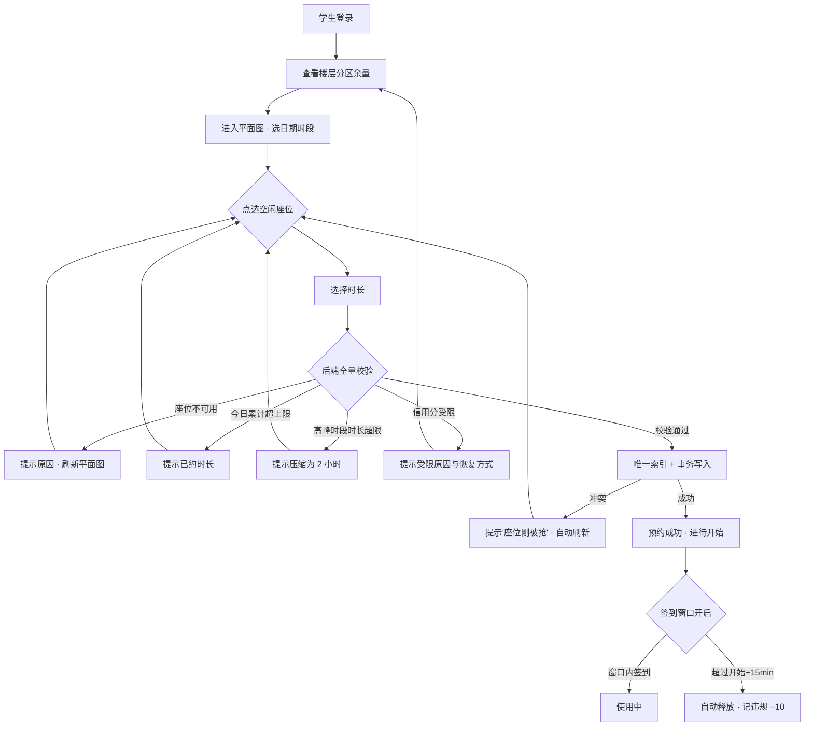
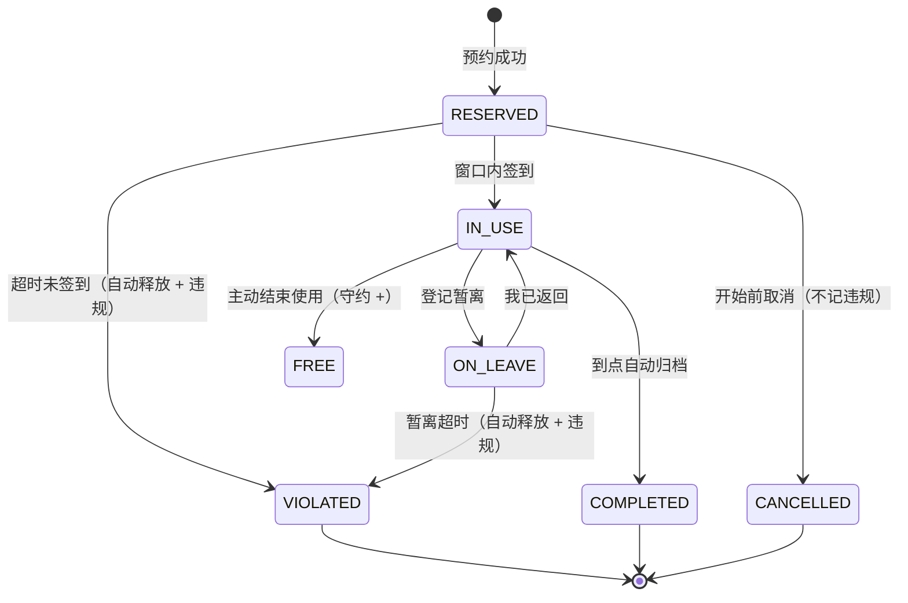
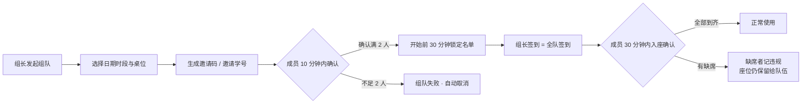
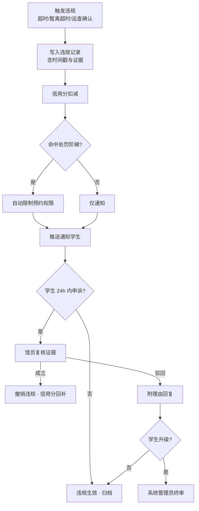

# 学校图书馆座位预约与占位管理系统 — 产品设计说明书 V2

> 版本：V2.0 ｜ 日期：2026-09-20 ｜ 定位：在 V1（基础预约系统）之上补齐「**占位管理**」能力
> 关系说明：V1 已实现「选座—预约—签到—取消」主干；V2 不推翻既有架构，新增**分区规则、暂离保留、组队学习、高峰调控、信用约束**五块能力。

---

## 1. 设计背景与核心问题

| 真实痛点 | 现象 | V2 的应对 |
| --- | --- | --- |
| **占座** | 一本书占一天，人不在座 | 暂离需登记且计时，超时自动释放 |
| **找座靠运气** | 走遍全馆才发现没位 | 实时余座 + 分区余量，出发前先看 |
| **高峰抢座不公平** | 拼手速、拼谁先到门口 | 提前开放 + 排队候补，先约先得且有秩序 |
| **暂离被误清** | 去吃饭回来书被收走 | 主动登记暂离，保留期内座位受保护 |
| **结伴无座** | 四人想坐一起，只能各自抢 | 按「桌位」整组预约 |
| **违规无成本** | 屡次爽约无后果 | 信用分 + 处罚阶梯 + 申诉通道 |
| **馆员靠腿巡** | 巡一圈 40 分钟，清座全凭经验 | 巡查任务看板，系统提示可疑座位 |

**设计目标**：让「有需求的人能坐上位」，让「占着不用的人付代价」，让「馆员从巡楼变成处理异常」。

---

## 2. 用户角色与权限

| 角色 | 身份说明 | 核心诉求 | 权限边界 | 主要终端 |
| --- | --- | --- | --- | --- |
| **学生**（本科生/研究生） | 持校园卡，馆内绝大多数用户 | 快速找到座位、暂离不被清、能和朋友一起坐 | 浏览全馆座位；预约/取消/签到/暂离享座位；查看本人信用分与记录；**不可见他人身份信息** | 手机为主（微信/App），PC 为辅 |
| **教师 / 教职工** | 持教工卡 | 专属区域、更长使用时长 | 学生全部权限 + **教师专区**预约权 + 单次时长上限更高（6h）+ 不受高峰时长压缩 | 手机 + PC |
| **馆员** | 前台值班 + 现场巡查 | 快速处理占座纠纷、确认违规 | 查看全馆实时座位与占用人（**手机号脱敏**）；强制释放并记录原因；确认/撤销违规；提交巡查结果 | PC（值班台）+ 平板（巡查） |
| **系统管理员** | 图书馆技术部门 | 规则可配置、数据可统计 | 全部权限 + **规则参数配置**（开放时间、时长上限、暂离时长、信用阈值）+ 分区/楼层/座位管理 + 数据导出 | PC |

**角色与账号的关系**：一个自然人只有一个账号，角色由校园统一身份认证授予（学生/教师）；馆员与系统管理员为**后台账号，不开放注册**，由系统管理员创建。

> **权限红线**：学生端任何接口**不得返回他人姓名/学号/手机号**；馆员端可见占用人姓名+学号（用于现场核对），但**手机号一律脱敏**（`138****1234`）。

---

## 3. 空间模型：楼层 → 分区 → 桌位 → 座位

V1 只有「楼层 → 座位」两层，V2 引入**分区**与**桌位**，这是「不同区域不同规则」与「结伴学习」的基础。

```
图书馆
 └─ 楼层（Floor）        1F / 2F / 3F / 4F
     └─ 分区（Zone）      静音自习区 / 研讨协作区 / 电子阅览区 / 休闲阅览区 / 考研专座 / 教师专区
         └─ 桌位（Table）  一张桌子，含 4~6 个座位（组队预约的最小单位）
             └─ 座位（Seat） 最小可预约单位
```

### 3.1 分区规则矩阵（**V2 核心规则表**）

| 分区 | 适用人群 | 单次时长上限 | 可否讨论 | 暂离 | 组队 | 提前预约 | 特殊说明 |
| --- | --- | --- | --- | --- | --- | --- | --- |
| **静音自习区** | 全体 | 4h | ❌ 严禁交谈 | ✅ 可暂离 | 可（相邻座） | 3 天 | 主体区域，规则最严 |
| **研讨协作区** | 全体 | 3h | ✅ 可小声讨论 | ✅ 可暂离 | ✅ **仅支持整组预约** | 3 天 | 2~6 人一组，按桌预约 |
| **电子阅览区** | 全体 | 2h | ❌ | ❌ **不可暂离** | ❌ | 1 天 | 配电脑，高周转，离座即释放 |
| **休闲阅览区** | 全体 | 1h | ⚠️ 可低声 | ❌ | ❌ | 当天 | 沙发位，仅作短时休息/阅读 |
| **考研专座** | 申请通过的应届考生 | 全天（开馆—闭馆） | ❌ | ✅（放宽至 120min） | ❌ | 按学期分配 | 需学期申请，周考勤不达标收回 |
| **教师专区** | 教师/教职工 | 6h | ⚠️ 可低声 | ✅ | ❌ | 3 天 | 学生不可见、不可约 |

> **实现要点**：分区是一组**规则参数的载体**。座位继承所属分区的规则，避免为每个座位单独配置。规则参数由系统管理员在后台维护，不写死在代码里。

### 3.2 桌位与结伴学习

- 一个**桌位（Table）**含 4~6 个座位，同一桌的座位共享一张桌子。
- **组队预约的最小单位是桌位**，不是单个座位——这样才真正保证「坐在一起」。
- 静音自习区允许「相邻座位自由组合」，研讨协作区**强制按桌预约**。

---

## 4. 开放时间与时段规则

| 规则项 | 常规周（周一至周五） | 周末 | 考试周（可配置） |
| --- | --- | --- | --- |
| 开馆 | 07:30 | 08:00 | 07:00 |
| 闭馆 | 22:30 | 22:00 | 23:00 |
| 预约时段粒度 | **30 分钟** | 30 分钟 | 30 分钟 |
| 单次时长上限 | 4h（教师 6h） | 4h | 6h |
| 单日累计上限 | **6h** | 6h | 8h |
| 可提前预约 | **3 天**（含当天） | 3 天 | 3 天 |
| 高峰时段 | 08:00–10:00、14:00–16:00、19:00–21:00 | 09:00–11:00、14:00–16:00 | 全天视为高峰 |

**关键约束**
1. **单日累计上限**：同一学生一天内在所有分区累计预约时长不超过上限——这是防止「一人占多段」的关键闸门。
2. **高峰时段时长压缩**：高峰时段内单次时长上限压缩至 **2 小时**（教师 4h），提高座位周转率。
3. **跨时段连续性**：不支持跨闭馆时间的预约；跨天预约需拆成两笔。
4. **不可预约已开始的时段**：当前时刻之前的时段只可查看，不可预约（避免「约了已经过去的时间」）。
5. **时段规则可后台配置**：寒暑假、考试周、临时闭馆均通过配置生效，**不发版**。

---

## 5. 座位生命周期（V2 核心状态机）

V1 只有「空闲 / 已预约 / 使用中 / 不可用」四态。V2 引入**暂离中**与**违约释放**，形成完整生命周期：

| 状态 | 含义 | 谁可见 | 座位是否被保护 |
| --- | --- | --- | --- |
| `FREE` 空闲 | 可被预约 | 全体 | — |
| `RESERVED` 已预约 | 已锁定，未到使用时间或未签到 | 全体（**不显示归属人**） | ✅ 保护至签到截止 |
| `IN_USE` 使用中 | 已签到，人在座 | 全体 | ✅ 保护至使用结束 |
| `ON_LEAVE` **暂离中** | 已登记暂离，**座位受保护** | 全体（显示预计返回时间） | ✅ 保护至暂离截止 |
| `MAINTENANCE` 维护中 | 设备维修等 | 全体 | — 不可预约 |
| `DISABLED` 已停用 | 管理员停用 | 全体 | — 不可预约 |

**状态的派生原则（沿用 V1，必须保持）**：座位的**基础状态**（可用/维护/停用）持久化在座位表；**占用状态**（预约/使用/暂离）由预约记录**实时派生**，不在座位表冗余「是否被占用」字段——避免定时任务失败产生双写脏数据。

**违约不是座位状态**：`VIOLATED` 是**预约记录的终态**，不是座位状态。座位在记录违约的瞬间回到 `FREE`。

---

## 6. 签到、暂离与结束（V2 新增重点）

### 6.1 签到

| 项 | 规则 |
| --- | --- |
| 签到窗口 | 预约开始 **前 15 分钟 ~ 开始后 15 分钟**（共 30 分钟） |
| 签到方式 | ① 扫描座位上的二维码 ② 在平面图点「我到了」并校验在馆（连接馆内 Wi-Fi） |
| 提前签到 | 允许，但**使用时间不从提前时刻顺延** |
| 超时未签到 | 自动释放座位，记 **1 次违规（爽约）**，信用分 −10 |
| 代签到 | ❌ 禁止；组队场景由**组长统一签到**（见 §7） |

### 6.2 暂离机制（**V2 最关键的新能力**）

学生在使用过程中短时离开，无需重新抢座，但**必须登记**：

| 暂离原因 | 单次上限 | 是否需凭证 | 说明 |
| --- | --- | --- | --- |
| **就餐** | **60 分钟** | 否 | 每日最多 2 次 |
| **上课 / 会议** | 60 分钟 | 否 | 需填课程名或事由 |
| **接听电话 / 短休** | 20 分钟 | 否 | 每日最多 3 次 |
| **取物 / 打印 / 其他** | 15 分钟 | 否 | — |

**核心约束**
1. **每日暂离总次数 ≤ 3 次**（考研专座放宽至 5 次），防止「无限续期式占座」。
2. **暂离期间座位进入 `ON_LEAVE`，平面图显示「暂离中 · 预计 14:35 返回」**，其他同学看得见，避免误判为占座。
3. **暂离超时未归** → 座位自动释放，记 **1 次违规（暂离超时）**，信用分 −10。
4. **暂离不可超出本次预约的结束时间**：若剩余时间不足，按剩余时间封顶。
5. **电子阅览区与休闲阅览区不支持暂离**（高周转区域，离座即释放）。
6. **暂离可提前返回**：点「我已返回」立即恢复 `IN_USE`，释放的时长不累计（本次暂离结束）。
7. **暂离期间的剩余使用时间照常消耗**——暂离只是「免于被清座」，不等于「暂停计时」。这条要在界面上讲清楚，否则会引发预期落差。

### 6.3 结束使用与主动释放

- 学生用完 **主动点「结束使用」** → 座位立即变 `FREE`，**不记违规**，并累计「守约次数」用于信用分回补。
- 到预约结束时间仍未结束 → 系统自动归档为 `COMPLETED` 并释放座位，**不记违规**。
- **主动释放奖励**：连续 5 次主动结束使用，信用分 +5（上限 100）。

### 6.4 超时处理与定时扫描

| 扫描任务 | 频率 | 处理 |
| --- | --- | --- |
| 超时未签到 | 每 1 分钟 | `RESERVED` 且 超过「开始+15min」→ 释放 + 违规 |
| 暂离超时 | 每 1 分钟 | `ON_LEAVE` 且 超过暂离截止 → 释放 + 违规 |
| 使用到期归档 | 每 5 分钟 | `IN_USE` 且 超过结束时间 → `COMPLETED` + 释放 |
| 巡查疑似占座 | 每 10 分钟 | 生成**巡查任务**（非自动释放，交馆员现场确认） |

> **设计原则**：**机器只处理「有明确时间证据」的释放**（超时未签到、暂离超时）；**「疑似占座」必须由人确认**——因为「书在人不在」也可能是去洗手间没来得及登记，直接清座会制造投诉。

---

## 7. 结伴学习：组队预约

### 7.1 队伍模型

| 项 | 规则 |
| --- | --- |
| 队伍规模 | **2 ~ 6 人** |
| 预约单位 | **桌位**（研讨协作区强制；静音自习区可选相邻座位） |
| 发起人 | 队伍的**组长**，唯一有权取消/改约 |
| 邀请方式 | ① 邀请码（6 位，10 分钟有效）② 搜索学号邀请 ③ 扫码加入 |
| 成员确认 | 被邀请者需在 **10 分钟内确认**，超时视为拒绝 |
| 组队截止 | 预约开始**前 30 分钟**锁定成员名单，之后不可增减 |

### 7.2 组队的签到与缺席

- **组长签到即全队签到**（避免 6 个人排队扫码）；组员可在 App 内看到「已由组长签到」。
- **成员缺席**：签到后 30 分钟内未到座（可通过扫描桌上二维码「入座确认」标记），该成员记 **1 次违规**，**但其座位保留给队伍**（不释放）——因为队伍是整体预约，中途释放会破坏「坐在一起」的初衷。
- **组长缺席**：全队预约作废，**组长记 2 次违规**。
- **全队爽约**：全员各记 1 次违规。

> **为什么这样设计**：组队场景下「释放单个座位」的收益很低（同组的人不会想坐生人），而「惩罚缺席者」才是有效约束。

---

## 8. 高峰时段与抢座调控

### 8.1 高峰识别

- **系统定义**（可配置）：开馆后 1 小时、下午 2–4 点、晚上 7–9 点。
- **动态高峰**：当某分区实时占用率 ≥ 90% 持续 15 分钟，标记为「**动态高峰**」，同样触发调控规则。

### 8.2 调控手段（按优先级）

| 手段 | 说明 | 解决的问题 |
| --- | --- | --- |
| **① 提前开放预约** | 高峰时段的座位在**前一天 22:00** 开放预约，而非当天 | 把「门口排队拼手速」变成「前一天有序预约」 |
| **② 时长压缩** | 高峰时段单次上限压至 2h | 提高周转，让更多人有机会 |
| **③ 排队候补** | 满座时可排队；有人释放 → **推送通知，5 分钟内确认**，超时顺延下一位 | 避免「守着刷新」，也避免「刚好走开就错过了」 |
| **④ 实时余座预告** | 出发前显示各分区余量，并给出「**预计到达时余座**」（基于历史同时段数据） | 减少白跑 |
| **⑤ 高峰提醒** | 高峰前 30 分钟推送「你常去的 3F 静音区通常在 19:00 满座，建议提前预约」 | 事前引导，非事后抱怨 |

### 8.3 排队候补规则

- 每个座位/桌位维护一条候补队列，**先到先得**。
- 释放时向队首推送，**5 分钟确认窗口**；超时未确认自动顺延，**且不记违规**（这是被动获得的机会，不应惩罚）。
- 同一学生**最多同时排 2 条队列**，防止刷队列。
- 已进入候补的学生**仍可正常预约其他座位**；一旦确认候补成功，其冲突时段的其他预约需先取消。

---

## 9. 违规、信用分与申诉

### 9.1 信用分模型

| 项 | 规则 |
| --- | --- |
| 初始分 | **100** |
| 下限 | 0（不为负） |
| 恢复 | 每自然周无违规 **+5**；连续 5 次主动结束使用 **+5** |
| 用途 | 低于阈值触发预约限制；高峰时段**信用分高者优先**进入候补队列 |

### 9.2 违规类型与扣分

| 违规类型 | 扣分 | 触发方式 |
| --- | --- | --- |
| 超时未签到（爽约） | −10 | 系统自动 |
| 暂离超时未归 | −10 | 系统自动 |
| 组队缺席 | −10 | 系统自动 |
| 组长缺席致全队作废 | −20 | 系统自动 |
| 现场占座（无预约占用） | −15 | 馆员确认 |
| 预约后未到且未取消 | −10 | 系统自动 |

### 9.3 处罚阶梯（**按信用分自动生效，无需人工介入**）

| 信用分 | 影响 |
| --- | --- |
| 90 ~ 100 | 正常使用 |
| 70 ~ 89 | **高峰时段不可预约**（仅可约非高峰） |
| 50 ~ 69 | **暂停预约权限 3 天**，仅可使用现场空位 |
| 1 ~ 49 | **暂停预约权限 7 天**，需到馆员处签署承诺书后恢复 |
| 0 | 权限暂停至学期末，由图书馆办公室审批恢复 |

### 9.4 申诉流程

```
收到违规通知 → 学生在「我的违规」页提交申诉（附事由，24h 内）
   → 馆员在后台复核（可查看签到/暂离/巡查记录）
       ├─ 申诉成立 → 撤销违规，信用分回补，记录留痕
       └─ 申诉驳回 → 附驳回理由，学生可见
   → 对驳回仍有异议 → 升级至系统管理员终审
```

**必须做到**：每条违规都要能**追溯到证据**（时间戳 + 触发规则 + 现场巡查照片），否则申诉无法裁定。

---

## 10. 核心功能模块清单

### 10.1 学生端（移动优先）

| 模块 | 关键能力 |
| --- | --- |
| **首页 / 实时余座** | 各楼层分区余量卡片、预计到达余座、高峰提示、快捷入口 |
| **找座** | 楼层 → 分区 → 平面图（实时状态、暂离中显示预计返回）；按条件筛选（靠窗/有插座/单人桌/可讨论） |
| **预约** | 个人预约（选时段+时长）、组队预约（建队/邀请/按桌选）、排队候补 |
| **我的座位** | 当前预约卡片：**签到 / 暂离 / 我已返回 / 结束使用 / 取消**（按钮**由后端计算可用性**，前端不重复实现规则） |
| **我的预约** | 待开始 / 使用中 / 已结束 / 已取消 分组；历史记录 |
| **信用与违规** | 信用分、违规明细（含证据）、申诉入口、恢复进度 |
| **个人中心** | 校园身份绑定、通知设置、修改密码 |

### 10.2 馆员端（值班台 PC + 巡查平板）

| 模块 | 关键能力 |
| --- | --- |
| **实时监控大屏** | 全馆座位热力图、各分区占用率、异常座位高亮 |
| **巡查任务** | 系统生成的「疑似占座」任务清单；扫码核对；现场处理（提醒/释放/记违规） |
| **座位处置** | 强制释放（**必填原因**）、临时关闭座位、延长/缩短预约 |
| **违规处理** | 确认违规、查看证据、受理申诉、撤销违规 |
| **座位与分区管理** | 楼层/分区/桌位/座位 CRUD、批量生成、状态切换 |
| **记录与统计** | 预约记录查询、使用统计、高峰分析、违约率报表、导出 |

### 10.3 系统管理端

| 模块 | 关键能力 |
| --- | --- |
| **规则配置** | 开放时间、时段粒度、时长上限、暂离规则、信用分阈值与处罚阶梯、高峰时段定义（**全部可配，不发版**） |
| **空间配置** | 楼层/分区/桌位/座位模板、平面图坐标维护 |
| **账号与权限** | 馆员账号创建、角色分配、统一身份认证对接配置 |
| **数据与审计** | 全量导出、操作审计日志（谁在何时释放了哪个座位） |

---

## 11. 关键业务流程

### 11.1 个人预约主流程



### 11.2 座位使用全生命周期（签到 → 暂离 → 结束）



### 11.3 组队预约流程



### 11.4 违规判定与申诉闭环



---

## 12. 规则约束条件汇总（开发验收基准）

**时间规则**
1. 开馆 07:30 / 闭馆 22:30（周末 08:00–22:00，考试周 07:00–23:00，**全部可配置**）
2. 预约粒度 30 分钟；单次上限 4h（教师 6h）；**高峰时段压缩至 2h**
3. **单日累计上限 6h**（考试周 8h）
4. 可提前 3 天预约；不可预约已开始的时段；不支持跨闭馆时间

**空间规则**
5. 座位分区为规则载体；规则参数后台可配
6. 研讨协作区**仅支持组队预约**（2~6 人，按桌）
7. 电子阅览区与休闲阅览区**不可暂离**；考研专座暂离放宽至 120min

**座位占用规则**
8. 座位表**不冗余占用字段**，占用态由预约实时派生
9. 签到窗口：开始前 15min ~ 开始后 15min
10. 同一学生同一时段**不可重复预约**（含跨分区）
11. 同一座位同一时段仅一人（**数据库唯一索引兜底，不依赖先查后插**）

**暂离规则**
12. 暂离单次上限：就餐/上课 60min，接听/短休 20min，取物 15min
13. **每日暂离 ≤ 3 次**（考研专座 5 次）
14. 暂离**不免除计时**，且不可超出本次预约结束时间
15. 暂离超时 → 自动释放 + 违规 −10

**组队规则**
16. 队伍 2~6 人；开始前 30 分钟锁定名单
17. 组长签到 = 全队签到；成员缺席记违规但**座位保留**
18. 组长缺席 → 全队作废，组长 −20

**信用与处罚规则**
19. 初始 100 分；每自然周无违规 +5；连续 5 次主动结束 +5
20. 扣分：爽约/暂离超时/缺席 −10，组长缺席 −20，现场占座 −15
21. 处罚阶梯：<90 高峰受限 → <70 停 3 天 → <50 停 7 天 → 0 分停至学期末
22. 任何违规**必须留存可追溯证据**，否则申诉无法裁定

**数据权限规则**
23. 学生端**不得返回**他人姓名/学号/手机号；平面图不暴露占用人
24. 馆员端可见姓名+学号，手机号一律脱敏

**巡查规则**
25. 机器只自动释放「有时间证据」的座位；**疑似占座必须人工确认**
26. 强制释放**必填原因**并通知学生

---

## 13. 整体使用体验要求

### 13.1 移动优先

学生**在去图书馆的路上**就用手机决策，因此：移动端是主战场，PC 端是补充。座位平面图在窄屏下**横向滚动而非缩放**（缩到看不清反而点不准），座位方块点击热区 **≥ 44px**。

### 13.2 三次点击完成预约

`进入平面图 → 点座位 → 确认`。时长用默认值（2h）并允许一键调整，不做多步向导。

### 13.3 状态永远可解释

- 平面图用**颜色 + 形状双重标识**（色盲友好）：空闲绿、已预约橙（●）、使用中红（●●）、暂离蓝（⌛ + 预计返回时间）、不可用灰（斜纹）
- **暂离必须显示「暂离中 · 预计 14:35 返回」**——这是化解「他是不是占座」焦虑的关键信息，比颜色更重要
- 每个按钮不可用时，**必须说明原因**（「签到窗口 14:45 开放」「暂离次数已用完」），禁止只置灰不给理由

### 13.4 实时性与降级

- 平面图 **15~30 秒轮询**；页面不可见时暂停，切回立即刷新
- 抢座失败（座位被抢）→ 明确提示 + **自动刷新平面图**，不让用户对着过期数据操作
- **高峰降级**：当并发超过阈值，优先保证「查看余座」可用，预约接口排队而非直接报错

### 13.5 提醒到位

- 预约开始前 15 分钟推送：「3F 静音区 A12，14:00 开始，记得签到」
- 暂离剩余 5 分钟推送：「暂离将于 15:20 到期，请及时返回」
- 违规即时推送 + 申诉入口（申诉入口就在通知里，不让学生去翻菜单）

### 13.6 无障碍与容错

- 键盘可达、焦点可见、`prefers-reduced-motion` 下关闭动画
- 所有破坏性操作二次确认；强制释放必填原因
- 空数据、网络异常、权限不足均有明确占位与下一步引导，不出现白屏

---

## 14. 与 V1 的差异（增量开发范围）

| 能力 | V1 现状 | V2 增量 |
| --- | --- | --- |
| 角色 | USER / ADMIN | **学生 / 教师 / 馆员 / 系统管理员**（四角色 + 统一身份认证） |
| 空间模型 | 楼层 → 座位 | **楼层 → 分区 → 桌位 → 座位**（分区承载规则） |
| 时段 | 1 小时粒度、14 时段、7 天 | **30 分钟粒度、3 天、单日累计上限、高峰压缩** |
| 座位状态 | 空闲/已预约/使用中/不可用 | **+ 暂离中**（含预计返回时间） |
| 签到 | ✅ 已实现 | 增加扫码签到、组队统一签到 |
| **暂离** | ❌ 无 | **全新**：原因分类、时长上限、次数上限、超时释放 |
| **组队学习** | ❌ 无 | **全新**：桌位模型、邀请确认、组长签到、缺席处理 |
| **高峰调控** | ❌ 无 | **全新**：提前开放、时长压缩、排队候补、余座预告 |
| 违规处理 | 仅记 `no_show_count` | **信用分 + 处罚阶梯 + 证据留存 + 申诉闭环** |
| 巡查 | ❌ 无 | **全新**：巡查任务看板、现场处置 |
| 规则配置 | 写死在代码/配置 | **后台可配，不发版** |

**保持不变的架构约定**：占用状态派生模型、唯一索引 + 事务的并发防重、统一响应 `{code,message,data}`、JWT + 角色拦截、前后端分离 + 单端口托管。

---

## 15. 待确认事项

| # | 问题 | 建议默认值（可直接开工） |
| --- | --- | --- |
| 1 | 是否对接学校统一身份认证（CAS/企业微信）？ | 默认预留接口，先用本地账号演示 |
| 2 | 签到是否需要地理围栏/馆内 Wi-Fi 校验？ | 默认只做二维码签到，地理校验为 P2 |
| 3 | 组队是否允许跨年级自由邀请？ | 默认允许，不设限制 |
| 4 | 考研专座是否需要学期申请审批流？ | 默认 P1，先做管理员手工分配 |
| 5 | 信用分恢复是否需馆员确认？ | 默认自动（每周 +5），无需人工 |
| 6 | 排队候补是否支持「指定桌位」排队？ | 默认按分区排队，不指定具体座位 |
