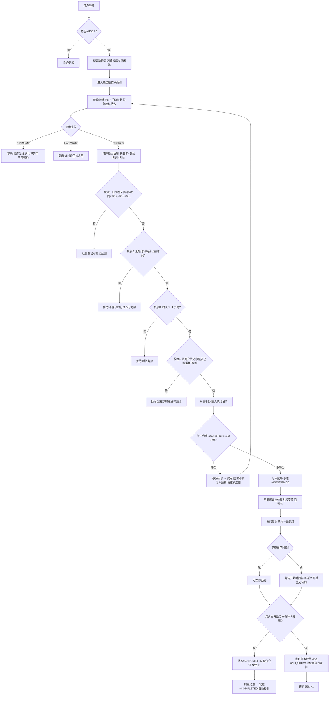
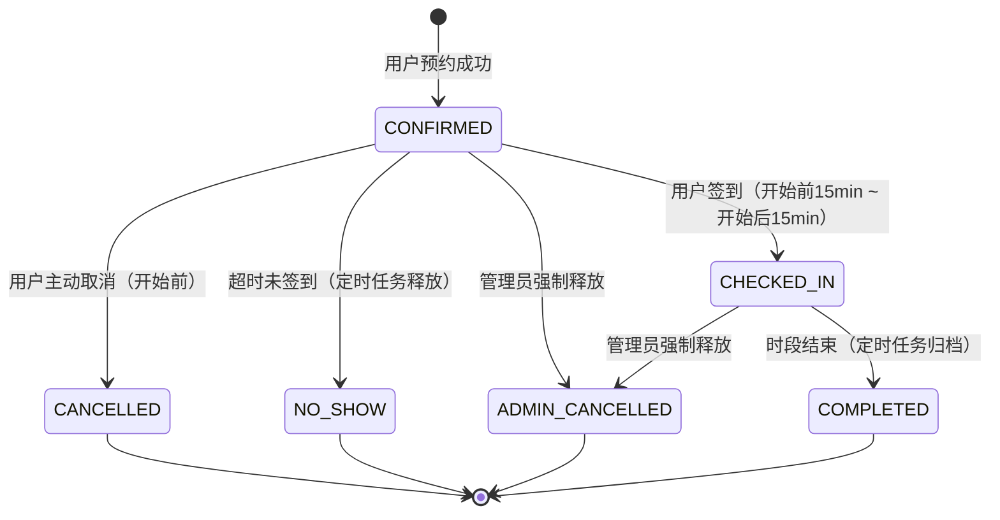

# 图书馆座位预约系统 — 产品需求文档（PRD）

| 项目信息 | 内容 |
| --- | --- |
| 文档语言 | 简体中文 |
| 项目名称（snake_case） | `library_seat_reservation` |
| 项目路径 | `D:\Project\LibraryReservation` |
| 后端技术栈 | Spring Boot（Java 21，版本由架构师定） |
| 前端技术栈 | 由架构师拍板，PM 仅提供体验侧约束（见 §7.1） |
| 文档类型 | 简单 PRD（产品目标 / 用户故事 / 需求池 / UI 设计稿 / 业务规则 / 待确认问题） |
| 项目定位 | 教学 + 演示级，但必须功能闭环、可真实运行、可完整演示 |

## 0. 原始需求复述

> 开发一个图书馆座位预约系统，后端使用 Spring Boot，前端技术栈自选并说明理由。系统包含用户端与管理员端。
> 用户端：用户注册登录后，先选择楼层，查看该楼层座位布局与实时占用状态，再选择空闲座位完成预约；支持查看个人预约记录与取消预约。
> 管理员端：管理员登录后可对楼层和座位信息增删改查，查看座位使用情况与预约数据统计，便于日常运营维护。
> 需先输出开发计划（整体架构、数据库表设计、接口设计、模块划分），再按计划逐步实现完整代码。

**约束**：不引入消息队列、微服务、OAuth2 第三方登录、Kubernetes、容器编排等重型组件；单机可跑、启动即可演示。

---

## 1. 产品目标

**一句话定位**：一个面向高校/公共图书馆的**轻量座位预约与运营管理系统**，让读者「看图选座、秒级预约」，让管理员「可视化运营、数据可追溯」。

| # | 目标 | 衡量标准 |
| --- | --- | --- |
| G1 | **降低找座成本**：读者 30 秒内完成「选楼层 → 看平面图 → 预约」 | 核心路径 ≤ 3 次点击完成预约；平面图首屏渲染 ≤ 1s |
| G2 | **消除座位冲突**：任意座位在任意时段至多被一人占用 | 并发预约场景下无重复占用（唯一约束 + 事务保证） |
| G3 | **运营可视化**：管理员能实时掌握楼层利用率、时段热度、违约情况 | 提供 ≥ 4 类统计指标（见 §6 统计页） |
| G4 | **闭环可演示**：注册 → 预约 → 签到 → 完成/取消 → 统计 全链路跑通 | 单账号 5 分钟内可完整演示一遍 |
| G5 | **保持轻量**：不引入重型中间件，单机启动即可 | 启动依赖 ≤ 2 个（JDK + 数据库），无 Docker 强制依赖 |

---

## 2. 用户角色与权限边界

| 角色 | 来源 | 核心权限 | 明确不可为 |
| --- | --- | --- | --- |
| **普通用户（USER）** | 自主注册 | 浏览楼层/座位平面图；预约空闲座位；查看**本人**预约；取消**本人**预约；对**本人**预约签到 | 不能查看他人预约、不能查看他人身份信息、不能修改楼层/座位、不能查看统计、不能访问 `/admin/**` |
| **管理员（ADMIN）** | 系统内置种子账号（**不开放注册**） | 楼层 CRUD、座位 CRUD（含批量生成/启用禁用）、查看全部预约、强制释放座位、查看使用情况与统计 | 不能代替用户创建预约（P0 不做代预约）；不能删除用户账号（P1 才考虑禁用） |

**权限实现约束**：
- 角色字段 `role` 存于用户表，值为 `USER` / `ADMIN`。
- 后端每个 `/admin/**` 接口必须做角色校验（不能只靠前端隐藏菜单）。
- 前端路由守卫 + 后端拦截器双保险；401/403 统一跳转登录或提示无权限。
- **管理员账号注册入口关闭**：注册接口固定写入 `USER` 角色，避免越权提权。

---

## 3. 用户故事

### 3.1 普通用户

| ID | 用户故事 |
| --- | --- |
| US-01 | 作为**新读者**，我希望通过邮箱/账号+密码自助注册并登录，以便无需人工开户即可使用预约服务 |
| US-02 | 作为**读者**，我希望先看到图书馆所有楼层及其空闲座位数量，以便快速判断去哪一层 |
| US-03 | 作为**读者**，我希望以**二维平面图**形式看到某楼层的座位布局和实时占用状态（颜色区分），以便像看影院选座一样直观选座 |
| US-04 | 作为**读者**，我希望点击一个空闲座位后选择日期与时段即可完成预约，以便 3 步内锁定座位 |
| US-05 | 作为**读者**，我希望查看「我的预约」列表并按状态筛选，以便管理自己的行程 |
| US-06 | 作为**读者**，我希望在行程有变时取消预约释放座位，以便把资源让给他人 |
| US-07 | 作为**读者**，我希望到馆后一键签到确认入座，以便系统知道我确实在使用（也避免被判定违约） |
| US-08 | 作为**读者**，我希望系统自动把已过期/已结束的预约归档，以便列表只展示有效信息 |

### 3.2 管理员

| ID | 用户故事 |
| --- | --- |
| AS-01 | 作为**管理员**，我希望对楼层进行增删改查（名称、编号、开放状态、座位行数/列数），以便映射真实馆舍结构 |
| AS-02 | 作为**管理员**，我希望对单个楼层的座位进行增删改查，并**批量生成**网格座位，以便避免逐个录入上百个座位 |
| AS-03 | 作为**管理员**，我希望把故障座位标记为「维护中/禁用」，以便读者无法预约到坏座位 |
| AS-04 | 作为**管理员**，我希望按楼层/日期/时段查看座位使用情况（哪些被占、哪些空闲、谁在用），以便现场巡检与疏导 |
| AS-05 | 作为**管理员**，我希望查看预约数据统计（预约量趋势、时段热度、楼层利用率、违约/未签到数），以便调整开放策略 |
| AS-06 | 作为**管理员**，我希望在特殊情况（设备维修、活动占用）下强制释放某座位，以便应急处理 |
| AS-07 | 作为**管理员**，我希望查询全部预约记录并按用户/座位/日期筛选，以便追溯纠纷 |

---

## 4. 核心业务流程

### 4.1 预约座位主流程（含并发与冲突判定）



### 4.2 预约生命周期状态机



> **占用判定规则**：仅 `CONFIRMED`、`CHECKED_IN` 两种状态占用座位时段。`CANCELLED / NO_SHOW / ADMIN_CANCELLED / COMPLETED` 均视为已释放，座位该时段重新变为可预约。

---

## 5. 需求池（P0 / P1 / P2）

**优先级定义**：P0 = 本轮必须完成（缺失则系统不可用）；P1 = 本轮尽量完成，可降级；P2 = 明确后置，不影响交付。

### 5.1 基础与账号（SYS）

| 需求ID | 需求描述 | 优先级 | 本轮 | 验收标准 |
| --- | --- | --- | --- | --- |
| SYS-01 | 用户注册（账号、密码、姓名、手机号可选） | P0 | ✅ | 账号唯一，重复注册返回明确错误；密码后端加密存储（BCrypt）；注册后角色固定为 USER |
| SYS-02 | 用户登录，返回 Token（JWT 或 Session，架构师定） | P0 | ✅ | 登录成功返回凭证与角色信息；凭证过期后请求返回 401 且前端跳转登录 |
| SYS-03 | 后端角色校验拦截器 | P0 | ✅ | USER 直接调用 `/admin/**` 接口返回 403（用接口工具可验证） |
| SYS-04 | 前端路由守卫（按角色限制菜单与路由） | P0 | ✅ | USER 访问 `/admin` 被拦截；ADMIN 可见管理菜单 |
| SYS-05 | 内置管理员种子账号（初始化脚本） | P0 | ✅ | 项目启动后有可用管理员账号（如 `admin / admin123`，文档注明） |
| SYS-06 | 统一响应结构与全局异常处理 | P0 | ✅ | 所有接口返回统一 `{code, message, data}`；业务异常有可读中文提示 |
| SYS-07 | 退出登录 | P1 | ✅ | 前端清除凭证并跳登录页 |
| SYS-08 | 修改密码 / 个人资料 | P2 | ❌ | 后置 |
| SYS-09 | 忘记密码 / 邮件验证 | P2 | ❌ | 明确不做 |

### 5.2 用户端（USR）

| 需求ID | 需求描述 | 优先级 | 本轮 | 验收标准 |
| --- | --- | --- | --- | --- |
| USR-01 | 楼层列表页：展示楼层名、总座位、当前空闲数、占用率 | P0 | ✅ | 数据实时（刷新后与平面图一致）；点击可进入该楼层平面图 |
| USR-02 | 座位平面图页：CSS Grid 渲染二维座位网格 | P0 | ✅ | 座位按 行/列 精确定位；行号列号有标尺；渲染 ≤ 200 座位无卡顿 |
| USR-03 | 座位状态颜色区分（空闲/已预约/使用中/不可用）+ 图例 | P0 | ✅ | 4 种状态颜色可辨；**除颜色外另有文字或图标标识**（色盲友好）；页面常驻图例 |
| USR-04 | 平面图日期 + 时段切换器 | P0 | ✅ | 切换日期/时段后，平面图按该时段重算占用状态 |
| USR-05 | 平面图实时刷新：30 秒轮询 + 手动刷新按钮 | P0 | ✅ | 空闲 30s 自动刷新；他人预约后 30s 内本页可见变化（不做 WebSocket） |
| USR-06 | 点击空闲座位 → 预约抽屉（日期/起始时段/时长） | P0 | ✅ | 默认带出当前所选日期时段；时长默认 2 小时，可选 1/2/3/4 |
| USR-07 | 提交预约（含全部业务规则校验） | P0 | ✅ | 见 §7 业务规则；任一校验失败返回具体中文原因 |
| USR-08 | 并发防重：唯一约束 + 事务 | P0 | ✅ | 两个请求同时预约同一座位同时段，**有且仅有一个成功**，另一个返回「座位已被占用」 |
| USR-09 | 我的预约页：列表 + 状态分组（待开始/进行中/已结束/已取消） | P0 | ✅ | 展示楼层、座位编号、日期时段、状态；状态标签颜色区分 |
| USR-10 | 取消预约（开始前可取消） | P0 | ✅ | 取消后座位该时段立即释放为可预约；列表状态更新为已取消 |
| USR-11 | 签到（手动点击签到） | P0 | ✅ | 仅在「开始前 15 分钟 ~ 开始后 15 分钟」窗口内按钮可用；签到后状态=使用中 |
| USR-12 | 签到超时自动释放 + 标记未到（定时任务） | P0 | ✅ | 超过开始后 15 分钟未签到，定时任务（每分钟）自动置为 NO_SHOW，座位释放 |
| USR-13 | 预约开始提醒（页面内提示） | P1 | ⚠️ | 可降级：仅在列表显示「x 分钟后开始」文案，不做消息推送 |
| USR-14 | 违约次数展示（未签到次数） | P1 | ⚠️ | 可降级：个人中心展示计数即可，P0 只落库不展示 |
| USR-15 | 违约惩罚：24h 内禁止预约 | P2 | ❌ | 后置（P0 仅记录次数不限制） |
| USR-16 | 平面图按「区域/分区」分组展示（A/B/C 区） | P1 | ⚠️ | 可降级：P0 用「行号段」分隔即可 |
| USR-17 | 选座偏好（靠窗/安静区/有插座）筛选 | P2 | ❌ | 后置（数据模型预留标签字段即可） |

### 5.3 管理员端（ADM）

| 需求ID | 需求描述 | 优先级 | 本轮 | 验收标准 |
| --- | --- | --- | --- | --- |
| ADM-01 | 楼层管理：列表 + 新增/编辑/删除 | P0 | ✅ | 字段：楼层名称、楼层编号、描述、排序、开放状态；删除已有座位的楼层需二次确认并级联处理 |
| ADM-02 | 座位管理：某楼层座位列表（分页/筛选） | P0 | ✅ | 支持按座位编号、状态筛选 |
| ADM-03 | 座位新增/编辑（单个） | P0 | ✅ | 字段：座位编号、行号、列号、区域、状态、备注 |
| ADM-04 | 座位**批量生成**（按行列数一键生成网格） | P0 | ✅ | 输入 行数/列数/编号前缀 → 生成 N 个座位；重复编号自动跳过并提示 |
| ADM-05 | 座位状态切换（启用 / 维护中 / 禁用） | P0 | ✅ | 切换后立即对用户端生效（不可被预约） |
| ADM-06 | 座位删除 | P0 | ✅ | 存在**未来有效预约**时禁止删除（或需先释放，二选一，建议禁止并提示） |
| ADM-07 | 座位使用情况查询（按楼层/日期/时段，谁在用） | P0 | ✅ | 表格展示座位编号、状态、占用人（**脱敏**：仅显示姓名/账号，不显示手机号） |
| ADM-08 | 预约记录查询（按用户/日期/状态筛选） | P0 | ✅ | 支持关键字搜索；分页 |
| ADM-09 | 管理员强制释放座位（需填原因） | P0 | ✅ | 释放后座位变为空闲；用户端该预约显示「已被管理员取消」及原因 |
| ADM-10 | 数据统计页：核心指标卡片 | P0 | ✅ | 今日预约数、当前在场人数、今日签到率、今日未签到数、座位总数、当前利用率 |
| ADM-11 | 数据统计：近 7 天预约量趋势图 | P0 | ✅ | 折线/柱状图，数据正确 |
| ADM-12 | 数据统计：时段热度分布（哪个时段最抢手） | P0 | ✅ | 柱状图，14 个时段 |
| ADM-13 | 数据统计：各楼层利用率对比 | P0 | ✅ | 横向柱状图或表格 |
| ADM-14 | 数据统计：违约/未签到统计 | P1 | ⚠️ | 可降级并入 ADM-10 卡片 |
| ADM-15 | 用户管理（列表、禁用/启用账号） | P1 | ⚠️ | 可降级：仅列表查看，不做禁用 |
| ADM-16 | 数据导出 CSV | P2 | ❌ | 后置 |
| ADM-17 | 开放时间/时段模板可配置（管理员后台配） | P2 | ❌ | P0 用代码常量，配置文件化即可 |

### 5.4 P0 交付清单（本轮必须完成的 22 项）

```
SYS-01 ~ SYS-06
USR-01 ~ USR-12
ADM-01 ~ ADM-13
```

---

## 6. UI 设计稿

### 6.0 页面清单总览

| # | 页面 | 路由 | 角色 | 优先级 |
| --- | --- | --- | --- | --- |
| P1 | 登录页 | `/login` | 全部 | P0 |
| P2 | 注册页 | `/register` | 访客 | P0 |
| P3 | 楼层选择页 | `/floors` | USER / ADMIN 只读 | P0 |
| P4 | **座位平面图页（核心）** | `/floors/:floorId/seats` | USER / ADMIN 只读 | P0 |
| P5 | 我的预约页 | `/my/reservations` | USER | P0 |
| P6 | 管理员·楼层管理 | `/admin/floors` | ADMIN | P0 |
| P7 | 管理员·座位管理 | `/admin/floors/:floorId/seats` | ADMIN | P0 |
| P8 | 管理员·座位使用情况 | `/admin/usage` | ADMIN | P0 |
| P9 | 管理员·预约记录 | `/admin/reservations` | ADMIN | P0 |
| P10 | 管理员·数据统计 | `/admin/statistics` | ADMIN | P0 |
| P11 | 个人中心 / 我的信息 | `/profile` | 全部 | P1（可降级） |
| P12 | 管理员·用户管理 | `/admin/users` | ADMIN | P1（可降级） |

### 6.1 登录页 / 注册页

```
┌──────────────────────────────────────────────┐
│                                              │
│         ┌────────────────────────┐           │
│         │  图书馆座位预约系统      │           │
│         │  Library Seat Booking  │           │
│         ├────────────────────────┤           │
│         │  账号  [____________]  │           │
│         │  密码  [____________]  │           │
│         │        [ 登  录 ]      │           │
│         │                        │           │
│         │  还没有账号？立即注册    │           │
│         └────────────────────────┘           │
│                                              │
└──────────────────────────────────────────────┘
```

- 居中卡片式布局，PC 宽屏；顶部品牌区 + 中部表单 + 底部切换链接。
- 登录成功后按角色跳转：ADMIN → `/admin/statistics`，USER → `/floors`。
- 注册页字段：账号（必填，3-20 位）、密码（必填，≥6 位）、确认密码、姓名（必填）、手机号（选填）。
- **注册页无「角色」选项**，固定为普通用户。
- 表单校验前端即时提示，后端重复校验并返回中文错误。

### 6.2 楼层选择页 `/floors`

```
Header: 图书馆座位预约系统        [我的预约]  [退出]
─────────────────────────────────────────────────
 选择楼层
┌───────────────┐ ┌───────────────┐ ┌───────────────┐
│  1F 一楼自习区  │ │  2F 二楼阅览区  │ │  3F 三楼研讨区  │
│  总座位  120   │ │  总座位   80   │ │  总座位   60   │
│  空闲     86   │ │  空闲     12   │ │  空闲     45   │
│  ▓▓▓▓▓▓░░ 72% │ │  ▓▓▓▓▓▓▓▓ 85% │ │  ▓▓▓░░░░ 25%  │
│  [ 查看座位 ]  │ │  [ 查看座位 ]  │ │  [ 查看座位 ]  │
└───────────────┘ └───────────────┘ └───────────────┘
```

- 卡片网格（每行 3-4 个，响应式换行）。
- 每张卡片：楼层名 + 编号徽章、总座位数、当前空闲数、占用率进度条（绿<50% / 黄 50-80% / 红>80%）、进入按钮。
- 顶部可加「日期 + 时段」选择器，卡片空闲数随所选时段变化（默认当前时段）。
- 关闭/维护中的楼层置灰并标注「暂不开放」。

### 6.3 座位平面图页 `/floors/:floorId/seats` —— **核心页面**

```
Header: [← 返回楼层]  2F 二楼阅览区        [我的预约] [退出]
──────────────────────────────────────────────────────────
 日期 [2026-02-11 ▾]   时段 [14:00-15:00 ▾]  [刷新]  (30s 自动)
 图例: 🟩 空闲  🟨 已预约  🟥 使用中  ⬛ 不可用/维护
──────────────────────────────────────────────────────────
        列1  列2  列3  列4  列5  列6  列7  列8
 行1   [ A1 ][ A2 ][ A3 ][ 🟨 ][ A5 ][ 🟥 ][ A7 ][ ⬛ ]
 行2   [ A9 ][A10 ][ 🟥 ][A12 ][A13 ][A14 ][ 🟨 ][A16 ]
 行3   [A17 ][A18 ][A19 ][A20 ][ ⬛ ][A22 ][A23 ][A24 ]
 行4   [A25 ][ 🟨 ][A27 ][A28 ][A29 ][A30 ][A31 ][A32 ]

                    讲台 / 入口（示意）
──────────────────────────────────────────────────────────
 点击空闲座位即可预约
```

**布局结构（自上而下）**
1. **面包屑/返回条**：`← 返回楼层` + 当前楼层名。
2. **筛选工具条**：日期选择器（默认今天，可选今天~+6 天）、时段下拉（14 个时段）、刷新按钮 + 「上次更新 xx:xx:xx」文案（体现"实时"）。
3. **图例条（常驻，不可折叠）**：4 种状态的颜色方块 + 文字标签。
4. **平面图主体（核心）**：
   - 使用 **CSS Grid** 渲染，容器列数 = 该楼层最大列数，每个座位占 1 格。
   - 每个座位是一个固定尺寸方块（建议 56×56 px，hover 放大 1.05 倍 + 阴影），内部显示座位编号（如 `A12`）。
   - 顶部有**列号标尺**，左侧有**行号标尺**。
   - 座位按 `row_no` / `col_no` 定位到网格对应格；空缺位置留空（支持不规则布局）。
   - 可按「区域/分区」分组，区与区之间留出更大间距并标注区名（A 区 / B 区）。
   - 可绘制少量**静态装饰元素**（讲台、入口、过道）作为占位块，提升"平面图"观感 —— 用 `grid-column: span N` 的占位 div 实现，不参与交互。
5. **底部提示条**：「点击空闲座位即可预约」。

**状态与视觉规范**

| 状态 | 颜色（建议） | 附加标识 | 可点击 | Tooltip 文案 |
| --- | --- | --- | --- | --- |
| 空闲 AVAILABLE | 绿色 `#52c41a` 系 | 无 | ✅ | 「A12 空闲，点击预约」 |
| 已预约 RESERVED | 橙黄 `#faad14` 系 | 右上角小圆点 ● | ❌ | 「A12 已预约（未签到）」 |
| 使用中 IN_USE | 红色 `#f5222d` 系 | 右上角实心圆 ●● | ❌ | 「A12 使用中」 |
| 不可用（维护/禁用） | 灰色 `#bfbfbf` 系 | 斜线纹理 + 🔧 图标 | ❌ | 「A12 维护中，暂不可用」 |

> **色盲友好强制要求**：颜色之外必须有第二重区分（图标/圆点/纹理），且 Tooltip 有文字说明。禁止仅靠颜色区分状态。

**交互流程**
1. 点击**空闲座位** → 右侧滑出**预约抽屉**（Drawer）：
   - 展示座位编号、楼层、区域
   - 日期（默认当前所选）、起始时段（默认当前所选）、时长（1/2/3/4 小时，默认 2）
   - 实时预览：「预约时段 14:00-16:00」
   - 校验提示区（如「您在该时段已有预约」）
   - `[ 确认预约 ]` 按钮
2. 点击**非空闲座位** → Tooltip 说明 + 不可点击（cursor: not-allowed）。
3. 预约成功 → Toast 成功提示 + 该座位立即变黄 + 提示「可在『我的预约』查看」。
4. 预约失败（被抢） → Toast 错误 + **自动刷新平面图**，避免用户看到过期状态。
5. 30 秒轮询刷新（用户无操作时）；有 Drawer 打开时暂停轮询，避免抖动。

**响应式要求**：PC 优先。`< 1024px` 时平面图容器横向滚动（`overflow-x: auto`），不缩放座位（保证可点击性）。

### 6.4 我的预约页 `/my/reservations`

```
Header: ... [楼层] [我的预约] [退出]
────────────────────────────────────────────────────────
 Tab: [即将开始(2)] [使用中(1)] [已结束(5)] [已取消(3)]
────────────────────────────────────────────────────────
┌────────────────────────────────────────────────────────┐
│ 2F 二楼阅览区 · 座位 A12         [ 已预约 ]            │
│ 📅 2026-02-11  14:00 - 16:00 (2小时)                   │
│ 预约时间: 2026-02-11 10:23                             │
│                        [ 签到 ]  [ 取消预约 ]           │
├────────────────────────────────────────────────────────┤
│ 3F 三楼研讨区 · 座位 C05         [ 使用中 ]            │
│ 📅 2026-02-11  10:00 - 12:00                           │
│ 签到时间: 2026-02-11 09:52                             │
│                                        [ 取消预约 ]     │
└────────────────────────────────────────────────────────┘
```

- Tab 分组：即将开始 / 使用中 / 已结束 / 已取消（含未签到、管理员取消）。
- 卡片式列表（PC 可两列），每张卡片：楼层·座位编号、状态标签、日期、时段、创建/签到时间、操作按钮。
- 按钮可用性规则：
  - `签到`：仅当处于签到窗口（开始前 15min ~ 开始后 15min）时可用，否则置灰并提示原因。
  - `取消预约`：仅状态为 CONFIRMED 且未过开始时间时可用。
- 已结束/已取消卡片操作区留空，状态标签灰化。

### 6.5 管理员·楼层管理 `/admin/floors`

```
侧边栏: [楼层管理] [座位管理] [使用情况] [预约记录] [数据统计]
────────────────────────────────────────────────────────
 楼层管理                              [ + 新增楼层 ]
┌────┬───────────┬────┬──────┬──────┬──────┬──────────┐
│ ID │ 楼层名称   │编号│座位数│ 排序 │ 状态 │   操作    │
├────┼───────────┼────┼──────┼──────┼──────┼──────────┤
│ 1  │ 一楼自习区 │ 1F │ 120  │  1   │ 开放 │ 编辑 删除 │
│ 2  │ 二楼阅览区 │ 2F │  80  │  2   │ 开放 │ 编辑 删除 │
│ 3  │ 三楼研讨区 │ 3F │  60  │  3   │关闭中│ 编辑 删除 │
└────┴───────────┴────┴──────┴──────┴──────┴──────────┘
```

- 标准后台布局：**左侧固定侧边栏（导航）+ 右侧内容区**（管理员端 4 个页面共用此布局）。
- 表格 + 顶部操作栏。
- 新增/编辑用**模态对话框**，字段：楼层名称*、楼层编号*、描述、排序、状态（开放/关闭）。
- 删除需二次确认（Confirm），提示「该楼层下 X 个座位将一并移除」。
- 「座位数」列可点击进入该楼层座位管理页。

### 6.6 管理员·座位管理 `/admin/floors/:floorId/seats`

```
 座位管理 · 二楼阅览区                    [ + 新增座位 ] [ ⚡ 批量生成 ]
 筛选: 座位编号[____] 状态[全部▾]                    [ 查询 ]
┌────┬──────┬────┬────┬──────┬────────┬──────────────┐
│ ID │ 编号  │ 行 │ 列 │ 区域 │  状态   │    操作      │
├────┼──────┼────┼────┼──────┼────────┼──────────────┤
│ 1  │ A01  │ 1  │ 1  │ A区  │ 可用   │ 编辑 禁用 删 │
│ 2  │ A02  │ 1  │ 2  │ A区  │ 维护中 │ 编辑 启用 删 │
└────┴──────┴────┴────┴──────┴────────┴──────────────┘
                                    共 80 条  [1][2][3]
```

**批量生成对话框（关键功能，避免手工录入）**
```
 ┌────────────────────────────────────┐
 │ 批量生成座位                        │
 │ 区域      [ A区 ▾ ]                │
 │ 行数      [ 4 ]                    │
 │ 列数      [ 8 ]                    │
 │ 编号前缀  [ A ]                    │
 │ 编号起始  [ 1 ]                    │
 │ 状态      [ 可用 ▾ ]               │
 │ → 将生成 32 个座位（A01 ~ A32）     │
 │              [ 取消 ] [ 生成 ]      │
 └────────────────────────────────────┘
```
- 编号规则：`前缀 + 序号补零`，按行优先递增。
- 已存在编号自动跳过，完成后提示「成功生成 X 个，跳过 Y 个（编号重复）」。
- 表格分页（每页 20 条），支持按编号/状态筛选。
- 状态切换（启用/维护中/禁用）为行内快捷操作，切换即时生效。
- 删除校验：存在未来有效预约时禁止删除并提示「该座位存在未完成的预约，请先释放」。
- 右上角提供「预览平面图」按钮，跳转到用户端平面图（只读），便于核对布局。

### 6.7 管理员·座位使用情况 `/admin/usage`

```
 座位使用情况
 楼层[2F▾] 日期[2026-02-11▾] 时段[14:00-15:00▾]      [ 查询 ]
──────────────────────────────────────────────────────────────
 概览: 总座位 80 | 已占用 62 | 空闲 14 | 不可用 4 | 利用率 77.5%
┌────────┬──────┬──────────┬──────────────┬──────────────┐
│ 座位编号│ 区域 │   状态    │   占用人      │   预约时段    │
├────────┼──────┼──────────┼──────────────┼──────────────┤
│  A01   │ A区  │  使用中   │ 张三(zhangsan)│ 14:00-16:00  │
│  A02   │ A区  │  维护中   │     —        │      —       │
│  A03   │ A区  │  空闲     │     —        │      —       │
└────────┴──────┴──────────┴──────────────┴──────────────┘
 占用行操作: [ 强制释放 ]
```

- 顶部筛选（楼层/日期/时段）+ 概览指标条。
- 表格展示每个座位的状态与占用人（**脱敏：姓名 + 账号，不展示手机号**）。
- 已占用的行提供 `[ 强制释放 ]` 按钮 → 弹出确认框要求填写原因（必填，≤100 字）→ 执行后刷新。
- 支持「仅看已占用 / 仅看空闲」快捷筛选。

### 6.8 管理员·数据统计 `/admin/statistics`

```
┌─────────┬─────────┬─────────┬─────────┬─────────┬─────────┐
│今日预约 │当前在场 │今日签到率│今日未签到│ 座位总数 │当前利用率│
│   86    │   42    │  78.5%  │    9    │   260   │  63.2%  │
└─────────┴─────────┴─────────┴─────────┴─────────┴─────────┘
┌────────────────────────┬────────────────────────┐
│ 近 7 天预约量趋势       │ 时段热度分布            │
│      ▁▃▅▇▅▃            │  ▁▂▃▅▇█▇▅▃▂▁          │
│  (折线图/柱状图)        │  (柱状图, 14 时段)      │
├────────────────────────┴────────────────────────┤
│ 各楼层利用率对比                                 │
│  1F ████████░░ 82%                               │
│  2F ██████░░░░ 63%                               │
│  3F ███░░░░░░░ 31%                               │
└──────────────────────────────────────────────────┘
```

- 6 个核心指标卡片（第一行）。
- 3-4 个图表（2×2 栅格）：近 7 天预约量趋势、时段热度、楼层利用率、状态分布（可选）。
- 时间范围切换：近 7 天 / 近 30 天（P0 至少支持近 7 天；近 30 天可 P1）。
- 图表库由架构师选型（ECharts / AntD Charts / Recharts 均可，要求：中文友好、开箱即用、体积小）。
- 无数据时显示空状态占位，不报错。

### 6.9 管理员·预约记录 `/admin/reservations`

- 筛选：用户账号/姓名关键字、楼层、日期范围、状态。
- 表格列：预约ID、用户（姓名+账号）、楼层、座位编号、日期、时段、状态、创建时间、签到时间、操作（强制释放）。
- 分页，默认按创建时间倒序。

---

## 7. 业务规则清单（**关键，务必严格遵守**）

### 7.1 预约时段定义

| 项 | 规则 | 备注 |
| --- | --- | --- |
| 开放时间 | **08:00 – 22:00** | 代码常量，可配置文件化 |
| 时段粒度 | **1 小时**，共 **14 个时段**：08-09, 09-10, …, 21-22 | 时段编号 8~21 |
| 单次预约时长 | **1 / 2 / 3 / 4 小时**可选，**默认 2 小时**，上限 4 小时 | 选择起始时段 + 时长后，系统展开为连续的 N 个 slot |
| 可预约窗口 | **今天 ~ 今天 + 6 天（7 天滚动窗口）** | 不能预约第 8 天及以后 |
| 过去时段 | 起始时间 ≤ 当前时间的时段**不可预约** | 今天早于当前时间的时段在图上显示为灰色不可选或直接禁止提交 |
| 跨天 | **不支持**跨天预约（预约不得跨越 22:00） | 时长选择需校验不超出当日 22:00 |
| 开放时间配置化 | P0 用常量/配置文件；管理员后台配置 → **P2 后置** | |

### 7.2 座位状态模型（**强烈建议按此设计，避免双写不一致**）

座位**基础状态**（持久化在 `seat.status`）：

| 值 | 含义 | 用户可否预约 |
| --- | --- | --- |
| `AVAILABLE` | 可用 | ✅ |
| `MAINTENANCE` | 维护中（故障维修） | ❌ |
| `DISABLED` | 已禁用（长期停用/拆除） | ❌ |

座位**占用状态**（由 `reservation` 表按「日期 + 时段」**实时派生**，不落库到 seat 表）：

| 展示态 | 派生条件 | 颜色 |
| --- | --- | --- |
| 空闲 | 该时段无有效预约，且基础状态 = AVAILABLE | 绿 |
| 已预约 | 该时段存在状态 = `CONFIRMED` 的预约 | 橙黄 |
| 使用中 | 该时段存在状态 = `CHECKED_IN` 的预约 | 红 |
| 不可用 | 基础状态 = MAINTENANCE / DISABLED | 灰 |

> **架构约束（重要）**：不要在 `seat` 表上冗余写入"是否被占用"字段。占用完全由预约记录派生，管理员改基础状态只改 `seat.status`。这样避免定时任务失败导致的状态脏数据。

### 7.3 预约状态枚举

| 状态 | 含义 | 是否占用座位 |
| --- | --- | --- |
| `CONFIRMED` | 已预约（未签到） | ✅ 占用 |
| `CHECKED_IN` | 已签到，使用中 | ✅ 占用 |
| `COMPLETED` | 已完成（时段结束自动归档） | ❌ |
| `CANCELLED` | 用户主动取消 | ❌ |
| `NO_SHOW` | 超时未签到（系统自动释放） | ❌ |
| `ADMIN_CANCELLED` | 管理员强制释放 | ❌ |

### 7.4 重复预约 / 座位冲突规则

| 场景 | 规则 | 实现方式 |
| --- | --- | --- |
| 同一用户同一时段重复预约 | **禁止**。同一用户不能存在时间重叠的有效预约（CONFIRMED / CHECKED_IN） | 提交前查询该用户在目标 [start, end) 区间是否有重叠的有效预约，有则返回「您在该时段已有预约」 |
| 同一座位同一时段被两人预约 | **禁止**。一个座位在一个 slot 上至多一条有效预约 | **数据库唯一索引**：`UNIQUE(seat_id, reserve_date, slot_index)` + 事务插入；冲突时捕获异常返回「该座位刚被他人预约，请重新选择」 |
| 并发抢占 | 两个请求同时到达，有且仅有一个成功 | 依赖唯一索引兜底（**不要只靠先查后插**），失败方回滚并提示刷新 |
| 用户预约后立刻取消再预约同一座位 | 允许（取消后该 slot 释放） | 唯一索引基于有效预约，取消后释放 |

> **注**：`slot_index` 为时段序号（8~21）。一次 2 小时预约会插入 **2 条**占用行（或 1 条记录 + 明细表，具体建模由架构师定）。推荐：**预约主表 `reservation` + 占用明细表 `reservation_slot`（seat_id, date, slot_index 唯一索引）**，这样唯一约束与查询都最自然。

### 7.5 取消规则

| 场景 | 规则 |
| --- | --- |
| 预约开始前 | **可自由取消**，不记违约（P0 简化版） |
| 预约开始后、未签到 | **不可取消**，只能等待签到窗口结束或由管理员释放 |
| 已签到（使用中） | **不可取消**（如需提前离开，P0 不做"提前退座"，用户可联系管理员强制释放） |
| 已结束 | 不可取消（状态已归档） |
| 取消后释放 | 立即释放该座位对应全部 slot，平面图该时段变回空闲 |

> **P1 可选升级**（本轮默认不做）：开始前 30 分钟内取消记 1 次违约；违约 ≥ 3 次触发 24 小时禁约。**理由**：教学演示项目中，惩罚逻辑会显著增加演示复杂度（测试时容易把自己锁死），且不影响主干闭环，故后置。

### 7.6 签到规则

| 项 | 规则 |
| --- | --- |
| 是否签到 | **需要**，P0 实现**简化版手动签到**（用户在我的预约/平面图点击「签到」按钮） |
| 签到窗口 | 预约**开始前 15 分钟** ~ **开始后 15 分钟**（共 30 分钟） |
| 提前签到 | 开始前 15 分钟内允许提前签到 |
| 超时未签到 | 开始时间 + 15 分钟仍未签到 → 定时任务（**每分钟执行一次**）自动将状态置为 `NO_SHOW`，释放所有 slot，违约计数 +1 |
| 签到后 | 状态 → `CHECKED_IN`，座位在平面图显示"使用中" |
| 时段结束 | 定时任务将 `CHECKED_IN` 且已过结束时间的预约置为 `COMPLETED`，释放座位 |
| 为什么 P0 做手动签到 | ① 成本极低（一个按钮 + 一个字段）；② 让「预约 → 签到 → 完成」全链路闭环，演示价值高；③ 让 NO_SHOW/违约统计有真实数据来源 |
| 为什么不做二维码/定位签到 | 需要扫码设备与地理围栏，属于硬件+算法投入，超出教学项目范围 → **P2** |

### 7.7 管理员强制释放

| 项 | 规则 |
| --- | --- |
| 可否强制释放 | **可以**，P0 支持 |
| 操作入口 | 座位使用情况页 / 预约记录页的 `[ 强制释放 ]` 按钮 |
| 必填原因 | **是**，弹窗要求填写原因（≤100 字），存入预约记录 |
| 用户可见 | 用户在「我的预约」看到状态 = 已取消（管理员释放），并展示原因 |
| 释放效果 | 立即释放对应 slot，座位变为空闲可预约 |
| 是否记违约 | **不记**（管理员原因不算用户违约） |

### 7.8 数据权限规则

| 项 | 规则 |
| --- | --- |
| 用户看他人预约 | **不能**。我的预约仅返回 `user_id = 当前用户` 的记录 |
| 平面图暴露占用人 | **不暴露**。平面图接口只返回座位编号 + 状态枚举，不返回占用人身份 |
| 管理员看用户信息 | 可看姓名 + 账号；**手机号脱敏**（如 `138****1234`）或 P0 直接不展示手机号 |
| 接口越权 | 后端必须校验 `user_id`，禁止通过改参数查他人数据（水平越权防护） |
| 管理员账号注册 | **不开放**，注册接口固定 `role = USER` |

### 7.9 删除与级联规则

| 操作 | 规则 |
| --- | --- |
| 删除楼层 | 需二次确认；级联处理该楼层下座位与其预约记录（建议：存在未来有效预约时禁止删除，或先强制释放。推荐**禁止 + 提示**） |
| 删除座位 | 存在**未来有效预约**时禁止删除，提示先释放 |
| 禁用楼层 | 该楼层不出现在用户端楼层列表（或置灰标注暂不开放） |
| 禁用座位 | 立即从可预约座位中移除；历史预约不受影响 |

### 7.10 定时/异步规则（**不使用消息队列**）

| 任务 | 频率 | 说明 |
| --- | --- | --- |
| 超时未签到扫描 | 每 1 分钟 | Spring `@Scheduled`，扫描 CONFIRMED 且 now > start + 15min → NO_SHOW |
| 已结束预约归档 | 每 5 分钟 | 扫描 CHECKED_IN 且 now > end → COMPLETED |
| 说明 | 单机定时任务即可，教学项目无需分布式调度 | |

---

## 8. 核心数据实体（产品视角，最终 DDL 以架构师为准）

| 实体 | 关键字段 | 说明 |
| --- | --- | --- |
| `user` | id, username(唯一), password_hash, real_name, phone, role(USER/ADMIN), no_show_count, status, create_time | 用户与管理员共用表 |
| `floor` | id, name, code(唯一), description, sort_order, status(OPEN/CLOSED), create_time | 楼层 |
| `seat` | id, floor_id, seat_no(楼层内唯一), row_no, col_no, zone, status(AVAILABLE/MAINTENANCE/DISABLED), remark | 座位；**不存占用状态** |
| `reservation` | id, user_id, seat_id, floor_id(冗余便于查询), reserve_date, start_slot, end_slot, status, check_in_time, cancel_time, admin_cancel_reason, create_time | 预约主表 |
| `reservation_slot` | id, reservation_id, seat_id, reserve_date, slot_index, **UNIQUE(seat_id, reserve_date, slot_index)** | 占用明细，**并发防重的核心** |

> 索引建议：`reservation(user_id, status)`、`reservation(reserve_date, status)`、`seat(floor_id)`、`reservation_slot(seat_id, reserve_date)`。

---

## 9. 前端技术栈：体验侧约束建议（最终由架构师拍板）

### 9.1 PM 给出的硬性体验约束（选型必须满足）

| # | 约束 | 原因 |
| --- | --- | --- |
| C1 | 必须具备**成熟的组件库**：表格（分页/筛选）、表单（校验）、模态框、抽屉 Drawer、日期选择器、下拉、消息提示 Toast、标签 Tag、进度条 | 7 个后台页面重度依赖这些组件，自己写会严重拖慢进度 |
| C2 | 具备**客户端路由 + 路由守卫**能力 | 需按角色隔离 `/admin/**` |
| C3 | 具备**统一请求拦截器**（自动携带 Token、统一处理 401/403、统一错误 Toast） | 6+ 页面 × 30+ 接口，无拦截器会有大量重复代码 |
| C4 | 原生支持 **CSS Grid** 布局 | 座位平面图核心实现方式 |
| C5 | 内置**图表能力**或可低成本接入（ECharts / Recharts 等） | 数据统计页需 3-4 个图表 |
| C6 | 中文文档/中文场景友好，PC 端优先的后台视觉风格 | 管理员端是典型中后台 |
| C7 | 构建产物可直接由 Spring Boot 静态托管（或本地 dev server 代理到后端） | 单机演示，要求一键可跑 |

### 9.2 双端是否同一套应用 —— **PM 建议：同一套 SPA，分路由**

| 方案 | 评价 |
| --- | --- |
| ✅ **同一工程 + 路由隔离**（推荐） | `/user/*` 与 `/admin/*` 在同一 SPA 内，共用 axios 封装、主题、组件库、布局骨架、Token 管理；通过路由守卫 + 后端角色校验隔离。开发量最小、一致性最好、一次构建一次部署 |
| 两个独立工程/两个域名 | 重复实现登录、请求封装、主题；构建部署成本翻倍；教学项目无收益 |
| 单体 HTML（无路由） | 页面状态管理混乱，7+ 页面不可维护 |

**结论**：**一个前端工程，两套路由前缀，一个登录页**。管理员登录后跳 `/admin/statistics`，普通用户跳 `/floors`。共用组件：`<SeatGrid>`（平面图，用户端只读 / 管理员预览只读可复用）、`<StatusTag>`、`<SeatLegend>`、`<PageHeader>`、`<SideLayout>`（仅管理员端）。

### 9.3 PC 优先 vs 响应式 —— **PM 建议：PC 优先 + 轻量响应式**

| 端 | 要求 |
| --- | --- |
| 管理员端（P6-P10） | **纯 PC 优先**，最小宽度 1280px，不做移动端适配 |
| 用户端（P3-P5） | **PC 优先，兼容平板与手机竖屏**：楼层卡片响应式换行；平面图容器 `overflow-x: auto` 横向滚动（**不缩放座位方块**，保证点击热区 ≥ 44px）；我的预约卡片单列堆叠 |
| 理由 | 座位平面图本质是二维网格，手机屏幕（~375px）无法容纳 8 列座位，强行缩放会破坏可点击性；且图书馆预约以 PC/自助机/平板为主场景。移动端只保证"能用"，不追求"好用" |

### 9.4 实时刷新策略 —— **PM 建议：轮询，不做 WebSocket**

| 方案 | 评价 |
| --- | --- |
| ✅ **30 秒轮询 + 手动刷新按钮**（推荐） | 实现简单（一个 `setInterval`），无心跳/重连/断线处理；教学项目足够体现"实时"；后端压力可控 |
| WebSocket / SSE | 需处理连接管理、心跳、重连、集群广播，显著增加复杂度，与"不引入重型组件"的约束冲突 |
| 长轮询 | 介于两者之间，收益不明显 |

**附加要求**：页面显示「上次更新 14:23:05」文案，让用户感知到实时性；打开预约抽屉时暂停轮询，关闭后恢复并立即刷新一次。

### 9.5 PM 倾向性建议（供架构师参考，可推翻）

> **倾向：Vite + React + Ant Design 5（+ 少量 Tailwind 或原生 CSS 做平面图微调），图表用 ECharts 或 @ant-design/charts。**
>
> **理由**：① Ant Design 是中文中后台事实标准，表格/表单/抽屉/日期选择器开箱即用，直接覆盖 C1/C6；② React 生态路由守卫（React Router）+ axios 拦截器方案成熟，覆盖 C2/C3；③ CSS Grid 为浏览器原生能力，与框架无关；④ 与团队默认前端基线（Vite + React）一致，学习成本低。
>
> **若架构师更熟悉 Vue**：Vue 3 + Element Plus 同样完全满足 C1-C7，PM 无异议 —— **约束（C1-C7）比具体框架更重要**。
> **MUI 提示**：MUI 更偏 Material Design 视觉，中文中后台组件（尤其复杂表格筛选、日期时段选择）不如 AntD/Element Plus 贴合，若采用需额外工作量。

---

## 10. 待确认问题（含 PM 默认推荐值，团队可先行不必等待）

| # | 问题 | PM 默认推荐值 | 影响 | 是否阻塞 |
| --- | --- | --- | --- | --- |
| Q1 | 是否需要签到功能？ | **需要，且 P0 做手动签到简化版**（按钮签到，不做二维码/定位） | 中 | ❌ 不阻塞（按默认值开工） |
| Q2 | 签到超时是否惩罚？ | **P0 只记录 no_show_count，不做禁约惩罚**；P1 再考虑"≥3 次禁 24h" | 低 | ❌ |
| Q3 | 单次预约最长时长？ | **4 小时**（可选 1/2/3/4，默认 2） | 中 | ❌ |
| Q4 | 可提前预约几天？ | **7 天滚动窗口（今天 ~ +6 天）** | 中 | ❌ |
| Q5 | 开放时间？ | **08:00–22:00，14 个 1 小时时段** | 中 | ❌ |
| Q6 | 取消是否设门槛？ | **P0：开始前任意时间可取消，不记违约** | 低 | ❌ |
| Q7 | 管理员能否强制释放？ | **能，P0 实现，必须填原因** | 中 | ❌ |
| Q8 | 普通用户能否看到谁占了座位？ | **不能，平面图不暴露占用人** | 高（隐私） | ❌（按默认执行） |
| Q9 | 前端框架选 React 还是 Vue？ | **PM 倾向 React + AntD；若架构师选 Vue3 + Element Plus 亦可** | 高 | ⚠️ **需架构师拍板**（但不阻塞 PRD 与后端开发，后端可先开工） |
| Q10 | 数据库选型？ | **PM 无强约束**，需满足 Windows 可装/可跑、支持事务与唯一索引。建议 H2 文件库或 MySQL/PostgreSQL（架构师定） | 高 | ⚠️ 需架构师定 |
| Q11 | 认证方式 JWT 还是 Session？ | **PM 无偏好**，要求能区分角色、能过期、前端易于拦截 401 | 中 | ❌ 架构师定 |
| Q12 | 是否需要"提前退座"？ | **P0 不做**，用户提前离开不操作，等时段结束自动完成 | 低 | ❌ |
| Q13 | 是否需要管理员代用户预约（现场柜台办理）？ | **P0 不做** | 低 | ❌ |
| Q14 | 一个用户能否为他人预约？ | **不能**，一人一预约 | 低 | ❌ |
| Q15 | 是否需要邮件/短信通知？ | **不做**（无第三方服务，避免重型依赖） | 中 | ❌ |

> **给团队的行动指令**：Q1-Q8、Q12-Q15 均按 PM 默认值先行开发，**不要等待用户回复**。仅 Q9/Q10/Q11 需架构师在本轮内拍板（技术选型，不涉及产品需求变更）。

---

## 11. 非功能需求（简版）

| 项 | 要求 |
| --- | --- |
| 并发 | 单座位同时段预约需严格互斥（唯一索引保证）；演示级别并发（≤ 20 QPS）无异常 |
| 数据规模 | 支持 5 个楼层 × 每楼层 ≤ 200 座位 |
| 响应 | 平面图接口 P95 ≤ 500ms（100 座位规模） |
| 安全 | 密码 BCrypt 加密；禁止水平越权；SQL 参数化防注入 |
| 可用性 | 启动后无需手工初始化即可演示（种子数据：3 个楼层 + 若干座位 + 1 个管理员账号） |
| 可维护性 | 统一响应结构、统一异常码、关键业务规则集中在一处常量/配置类 |
| 浏览器 | Chrome / Edge 最新版；不兼容 IE |

---

## 12. 种子数据要求（便于开箱演示）

| 数据 | 内容 |
| --- | --- |
| 管理员账号 | `admin` / `admin123`（文档与登录页注明） |
| 演示用户 | `student1` / `123456`、`student2` / `123456`（可选，便于演示并发抢座） |
| 楼层 | 1F 一楼自习区、2F 二楼阅览区、3F 三楼研讨区 |
| 座位 | 每层批量生成一批（如 1F: 6 行 × 10 列 = 60；2F: 5×8=40；3F: 4×6=24） |
| 预约 | 可选：随机生成少量历史预约，让统计页首屏有数据（建议做，否则统计页空白影响演示） |
