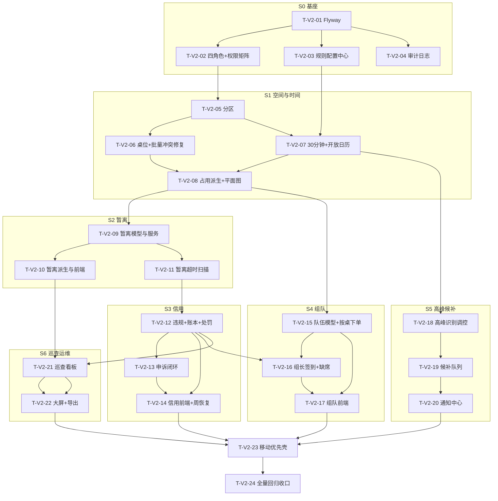

# 图书馆座位预约系统 V2 — 任务分解（开发计划）

> 上游：`docs/PRD-V2.md`（需求与 26 条验收基准）　|　`docs/DESIGN-V2.md`（架构/表/接口/迁移）　|　基线：V1 已收口（git `f17f4cf`…`8a4b00d`，mvn 120/120）
> 约定：任务 ID `T-V2-xx`。**按片（S0→S7）串行推进，片内可并行**；每片结束必须回到「可运行、可演示、可回归」状态。
> **每片统一交付门槛（不达标不得进入下一片）**：
> 1. `mvn clean test` 全绿（新增用例覆盖本片规则）；2. `npm run build` EXITCODE=0；
> 3. 冒烟脚本跑通并更新期望表；4. 浏览器端到端走通本片主链路且 console 无 error；
> 5. 清库重启种子可再生且幂等；6. 独立提交（一次提交一件事）+ 证据归档到 `.workbuddy/regression-YYYY-MM-DD/`。

---

> ★ **迁移编号以 `backend/src/main/resources/db/migration/{h2,mysql}/` 目录为准**。
> 本文各任务初稿写的 `Vn__` 是计划编号，落库时按「一片一版本」拆开了
> （例如初稿的 `V9__peak_waitlist_notice.sql` 实际是 V11 高峰 / V12 候补 / V13 通知三版）。
> 已落库脚本不能回改（破 Flyway checksum），所以只能改文档 —— 2026-10-05 已逐条对齐，
> 完整清单见 `DESIGN-V2.md` §14。

## 0. 环境准备（一次性）

```powershell
# 后端（JDK 路径含空格必须加引号）
$env:JAVA_HOME = 'D:\JDK SE-21'
$env:PATH = "$env:JAVA_HOME\bin;$env:PATH"
& 'C:\Users\18500\.workbuddy\binaries\maven\apache-maven-3.9.9\bin\mvn.cmd' -v

# 前端
& 'D:\nodejs\npm.cmd' -v
```

**本机既有约定（V1 已验证，V2 必须遵守）**
- 后端跑 **8081**（8080 被宿主进程 `ApplicationWebServer` 占用，返回 404，不可停）：
  `& 'D:\JDK SE-21\bin\java.exe' -jar target\library-seat.jar --server.port=8081`
- 含中文的 `.ps1` **必须带 UTF-8 BOM**，否则 PS 5.1 在 GBK 环境按 ANSI 误读、解析期报错。
- 沙箱禁 `Remove-Item` / `Start-Process` → 删除用 `[System.IO.Directory]::Delete($p,$true)`，起进程用后台任务。
- **测试隔离**：所有测试类共享同一内存库（`ApiTestBase` 无清理）。凡「计数 / 全库扫描」类断言必须用 `newUser()` 隔离用户；注意 `SchedulerApiTest` 有 `hour < 10` 早退分支，上午的"全绿"可能是跳过式通过。
- **前端新增任何顶层路由，必须同步 `WebConfig.SpaFallbackController` 白名单**，否则刷新白屏（V1 真实事故）。
- 定时任务的写操作一律放独立 `@Service` Bean（如 `ReservationStateService`），**不得同类 `this.` 自调用**（Spring 代理被绕过 → 事务静默失效）。

---

## 1. S0 基座（Flyway + 四角色 + 规则配置 + 审计）

### T-V2-01　接入 Flyway，建表权移交

| 项 | 内容 |
| --- | --- |
| 前置依赖 | 无 |
| 优先级 | P0 |
| 涉及文件 | `backend/pom.xml`（+`flyway-core`）<br/>`backend/src/main/resources/application.yml`（停 `spring.sql.init`，加 `spring.flyway.*`）<br/>`backend/src/main/resources/db/migration/h2/V1__baseline.sql`（由现 `sql/schema-h2.sql` 逐字迁移）<br/>`backend/src/main/resources/db/migration/mysql/V1__baseline.sql`<br/>删除 `resources/sql/schema-*.sql`（迁移完成后）<br/>`backend/src/test/resources/application-test.yml`（测试库仍用内存 H2，Flyway 关闭或独立目录） |

**要点**
- `spring.flyway.baseline-on-migrate=true`、`baseline-version=1`：老 H2 文件库（已有 V1 表）首次启动打基线而不重建。
- `spring.sql.init.mode=never`：**必须**，否则与 Flyway 双跑建表。
- H2 与 MySQL 分目录（`db/migration/h2`、`db/migration/mysql`），由 profile 决定 `locations`。
- 测试环境：`spring.flyway.enabled=true` + 内存库，让迁移脚本本身被测试覆盖。

**验收标准**
1. 删除 `backend/data/` 后启动 → 日志出现 `Successfully applied 1 migration`，5 张表建齐。
2. 用 V1 遗留库（含数据）启动 → 不报错、不重复建表、`t_user` 数据仍在（基线场景）。
3. 二次启动 → `Schema ... is up to date. No migration necessary.`（幂等）。
4. `mvn clean test` 120/120 不退化。

---

### T-V2-02　角色升级与权限矩阵

| 项 | 内容 |
| --- | --- |
| 前置依赖 | T-V2-01 |
| 优先级 | P0 |
| 涉及文件 | `enums/UserRole.java`（改为 STUDENT/TEACHER/LIBRARIAN/SYS_ADMIN）<br/>`security/RolePermission.java`（**新增**，路径前缀→角色集合）<br/>`security/JwtAuthInterceptor.java`（改用矩阵）<br/>`service/AuthService.java`（注册仅允许 STUDENT/TEACHER；后台账号不开放注册）<br/>`dto/AuthDTO.java`（role 字段校验）<br/>`seed/DataInitializer.java`（新增 teacher1 / librarian1）<br/>`db/migration/*/V2__role.sql`（角色值 UPDATE + `t_user` 新列 `credit_score`/`student_no`/`active_finish_streak`）<br/>前端：`constants/index.js`（角色常量）、`router/RequireAuth.jsx`、`store/AuthContext.jsx`、`layouts/*` |

**要点**
- 迁移 SQL 顺序：`UPDATE t_user SET role='STUDENT' WHERE role='USER';` → `UPDATE t_user SET role='SYS_ADMIN' WHERE role='ADMIN';`
- `RolePermission.RULES` 是权限的**唯一来源**，按最长前缀命中；未命中 4030。禁止在 Controller 里再写 `if (role == ...)` 的入口级判断（业务级资格判断放 Service，见 T-V2-08）。
- 旧 token（role=USER/ADMIN）解析失败 → 4010 强制重登，不做双版本兼容。
- 前端：学生端与管理端按角色分流；`/staff/*` 新命名空间与 `AdminLayout` 并列（`StaffLayout` 在 T-V2-21 建，本片先给路由占位与守卫）。

**验收标准**
1. 四个演示账号分别登录，落地页与可见菜单符合矩阵（学生→`/floors`，教师→`/floors`，馆员→`/staff/usage` 占位，管理员→`/admin/statistics`）。
2. `POST /api/auth/register` 传 `role=SYS_ADMIN` → 仍注册为 STUDENT；注册 LIBRARIAN 角色请求 → 4001。
3. 越权矩阵：STUDENT 调 `/api/staff/**` → 4030；LIBRARIAN 调 `/api/admin/rules` → 4030；LIBRARIAN 调 `/api/staff/usage` → 200。
4. V1 时代的旧 token 调任何接口 → 4010。
5. 后端权限矩阵有独立单测（每个前缀 × 每个角色，含未命中分支）。

---

### T-V2-03　规则配置中心

| 项 | 内容 |
| --- | --- |
| 前置依赖 | T-V2-01 |
| 优先级 | P0 |
| 涉及文件 | `db/migration/*/V3__rule_audit.sql`（`t_rule_config` + 默认规则种子）<br/>`entity/RuleConfig.java`、`repository/RuleConfigRepository.java`<br/>`service/RuleConfigService.java`（**内存快照 + 写后刷新 + 60s TTL**）<br/>`common/BizConstants.java`（注释降级为"兜底默认值"）<br/>`controller/AdminRuleController.java`、`dto/RuleDTO.java`<br/>前端 `pages/admin/RuleManage.jsx` + `api/admin.js` |

**要点**
- 读写接口：`GET /api/admin/rules?rgroup`、`PUT /api/admin/rules`（批量，带旧值校验）；写入即刷新快照 + 写审计（T-V2-04）。
- 值类型强校验（INT/BOOL/TIME/STRING），非法值 → 4001 且**不落库**。
- 提供 `GET /api/admin/rules/consistency`：比对 `sum(t_credit_log.delta)` 与 `t_user.credit_score`（S3 后生效，本片先留接口）。
- 关键默认值一次配齐：`credit_enforce_enabled`（演示可关）、`suspect_min`、`waitlist_offer_window_min`（默认 10）、`slot_minutes=30`。

**验收标准**
1. 改 `open_time` 后立即生效（无需重启），`/api/config/slots` 返回的时段随之变化。
2. 写入非法值（`max_duration_min=abc`）→ 4001 且原值不变。
3. 配置变更在审计日志中可查到（新旧值齐全）。
4. `BizConstants` 兜底路径有单测（配置表清空后仍能启动并走默认值）。

---

### T-V2-04　审计日志骨架

| 项 | 内容 |
| --- | --- |
| 前置依赖 | T-V2-01 |
| 优先级 | P0 |
| 涉及文件 | `entity/AuditLog.java`、`repository/AuditLogRepository.java`、`service/AuditService.java`、`controller/AdminAuditController.java`、`db/migration/*/V3__rule_audit.sql`（`t_audit_log`） |

**要点**：`record(action, targetType, targetId, detailJson)` 从 `UserContext` 取 actor；接入点：规则变更、强制释放、违规撤销、申诉裁定、账号角色变更、空间删除。审计写失败**不得影响主业务事务**（`REQUIRES_NEW` 或 try-catch + 日志）。

**验收标准**：① 上述动作各产生一条审计记录且 detail 可读；② `GET /api/admin/audit?from&to&action` 分页正确；③ 非 SYS_ADMIN 访问 → 4030；④ 审计异常不回滚主业务（集成测试构造审计抛错场景）。

---

## 2. S1 空间与时间（分区 / 桌位 / 30 分钟 / 开放日历）

### T-V2-05　分区建模与座位归属迁移

| 项 | 内容 |
| --- | --- |
| 前置依赖 | T-V2-01, T-V2-02 |
| 优先级 | P0 |
| 涉及文件 | `db/migration/*/V4__space_zone.sql`（建 `t_zone`、`t_seat.zone_id`、回填、`uk_zone_floor_code`）<br/>`entity/Zone.java`、`enums/ZoneType.java`、`repository/ZoneRepository.java`<br/>`service/ZoneService.java`（CRUD + 规则解析 + 可见性过滤）<br/>`controller/ZoneController.java`（学生面）、`controller/StaffZoneController.java`（管理面）<br/>`dto/ZoneDTO.java`<br/>`seed/DataInitializer.java`（3 楼层各建 2~3 个分区并回填座位） |

**要点**
- 分区规则字段按 DESIGN §2.1 全量落地；`visible_roles`/`eligible_roles` CSV 写入时校验枚举合法。
- 座位旧 `zone` 文本列保留只读兼容，新代码读 `zone_id`。
- 学生面 `/api/zones?date&slot` 返回：分区基本信息 + 总座/空闲/占用率 + `peakFlag` + `leaveAllowed` + `maxDurationMin`（**有效值**，已叠加当日与高峰压缩）。
- 删除分区前校验：存在未来有效预约 → 4109。

**验收标准**
1. 迁移后每个座位都有 `zone_id`，无孤儿（SQL 断言 `zone_id IS NULL` 计数为 0）。
2. 教师专区（`visible_roles` 不含 STUDENT）对学生面不可见；教师面可见。
3. 分区 CRUD + 状态切换生效；删除有未来预约的分区 → 4109。
4. `GET /api/zones` 响应不含任何占用人身份信息。

---

### T-V2-06　桌位建模 + 批量生成冲突修复

| 项 | 内容 |
| --- | --- |
| 前置依赖 | T-V2-05 |
| 优先级 | P0 |
| 涉及文件 | `db/migration/*/V5__seat_table.sql`（建 `t_table`、`t_seat.table_id`、`uk_seat_pos`）<br/>`entity/SeatTable.java`（避开 java.sql.Table 歧义，表名仍 `t_table`）、`repository/SeatTableRepository.java`<br/>`service/TableService.java`<br/>`service/AdminSeatService.java`（**改**：批量生成支持 `zoneId/tableId`、冲突预览、`skipConflicting`）<br/>`controller/StaffTableController.java`、`dto/TableDTO.java`<br/>前端 `pages/admin/TableManage.jsx`、`pages/admin/SeatBatchModal.jsx`（改造） |

**要点**
- **修 V1 遗留缺陷**：批量生成不再与既有座位同格重叠。先 `batch-preview` 返回冲突行列清单，正式生成默认跳过冲突并返回 `skippedPositions`。
- 迁移前先跑冲突检测脚本；若历史数据存在有意重叠，`uk_seat_pos` 降级为 Service 校验并在代码注释说明原因（不得静默放弃约束）。
- 桌位创建时 `seat_count` 与实际座位数不一致 → 校验提示；桌位删除需先迁移/删除其座位。

**验收标准**
1. 对已有 60 座的楼层执行 `rows=1,cols=3,prefix=Z,startNo=1` → `created=0, skipped=3` 且 `skippedPositions` 列出 (1,1)(1,2)(1,3)；平面图无重叠。
2. `uk_seat_pos` 存在（或降级方案有注释与测试）。
3. 桌位 CRUD + 按桌生成 4 座 → 平面图同桌座位相邻且 `table_id` 一致。
4. 非馆员调用 → 4030。

---

### T-V2-07　30 分钟时段与开放日历

| 项 | 内容 |
| --- | --- |
| 前置依赖 | T-V2-05 |
| 优先级 | P0 |
| 涉及文件 | `db/migration/*/V6__open_time.sql`（slot ×2 迁移 + `t_open_profile` + `t_open_calendar` + `t_peak_window` + 种子）<br/>`common/BizConstants.java`（slot 编码常量改造：`SLOT_MINUTES=30`、`slotOf(LocalTime)`、`slotToMinute`）<br/>`entity/OpenProfile.java`、`entity/OpenCalendar.java`、`entity/PeakWindow.java` + 三个 Repository<br/>`service/OpenRuleService.java`（`resolve(date)` → 当日生效规则）<br/>`service/FloorService.java`（`/api/config/slots` 改造）<br/>`controller/AdminOpenRuleController.java`、`dto/OpenRuleDTO.java`<br/>前端 `utils/datetime.js`（slot ↔ 时间）、`constants/index.js`、`pages/SeatMap.jsx` 时段选择器 |

**要点**
- 编码唯一口径：`slot = (hour*60+minute)/30`，`end_slot` 开区间。**内部格长固定 30 分钟**，60 分钟只是时长选项限制。
- 迁移语句：`UPDATE t_reservation SET start_slot=start_slot*2, end_slot=end_slot*2;` 与 `UPDATE t_reservation_slot SET slot_index=slot_index*2;`（同事务、同脚本）。
- 日型解析链：calendar 覆盖 → profile(day_type) → 全局默认；临时闭馆 `closed=true` 时该日不可预约且平面图全灰。
- 时段选项接口返回：`slotIndex/label("07:30-08:00")/bookable/reason/peak/isCurrent`，**bookable 判定含规则，前端不重复实现**。

**验收标准**
1. 迁移后历史预约的时段标签与 V1 语义一致（V1 的 14 时段 → V1 的 28 个半小时格区间，抽样核对 5 条）。
2. `/api/config/slots?date=<工作日>` 返回 30 分钟格；周末日期返回不同的开闭馆时间。
3. 在 `t_open_calendar` 标记某日闭馆 → 该日预约返回 4001 且平面图全 `UNAVAILABLE`。
4. 时段选择器在 07:30–22:30 下共 30 项，标签格式 `HH:mm-HH:mm` 全站唯一（B2 约定延续）。
5. 新增单测：slot 编码往返、跨闭馆判定、日型解析（含 calendar 覆盖）。

---

### T-V2-08　占用派生升级与平面图按分区渲染

| 项 | 内容 |
| --- | --- |
| 前置依赖 | T-V2-06, T-V2-07 |
| 优先级 | P0 |
| 涉及文件 | `service/OccupancyService.java`（返回 `SeatOccupancy`）<br/>`enums/SeatDisplayStatus.java`（预留 `ON_LEAVE`，本片不产出该态）<br/>`service/FloorService.java`（`getSeatMap` 支持 `zoneId` 过滤 + 分区有效规则）<br/>`dto/SeatDTO.java`（`SeatMapVO` 增 `zoneId/zoneName/rules/peakFlag`）<br/>`service/AdminStatisticsService.java`（统计口径改 30 分钟 + 分区维度）<br/>前端 `components/SeatGrid.jsx`、`pages/SeatMap.jsx`（分区 Tab）、`pages/FloorList.jsx`（分区余量卡） |

**要点**
- 平面图/楼层余量/分区余量/利用率**必须仍走同一个 `OccupancyService`**（V1 单一入口原则）。
- 分区资格校验（`eligible_roles` + `t_zone_grant`）在 Service 层，越权预约 → 4031。
- 统计接口全部改为 30 分钟格 + 分区维度；时段热度图 30 项。

**验收标准**
1. `/api/seats/map?floorId=1&zoneId=2&date&slot` 只返回该分区座位，且带该分区有效规则。
2. 学生预约教师专区座位 → 4031；教师 → 成功。
3. 楼层/分区/平面图三处空闲数完全一致（同一时刻）。
4. 统计页 4 图正常（时段热度 30 柱、楼层利用率含分区下钻）。
5. 平面图 200 座渲染无卡顿、接口 P95 < 500ms（本地实测记录到证据目录）。

---

## 3. S2 暂离（用户核心诉求）

### T-V2-09　暂离数据模型与规则服务

| 项 | 内容 |
| --- | --- |
| 前置依赖 | T-V2-08 |
| 优先级 | **P0（最高优先）** |
| 涉及文件 | `db/migration/*/V7__leave.sql`（`t_leave_reason`/`t_leave_record` + `uk_leave_open` + 原因种子；`t_user` 信用列已在 V2 建好）<br/>`entity/LeaveRecord.java`、`entity/LeaveReason.java` + Repository<br/>`enums/LeaveStatus.java`<br/>`service/LeaveService.java`（start/returnBack 校验链 DESIGN §5.2）<br/>`controller/LeaveController.java`、`dto/LeaveDTO.java`<br/>`service/ReservationService.java`（新增 `finish` 主动结束） |

**要点**
- 7 步校验顺序严格照 DESIGN §5.2；`planned_end` 双重封顶（分区上限 + 预约结束时间），**剩余不足按剩余封顶而非报错**。
- `open_flag` 技巧保证"一条预约至多一条 OPEN 暂离"，由唯一索引兜底（不靠先查后插）。
- 每日次数按**自然日**统计（`start_time` 落在今天）。
- 主动结束使用：`COMPLETED` + 删 slot + `active_finish_streak++`（每满 5 次给 +5 分，S3 前只累计不加分，代码留 TODO 挂钩点）。

**验收标准**
1. `CHECKED_IN` 后登记暂离 → 成功且 `planned_end = min(now+reason, zone 上限, 预约结束)`。
2. 电子阅览区暂离 → 4095；已在暂离中再登记 → 4097；当日第 4 次（静音区 limit=3）→ 4096；`CLASS` 原因不填事由 → 4001。
3. 「我已返回」→ 状态 `RETURNED`、`open_flag=NULL`、座位回 `IN_USE`，且**剩余使用时间不顺延**（断言结束时间未变）。
4. 并发登记两条同预约暂离 → 仅一条成功（唯一索引），另一条 4091/4097 语义明确。
5. 取消/结束后不允许再登记暂离（4093）。

---

### T-V2-10　暂离状态派生与前端呈现

| 项 | 内容 |
| --- | --- |
| 前置依赖 | T-V2-09 |
| 优先级 | P0 |
| 涉及文件 | `service/OccupancyService.java`（`leaveUntil` 派生）<br/>`enums/SeatDisplayStatus.java`（`ON_LEAVE`）<br/>`dto/SeatDTO.java`（`expectedReturnAt`）<br/>前端 `constants/index.js`（`ON_LEAVE: {text:'暂离中', color:'#1677ff', marker:'⌛'}`）、`components/SeatLegend.jsx`、`components/SeatGrid.jsx`、`styles/seat.css`、`pages/MyReservations.jsx`（我的座位按钮组）、`api/reservation.js` |

**要点**
- 平面图必须显示「暂离中 · 预计 14:35 返回」文案（PRD §13.3：文案优先于颜色）；Tooltip 同步。
- 按钮可用性一律后端算：`canLeave/canReturn/canFinish/canCancel` + `disabledReason`（如「今日暂离次数已用完」）。
- 图例新增第 5 态，色盲友好第二重标识为 `⌛`。

**验收标准**
1. 暂离期间平面图该座位为蓝色 `⌛` 且文案含预计返回时刻；返回后回红色 `●●`。
2. `GET /api/seats/map` 响应仍不含占用人身份。
3. 浏览器端到端：签到 → 暂离（平面图变蓝）→ 返回（变红）→ 结束（变绿）四步全部可见且 console 无 error。
4. 按钮置灰时 Tooltip 给出具体原因，无"只置灰不给理由"的情况。

---

### T-V2-11　暂离超时扫描与释放

| 项 | 内容 |
| --- | --- |
| 前置依赖 | T-V2-09 |
| 优先级 | P0 |
| 涉及文件 | `service/LeaveStateService.java`（**独立 Bean，`@Transactional`**）<br/>`scheduler/ReservationScheduler.java`（新增 `scanLeaveTimeout`，仅判定 + 经代理调用 + 逐条 try-catch）<br/>`enums/ReservationStatus.java`（新增 `VIOLATED`）<br/>`test/…/LeaveTimeoutApiTest.java` |

**要点**
- 动作：预约置 `VIOLATED`、物理删除该预约全部 slot、暂离记录置 `TIMEOUT`、`open_flag=NULL`；**扣分与违规记录在 S3 接入**，本片先写 `t_user.no_show_count` 兼容字段并在代码标注 `// TODO(S3): CreditService.applyViolation(LEAVE_TIMEOUT)`。
- 释放后必须触发候补挂钩点（S5 前为 no-op 接口 `WaitlistService.onSeatReleased`，本片先建空实现以免后续改核心链路）。

**验收标准**
1. 造一条 `planned_end` 已过 1 分钟的 OPEN 暂离 → 1 分钟内变 `TIMEOUT`、预约 `VIOLATED`、slot 行数为 0、平面图回 `FREE`。
2. 单条脏数据（关联预约缺失）不中断整轮扫描（日志有 error，其余记录仍处理）。
3. 事务性：人为让 slot 删除抛错 → 预约状态回滚（不得出现"已归档但座位仍占用"的脏状态，这是 V1 修过的缺陷）。
4. 重复扫描幂等（不重复计数）。

---

## 4. S3 信用、违规与申诉

### T-V2-12　违规与信用账本 + 处罚阶梯

| 项 | 内容 |
| --- | --- |
| 前置依赖 | T-V2-11 |
| 优先级 | P0 |
| 涉及文件 | `db/migration/*/V8__credit.sql`（`t_violation`/`t_credit_log`/`t_penalty` + 历史 `no_show_count` 折算）<br/>`entity/{Violation,CreditLog,Penalty}.java` + Repository<br/>`enums/{ViolationType,PenaltyType}.java`<br/>`service/CreditService.java`（**applyViolation 唯一入口**）<br/>`service/PenaltyService.java`<br/>`service/ReservationService.java`（校验链插入处罚闸门 + 单日累计）<br/>`service/ReservationStateService.java`、`LeaveStateService.java`（改为调用 `CreditService`）<br/>`test/…/CreditPenaltyApiTest.java` |

**要点**
- `applyViolation` 单事务内完成：写违规（**无证据 JSON 直接抛异常**）→ 扣分（`max(0, …)`）→ 写 `t_credit_log(balance_after)` → 评估阶梯生成 `t_penalty`（幂等：同类 ACTIVE 只延长）→ 写通知。
- 预约闸门：`BOOK_BAN_*`（ACTIVE 且未过期）→ 4100（带恢复时间）；`PEAK_BAN` 且目标时段命中高峰 → 4101。
- 单日累计上限：`daily_cap_min`（考试周 8h）→ 4098，返回已用/上限分钟。
- `credit_enforce_enabled=false` 时只记录不限制（演示逃生阀，DESIGN §17-6）。

**验收标准**
1. 爽约/暂离超时/组队缺席分别产生违规，扣分 -10/-10/-10，组长缺席 -20，现场占座 -15。
2. 分数跌破 90/70/50/1 时自动生成对应 `PEAK_BAN/BOOK_BAN_3D/BOOK_BAN_7D/SEMESTER_BAN`，且重复违规不产生第二条同类 ACTIVE。
3. 受限用户预约 → 4100 且文案含恢复时间；`credit_enforce_enabled=false` 后可正常预约。
4. 单日累计超 6h → 4098（先约 4h 再约 3h 场景）。
5. `sum(t_credit_log.delta)` 与 `t_user.credit_score` 一致（consistency 接口断言）。

---

### T-V2-13　申诉闭环

| 项 | 内容 |
| --- | --- |
| 前置依赖 | T-V2-12 |
| 优先级 | P1（本轮做，可降级为"仅撤销"） |
| 涉及文件 | `db/migration/*/V9__appeal.sql`（`t_appeal` + `uk_appeal_violation`）<br/>`entity/Appeal.java`、`service/AppealService.java`、`controller/AppealController.java`（学生面）、`controller/StaffAppealController.java`<br/>`dto/AppealDTO.java`、`test/…/AppealApiTest.java` |

**要点**：24h 时限（超期 4108）；一条违规一次申诉（唯一索引兜底）；成立 → 违规 `REVOKED` + 反向补分（写 `RESTORE` 流水，**不改历史**）+ 解除本次扣分触发的处罚；驳回附理由；学生可升级 → SYS_ADMIN 终审 `FINAL_JUDGED`（终态）。裁定页渲染违规 `evidence` JSON 的可读视图。

**验收标准**
1. 申诉成立后信用分回补、处罚解除、历史流水完整可追溯。
2. 馆员只能裁定、不能撤销他人裁定的终态；终审后不可再申诉。
3. 超 24h 申诉 → 4108；重复申诉 → 4108。
4. 全部裁定动作进审计日志。

---

### T-V2-14　信用前端与周恢复

| 项 | 内容 |
| --- | --- |
| 前置依赖 | T-V2-12, T-V2-13 |
| 优先级 | P1 |
| 涉及文件 | 前端 `pages/Credit.jsx`（分数/处罚/违规明细/证据/申诉入口/恢复进度）、`pages/admin/ViolationManage.jsx`、`pages/staff/AppealQueue.jsx`、`api/credit.js`<br/>后端 `scheduler/WeeklyCreditTask.java`<br/>`pages/Profile.jsx`（信用分入口卡片） |

**验收标准**
1. 学生能看到每条违规的时间线、规则依据、扣分、申诉状态。
2. 连续 5 次主动结束 → +5 分并在流水中可见；上一自然周无违规 → 周一 +5。
3. 馆员队列页可按状态筛选申诉，裁定弹窗必填理由。
4. 浏览器端到端：违规 → 申诉 → 成立回补 → 学生端分数变化，全链路 console 无 error。

---

## 5. S4 组队学习

### T-V2-15　队伍模型与按桌下单

| 项 | 内容 |
| --- | --- |
| 前置依赖 | T-V2-06, T-V2-08 |
| 优先级 | P1 |
| 涉及文件 | `db/migration/*/V10__group.sql`<br/>`entity/{Group,GroupMember}.java` + Repository、`enums/{GroupStatus,MemberInviteStatus}.java`<br/>`service/GroupService.java`（建队/邀请/确认/锁定下单）<br/>`controller/GroupController.java`、`dto/GroupDTO.java`<br/>`test/…/GroupBookingApiTest.java` |

**要点**
- **不新建占用表**：锁定后按桌位座位逐条创建 `reservation`（共享 `group_id`），并发防重仍由 `uk_slot_seat_date_idx` 保证；任一座位被抢 → 整单事务回滚 + 4091（"要么整桌成功，要么不动"）。
- `group_required` 分区不接受个人预约 → 4102。
- 邀请码 6 位、10 分钟有效；成员 10 分钟未确认 → `EXPIRED`；`lock_time`（开始前 30 分钟）后禁止增减 → 4104。
- 人数 < `min_members` 到锁定时刻 → 队伍 `FAILED` + 全员通知。

**验收标准**
1. 组长建队 → 邀请 3 人确认 → 锁定 → 桌位 4 座各生成 1 条 reservation 且 `group_id` 相同、slot 行数正确。
2. 锁定前桌位中 1 座被他人预约 → 整单失败、无任何 reservation/slot 残留（断言回滚干净）。
3. 非组长取消/改约 → 4031；锁定后加人 → 4104。
4. 邀请码过期/错误 → 4105；研讨协作区个人预约 → 4102。

---

### T-V2-16　组长签到与缺席处理

| 项 | 内容 |
| --- | --- |
| 前置依赖 | T-V2-15, T-V2-12 |
| 优先级 | P1 |
| 涉及文件 | `service/GroupStateService.java`（独立 Bean + `@Transactional`）<br/>`scheduler/ReservationScheduler.java`（`scanGroupAttendance`）<br/>`enums/AttendStatus.java`<br/>`service/GroupService.java`（`checkInByLeader`、`confirmAttend`）<br/>`test/…/GroupAttendanceTest.java` |

**要点**：组长签到 → 该组全部 reservation 置 `CHECKED_IN`（成员 `attend_status=UNKNOWN`）；成员 30 分钟未入座 → `ABSENT` + 违规 -10，**slot 不删（座位保留给队伍）**；组长未签到 → 全队 `CANCELLED` + 删 slot + 组长 -20。

**验收标准**
1. 组长签到后 4 座全部 `CHECKED_IN`，平面图 4 座同时变红。
2. 1 名成员缺席 → 该成员违规记录 + 座位仍为占用态（关键断言：**不释放**）。
3. 组长缺席 → 全队取消、slot 清空、组长 -20、成员不记违规。
4. 扫描幂等，重复执行不重复扣分。

---

### T-V2-17　组队前端

| 项 | 内容 |
| --- | --- |
| 前置依赖 | T-V2-15, T-V2-16 |
| 优先级 | P1 |
| 涉及文件 | 前端 `pages/GroupCreate.jsx`、`pages/MyGroup.jsx`、`components/GroupPanel.jsx`、`api/group.js`、`pages/SeatMap.jsx`（桌位选择模式）、`router/index.jsx` + **`WebConfig` SPA 白名单同步** |

**验收标准**：建队→邀请→确认→锁定→组长签到全流程可视化；桌位选择模式下整桌高亮预览；成员列表显示邀请状态；新路由刷新不白屏。

---

## 6. S5 高峰调控与候补

### T-V2-18　高峰识别与调控

| 项 | 内容 |
| --- | --- |
| 前置依赖 | T-V2-07, T-V2-12 |
| 优先级 | P1 |
| 涉及文件 | `entity/{PeakWindow,ZonePeakState}.java` + Repository<br/>`service/PeakService.java`（静态命中 + 动态占用率滑窗）<br/>`scheduler/PeakDetectTask.java`（5 分钟）<br/>`service/ReservationService.java`（时长压缩 + 提前开放闸门）<br/>`test/…/PeakRuleApiTest.java` |

**验收标准**
1. 高峰时段单次上限自动压至 `peak_compress_min`（教师用 `teacher_duration_min`）；超限 → 4101 且提示压缩后上限。
2. 高峰时段在「前一天 22:00」前不可预约 → 4101 带开放时刻文案。
3. 分区占用率 ≥90% 持续 15 分钟 → `peakFlag=true`，余量卡片与平面图显示高峰提示。
4. 信用 `PEAK_BAN` 用户仅高峰时段被拒，非高峰可约。

---

### T-V2-19　候补队列

| 项 | 内容 |
| --- | --- |
| 前置依赖 | T-V2-18, T-V2-11（释放挂钩点） |
| 优先级 | P2（可延至下一轮） |
| 涉及文件 | `db/migration/*/V12__waitlist.sql`（`t_waitlist` + `uk_waitlist_active`）<br/>`entity/Waitlist.java`、`enums/WaitlistStatus.java`<br/>`service/WaitlistService.java`（join/confirm/quit/**onSeatReleased**）<br/>`service/WaitlistStateService.java` + `scheduler/WaitlistExpireTask.java`（每分钟）<br/>`controller/WaitlistController.java`、`test/…/WaitlistApiTest.java` |

**要点**：每人活动队列 ≤2 → 4106；释放同事务内推送 offer 给队首（窗口默认 10 分钟，可配）；确认前须先取消冲突时段自有预约；超时 `EXPIRED` 顺延下一位且**不记违规**。

**验收标准**
1. 满座分区加入候补 → 有人释放后队首收到 offer；第二位在队首过期后收到。
2. 窗口内确认 → 生成正常预约（走完整校验链）；不确认 → 顺延，无人被记违规。
3. 同人同（分区,日期,起始时段）重复排队 → 4106（唯一索引兜底）。
4. 并发释放与确认 → 不产生同一 slot 两条预约。

---

### T-V2-20　通知中心

| 项 | 内容 |
| --- | --- |
| 前置依赖 | T-V2-19 |
| 优先级 | P1（候补与暂离提醒都依赖它） |
| 涉及文件 | `db/migration/*/V13__notice.sql`（`t_notice`）<br/>`entity/Notice.java`、`service/NoticeService.java`、`controller/NoticeController.java`<br/>`scheduler/ReminderTask.java`（签到前 15 分钟 / 暂离剩 5 分钟，按 `type+ref` 幂等）<br/>前端 `components/NoticeBell.jsx`（复用平面图轮询通道）、`api/notice.js` |

**验收标准**：三类通知（候补 offer、暂离到期、违规即时）均产生且可读、可标已读、未读数正确；同一条不重复生成；**明确文档化"无第三方推送，推送=站内通知+轮询"**。

---

## 7. S6 巡查与运维

### T-V2-21　巡查任务生成与看板

| 项 | 内容 |
| --- | --- |
| 前置依赖 | T-V2-10, T-V2-12 |
| 优先级 | P1 |
| 涉及文件 | `db/migration/*/V14__patrol.sql`（`t_patrol_task` + `uk_patrol_open` + 巡查阈值种子）<br/>`entity/PatrolTask.java`、`enums/{PatrolType,PatrolStatus}.java`<br/>`service/PatrolService.java`（生成 + 四种处置）<br/>`scheduler/PatrolTaskGenerator.java`（10 分钟）<br/>`controller/StaffPatrolController.java`、`dto/PatrolDTO.java`<br/>前端 `layouts/StaffLayout.jsx`、`pages/staff/PatrolBoard.jsx`、`pages/staff/UsageBoard.jsx`<br/>`test/…/PatrolApiTest.java` |

**要点**：三条生成规则（连续使用 ≥`suspect_min`、组队未入座、到期仍占）+ 馆员人工登记；**机器绝不自动释放**；`RELEASE` 复用强制释放（必填原因 + 通知 + 审计），`VIOLATION` 走 `CreditService.applyViolation(ON_SITE_OCCUPY,-15)` 并固化证据。

**验收标准**
1. 造"签到后 2 小时无暂离"数据 → 10 分钟内生成 HIGH 级任务，且同一座位不重复生成（`uk_patrol_open`）。
2. 处置为 RELEASE → 座位释放 + 学生收到通知 + 审计留痕；处置为 VIOLATION → 违规含证据 JSON 可渲染。
3. 馆员面权限：学生/管理员各自 4030/200 正确。
4. 看板按楼层/等级/状态筛选，处置弹窗必填说明。

---

### T-V2-22　监控大屏、导出与变更历史

| 项 | 内容 |
| --- | --- |
| 前置依赖 | T-V2-21 |
| 优先级 | P2（大屏可降级为表格版） |
| 涉及文件 | `controller/StaffDashboardController.java`、`service/StaffDashboardService.java`（单接口聚合）<br/>`service/ExportService.java`（CSV：预约/违规/巡查/信用）<br/>`controller/AdminExportController.java`<br/>前端 `pages/staff/Dashboard.jsx`、`pages/admin/RuleHistory.jsx` |

**验收标准**：大屏单接口返回全馆热力 + 分区占用 + 异常数（<1s）；CSV 导出中文不乱码（UTF-8 BOM）；规则变更历史可查任意字段前后值。

---

## 8. S7 体验收口

### T-V2-23　移动优先壳与无障碍

| 项 | 内容 |
| --- | --- |
| 前置依赖 | S0–S6 |
| 优先级 | P1 |
| 涉及文件 | 前端 `layouts/MobileLayout.jsx`（底部 Tab：首页/找座/我的座位/信用/我的）、`/m/*` 路由、`styles/global.css`、`styles/seat.css`（热区 ≥44px、横向滚动不缩放）、`components/SeatGrid.jsx`（焦点可达 + `prefers-reduced-motion`）<br/>`db/migration/*/V19__seed_demo.sql`（**本片未做**，仍欠，见 DESIGN-V2 §14）（演示数据补齐：教师/馆员账号、分区样例、历史违规样例）<br/>**`WebConfig.SpaFallbackController` 同步新增 `/m`、`/m/**` 白名单** |

**验收标准**：375px 宽度下主流程（找座→点座→确认）≤3 次点击；键盘 Tab 可达全部操作且焦点可见；`prefers-reduced-motion` 下无动画；`/m/seat` 等深链刷新不白屏。

---

### T-V2-24　V2 全量回归与文档收口

| 项 | 内容 |
| --- | --- |
| 前置依赖 | S0–S7 |
| 优先级 | P0 |
| 涉及文件 | `docs/api-smoke.ps1`（升级为 V2 冒烟：新增暂离/信用/组队/高峰/巡查步骤，含 UTF-8 BOM）<br/>`backend/src/test/**`（补齐规则矩阵、迁移、账本一致性、事务边界用例）<br/>`docs/DESIGN.md`（标注 V2 生效范围）、`docs/README.md`（启动与演示脚本）、`.workbuddy/memory/` |

**验收标准（V2 收口门）**
1. `mvn clean test` 全绿且**新增用例覆盖 PRD-V2 §12 的 26 条基准**（逐条映射表进证据目录）。
2. `npm run build` EXITCODE=0；单端口 jar 在 8081 部署后深链全部可刷新。
3. V2 冒烟脚本全步骤符合期望表（含权限矩阵四角色 × 三个命名空间）。
4. 浏览器端到端：学生「预约→签到→暂离→返回→结束」+「爽约→扣分→受限→申诉→回补」+「组队整桌→组长签到→成员缺席保留」+「满座排队→释放→offer→确认」四条链路全通过，console 无 error。
5. 清库重启种子（含分区/桌位/规则配置/四类账号）可再生且幂等；老 V1 库跑迁移后数据可继续正常使用（抽样核对预约时段与占用派生）。
6. 证据归档 + 记忆更新 + 分片提交齐全（每片至少一个可回退提交）。

---

## 9. 任务依赖图



**关键路径（必须串行）**：`T-01 → T-02 → T-05 → T-08 → T-09 → T-11 → T-12 → T-14 → T-23 → T-24`
（迁移基座 → 角色 → 分区 → 派生 → 暂离 → 超时 → 信用 → 前端 → 收口）

---

## 10. 并行建议与风险提示

| 阶段 | 可并行 | 说明 |
| --- | --- | --- |
| S0 | T-03 / T-04 与 T-02 | 规则与审计文件与安全层无冲突 |
| S1 | T-06 与 T-07 | 桌位 vs 时段，文件独立；T-08 必须等两者 |
| S2–S3 | 基本串行 | 暂离是信用扣分的主要来源 |
| S4 与 S5 | 可并行 | 组队与高峰候补互不触碰同一 Service（`group_id` 与 `waitlist` 无交集） |
| S6 与 S5 | 可并行 | 巡查依赖信用与派生，不依赖候补 |

**风险提示**
1. **T-V2-07（30 分钟迁移）是全局最高风险**：改的是时间语义本身，必须一次做完 + 迁移测试；禁止"部分接口先切"。
2. **T-V2-01 与 T-V2-07 都要动 `resources`**，注意 `spring.sql.init` 停用后 MySQL profile 也要验证。
3. **信用自动处罚会锁死演示账号**（V1 当年正因如此把惩罚后置）：演示前确认 `credit_enforce_enabled`，并在 README 写清恢复入口。
4. **测试隔离**：V2 新增大量"计数/全库扫描"逻辑（暂离次数、单日累计、候补顺延、巡查生成），每个都必须用 `newUser()` 隔离，否则重演 V1 的 flaky。
5. **候补体验受限于无推送**：窗口默认 10 分钟并在 UI 明示"请保持页面打开"，否则用户感知为"错过即没"。
6. 每片结束请回到 V1 的收口动作（清库幂等 + 冒烟 + 端到端），不要攒到最后一次验证。
