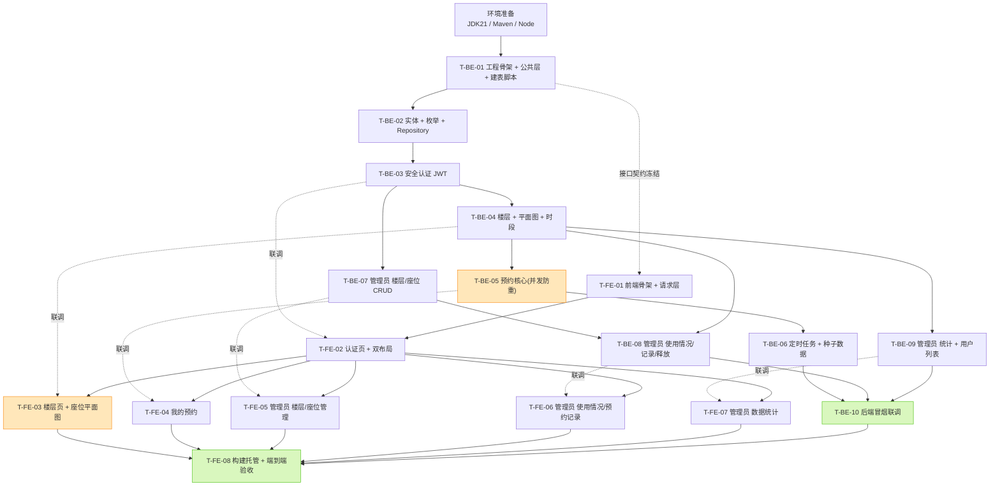

# 图书馆座位预约系统 — 任务分解（开发计划）

> 上游：`docs/DESIGN.md`（架构/表结构/接口清单）　|　`docs/PRD.md`（22 项 P0 需求）
> 约定：任务 ID `T-BE-xx` = 后端，`T-FE-xx` = 前端。**先按 BE-01 → BE-09 顺序把后端跑通，前端可并行起步**。
> 每个任务 = 工程师一次能完成的量（3~15 个文件）。

---

## 0. 环境准备（所有任务的前置，一次性完成）

```powershell
# 后端：每次新开 PowerShell 窗口都要先设 JAVA_HOME（JDK 路径含空格，必须加引号）
$env:JAVA_HOME = 'D:\JDK SE-21'
$env:PATH = "$env:JAVA_HOME\bin;$env:PATH"
& "$env:JAVA_HOME\bin\java.exe" -version          # 期望 21.0.2
& 'C:\Users\18500\.workbuddy\binaries\maven\apache-maven-3.9.9\bin\mvn.cmd' -v   # 期望 3.9.9

# 前端
& 'D:\nodejs\node.exe' -v        # 期望 v24.13.0
& 'D:\nodejs\npm.cmd' -v         # 期望 11.6.2
```

> ⚠ 本机 Bash 工具 PATH 初始化异常，**所有命令一律用 PowerShell 工具执行**。
> 目录约定：`D:\Project\LibraryReservation\backend`（Maven 工程）、`D:\Project\LibraryReservation\frontend`（Vite 工程）。

---

## 1. 后端任务（T-BE）

### T-BE-01　后端工程骨架 + 公共层 + 建表脚本

| 项 | 内容 |
| --- | --- |
| **前置依赖** | 无 |
| **优先级** | P0 |
| **涉及文件** | `backend/pom.xml`<br/>`backend/src/main/resources/application.yml`<br/>`backend/src/main/resources/application-h2.yml`<br/>`backend/src/main/resources/application-mysql.yml`<br/>`backend/src/main/resources/sql/schema-h2.sql`<br/>`backend/src/main/resources/sql/schema-mysql.sql`<br/>`backend/src/main/java/com/libseat/LibrarySeatApplication.java`<br/>`backend/src/main/java/com/libseat/common/Result.java`<br/>`backend/src/main/java/com/libseat/common/ErrorCode.java`<br/>`backend/src/main/java/com/libseat/common/BusinessException.java`<br/>`backend/src/main/java/com/libseat/common/GlobalExceptionHandler.java`<br/>`backend/src/main/java/com/libseat/common/PageResult.java`<br/>`backend/src/main/java/com/libseat/common/BizConstants.java`<br/>`backend/src/main/java/com/libseat/config/WebConfig.java`<br/>`backend/.gitignore` |

**要点**
- parent = `spring-boot-starter-parent:3.2.5`，`java.version=21`；依赖见 DESIGN §9.1。
- `application.yml`：`spring.profiles.active=h2`、`spring.jpa.hibernate.ddl-auto=none`、`spring.sql.init.mode=always`、`app.jwt.*`、`server.port=8080`。
- `schema-h2.sql` / `schema-mysql.sql` 按 DESIGN §3.2 / §3.3 逐字实现（5 张表 + 4 个唯一索引 + 6 个普通索引）。
- `BizConstants` 常量按 DESIGN §8.4。
- `WebConfig`：CORS 允许 `http://localhost:5173`；注册拦截器（本期先只加 CORS 与 fallback，拦截器在 T-BE-03 注册）。
- `GlobalExceptionHandler` 捕获：`BusinessException` / `MethodArgumentNotValidException` / `DataIntegrityViolationException`(→4091) / `Exception`(→5000)。

**验收标准**
1. `mvn.cmd clean package -DskipTests` 构建成功。
2. `mvn.cmd spring-boot:run` 启动成功，日志无 ERROR。
3. H2 console（`http://localhost:8080/h2-console`，URL `jdbc:h2:file:./data/library`）能看到 `T_USER / T_FLOOR / T_SEAT / T_RESERVATION / T_RESERVATION_SLOT` 5 张表及 `UK_SLOT_SEAT_DATE_IDX` 唯一索引。
4. 任意接口返回体为 `{code, message, data}` 结构。

---

### T-BE-02　实体层 + 枚举 + Repository

| 项 | 内容 |
| --- | --- |
| **前置依赖** | T-BE-01 |
| **优先级** | P0 |
| **涉及文件** | `entity/User.java`、`entity/Floor.java`、`entity/Seat.java`、`entity/Reservation.java`、`entity/ReservationSlot.java`<br/>`enums/UserRole.java`、`enums/FloorStatus.java`、`enums/SeatStatus.java`、`enums/ReservationStatus.java`、`enums/SeatDisplayStatus.java`<br/>`repository/UserRepository.java`、`repository/FloorRepository.java`、`repository/SeatRepository.java`、`repository/ReservationRepository.java`、`repository/ReservationSlotRepository.java` |

**要点**
- 全部 `@Table(name="t_xxx")`，枚举字段 `@Enumerated(EnumType.STRING)`。
- `Seat`：`@Table(uniqueConstraints=@UniqueConstraint(columnNames={"floor_id","seat_no"}))`。
- `ReservationSlot`：`@Table(uniqueConstraints=@UniqueConstraint(name="UK_SLOT_SEAT_DATE_IDX", columnNames={"seat_id","reserve_date","slot_index"}))`。
- 时间字段用 `@CreatedDate` 风格或直接在构造/`@PrePersist` 赋值；`update_time` 用 Hibernate `@UpdateTimestamp`。
- `ReservationRepository` 需提供：
  - `List<Reservation> findByUserIdAndStatusIn(Long userId, Collection<ReservationStatus> statuses)`
  - `int countByReserveDate(LocalDate date)`
  - `@Query` 用户时段重叠：`r.userId=?1 AND r.status IN (?2) AND r.reserveDate=?3 AND r.startSlot < ?4 AND r.endSlot > ?5`
  - `@Query` 定时任务扫描：`r.status=?1 AND r.reserveDate BETWEEN ?2 AND ?3`
  - `@Query` 统计分组：`GROUP BY r.reserveDate` / `GROUP BY r.status`
- `ReservationSlotRepository` 需提供：
  - `@Query("select s.seatId, r.status from ReservationSlot s join s.reservation r where s.reserveDate=?1 and s.slotIndex=?2 and r.status in (?3)")`
  - `List<ReservationSlot> findBySeatIdAndReserveDate(Long seatId, LocalDate date)`
  - `void deleteByReservationId(Long reservationId)`
- `ReservationSlot` 持有 `@ManyToOne Reservation reservation`（便于 join）。

**验收标准**
1. 启动无 Hibernate 映射/校验错误（`ddl-auto=none`，表由脚本建立，实体与表必须字段一致）。
2. H2 console 中 5 张表字段类型、默认值与 DESIGN §3.2 一致。
3. `SeatRepository.existsByFloorIdAndSeatNo` 等派生方法可被 Spring Data 正确解析（启动不报 `PropertyReferenceException`）。

---

### T-BE-03　安全认证（JWT + 注册/登录 + 角色拦截）

| 项 | 内容 |
| --- | --- |
| **前置依赖** | T-BE-02 |
| **优先级** | P0 |
| **涉及文件** | `security/JwtUtil.java`<br/>`security/JwtAuthInterceptor.java`<br/>`security/UserContext.java`<br/>`service/AuthService.java`<br/>`controller/AuthController.java`<br/>`dto/AuthDTO.java`<br/>`config/WebConfig.java`（**修改**：注册拦截器） |

**要点**
- `JwtUtil`：`generate(User)` → payload `{sub,username,role,iat,exp}`（HS256，`app.jwt.secret`，24h）；`parse(token)` 失败抛 `BusinessException(4010)`。
- `JwtAuthInterceptor`：白名单 `/api/auth/login`、`/api/auth/register`；解析 Token → `UserContext.set(...)`；`request.getRequestURI().startsWith("/api/admin/")` 且 `role != ADMIN` → 抛 `BusinessException(4030)`；`afterCompletion` 必须 `UserContext.clear()`。
- `AuthService.register`：**强制** `role = USER`；`username` 3–20、`password` ≥6；重复 → 4090「该账号已被注册」；BCrypt 加密。
- `AuthService.login`：校验密码 → 生成 Token。

**验收标准**（用 curl / API 工具验证）
1. `POST /api/auth/register` 成功，返回角色恒为 `USER`（请求体传 `role=ADMIN` 也无效）。
2. 重复注册 → HTTP 409 `code=4090`。
3. `POST /api/auth/login` 返回 `{token, user:{...role}}`。
4. 不带 Token 调 `/api/floors` → HTTP 401 `code=4010`。
5. 用 USER 的 Token 调 `/api/admin/floors` → HTTP 403 `code=4030`（**不能只靠前端隐藏**）。
6. 篡改 Token → 401。

---

### T-BE-04　楼层列表 + 座位平面图 + 时段选项

| 项 | 内容 |
| --- | --- |
| **前置依赖** | T-BE-03 |
| **优先级** | P0 |
| **涉及文件** | `service/FloorService.java`<br/>`service/OccupancyService.java`<br/>`service/SeatService.java`<br/>`controller/FloorController.java`<br/>`dto/FloorDTO.java`<br/>`dto/SeatDTO.java` |

**要点**
- `OccupancyService.getOccupiedMap(LocalDate, int slot)` → `Map<Long, ReservationStatus>`（**只查一次库**，条件 `reserve_date=? AND slot_index=? AND status IN (CONFIRMED,CHECKED_IN)`）。全局唯一占用派生入口。
- `FloorService.getSeatMap(floorId, date, slot)`：
  1. 查该楼层全部座位；2. 调 `OccupancyService`；3. 派生 `displayStatus`（规则 DESIGN §6.1）；4. 算 `maxRow/maxCol` 与 `stats`。
  - **响应绝不包含占用人身份**（隐私红线）。
- `FloorService.listFloors(date, slot)`：座位数统计 + 占用 Map + 内存分组，返回 `totalSeats/freeSeats/occupiedSeats/unavailableSeats/usageRate`；`CLOSED` 楼层 `freeSeats=0` 且前端置灰。
- `GET /api/config/slots?date=` 返回 14 项，`bookable = (date > today) || (slot 开始时间 > now)`，`isCurrent` 标记当前时段。

**验收标准**
1. `GET /api/floors?date=&slot=` 返回各楼层空闲数与占用率，与平面图数据一致。
2. `GET /api/seats/map?floorId=1&date=2026-02-11&slot=14` 返回 `seats[]`（含 `rowNo/colNo/displayStatus`）与 `stats`；**响应体中不出现任何用户名/姓名/手机号**。
3. 切换 `slot` 参数，`displayStatus` 随之变化。
4. `GET /api/config/slots` 返回 14 项，今天已过去的时段 `bookable=false`。
5. 单个楼层 60 座位时接口响应 < 200ms。

---

### T-BE-05　★ 预约核心（创建 / 并发防重 / 我的预约 / 取消 / 签到）

| 项 | 内容 |
| --- | --- |
| **前置依赖** | T-BE-04 |
| **优先级** | P0 |
| **涉及文件** | `service/ReservationService.java`<br/>`controller/ReservationController.java`<br/>`dto/ReservationDTO.java` |

**要点**
- `createReservation` 标注 `@Transactional`，按 DESIGN §4.3-C1 的 **7 步顺序**校验。
- **并发防重（核心）**：`reservationRepository.saveAndFlush(reservation)` 拿 id → `reservationSlotRepository.saveAllAndFlush(slots)` 用 `try/catch (DataIntegrityViolationException)` 包裹 → 抛 `BusinessException(4091, "该座位刚被他人预约，请重新选择")`（抛异常触发回滚，不要用 `setRollbackOnly`）。
- `myReservations(userId, tab, page)`：`tab` 映射 → `upcoming`(CONFIRMED 且未开始)、`inProgress`(CHECKED_IN)、`finished`(COMPLETED/NO_SHOW)、`cancelled`(CANCELLED/ADMIN_CANCELLED)；**强制 `user_id = UserContext.getUserId()`**（防水平越权）。
- VO 中后端计算 `canCancel` / `canCheckIn` / `checkInWindowText`（规则 DESIGN §6.4）。
- `cancel`：`status==CONFIRMED && now < start` → `CANCELLED` + `deleteByReservationId`。
- `checkIn`：`status==CONFIRMED && now ∈ [start-15min, start+15min]` → `CHECKED_IN` + `check_in_time`。
- 任何不满足状态的操作 → 4093 并给出具体中文原因（如「已签到后不可取消」）。

**验收标准**
1. 正常预约成功，`t_reservation` 1 行 + `t_reservation_slot` 2 行（duration=2）。
2. **并发测试**：对同一 `seatId/date/startSlot=duration=2` 同时发 5 个请求 → **有且仅有一个**返回 200，其余返回 4091，且 DB 中该座位该日期该时段仅 2 行 slot。
3. 同一用户重叠时段预约 → 4092；日期超出 +6 天 → 4001；预约已过时段 → 4001；duration=5 → 4001；座位 `MAINTENANCE` → 4093。
4. 取消后该座位该时段可再次被预约（slot 行已物理删除）。
5. 签到窗口外点签到 → 4093；窗口内签到 → `CHECKED_IN`，平面图该座位变 `IN_USE`。
6. 用 student1 的 Token 查/取消 student2 的预约 → 4040 或 4030（**越权被挡**）。

---

### T-BE-06　定时任务 + 种子数据

| 项 | 内容 |
| --- | --- |
| **前置依赖** | T-BE-05 |
| **优先级** | P0 |
| **涉及文件** | `scheduler/ReservationScheduler.java`<br/>`seed/DataInitializer.java`<br/>`LibrarySeatApplication.java`（**修改**：加 `@EnableScheduling`） |

**要点**
- `scanNoShow()` `@Scheduled(fixedRate=60000)`：查 `CONFIRMED AND reserve_date BETWEEN today-1 AND today`，逐条判断 `start.plusMinutes(15).isBefore(now)` → `NO_SHOW` + `cancel_time` + `deleteByReservationId` + `user.no_show_count++`。
- `completeExpired()` `@Scheduled(fixedRate=300000)`：查 `CHECKED_IN AND reserve_date BETWEEN today-1 AND today`，`end.isBefore(now)` → `COMPLETED` + 删除 slot。
- `DataInitializer implements ApplicationRunner`，`if (userRepository.count() > 0) return;` 幂等。
- 种子内容按 DESIGN §6.7：admin/admin123、student1~3/123456、3 楼层、1F 60 + 2F 40 + 3F 24 座位（含 3 个 MAINTENANCE）、约 40 条历史/未来预约；仅 `CONFIRMED/CHECKED_IN` 写 slot。
- 启动日志打印可用账号。

**验收标准**
1. 清空 `data/` 目录后重启，`admin/admin123` 与 `student1/123456` 均可登录；3 个楼层、124 个座位生成完毕。
2. 重复启动**不重复插入**数据。
3. 手工把一条 `CONFIRMED` 预约的 `start_slot` 改成已过去 20 分钟的时段 → 1 分钟内变为 `NO_SHOW`，对应 slot 行被删除，该用户 `no_show_count` +1。
4. 手工把一条 `CHECKED_IN` 预约结束时间改到过去 → 5 分钟内变 `COMPLETED`。
5. 统计页首屏有数据（历史预约已种入）。

---

### T-BE-07　管理员：楼层 CRUD + 座位 CRUD + 批量生成

| 项 | 内容 |
| --- | --- |
| **前置依赖** | T-BE-03（可与 T-BE-04/05 **并行**开发） |
| **优先级** | P0 |
| **涉及文件** | `service/AdminFloorService.java`<br/>`service/AdminSeatService.java`<br/>`controller/AdminFloorController.java`<br/>`controller/AdminSeatController.java`<br/>`dto/AdminDTO.java`（楼层/座位部分） |

**要点**
- 楼层：`GET/POST/PUT/DELETE /api/admin/floors`、`PUT /{id}/status`；编号重复 → 4090；删除前检查该楼层座位是否有 `reserve_date >= today` 且状态 ∈ {CONFIRMED, CHECKED_IN} 的预约 → 4094「该楼层存在未完成的预约，请先释放」；否则级联删除座位 + 历史预约 + slot。
- 座位：`GET /api/admin/floors/{floorId}/seats`（分页 + `seatNo` 模糊 + `status` 筛选）、`POST/PUT/DELETE /api/admin/seats/{id}`、`PUT /{id}/status`、`POST /api/admin/seats/batch`。
- **批量生成**：`rows × cols`，编号 `prefix + 补零序号`（宽度 = max(2, 末位序号位数)），行优先递增；先用 `existsByFloorIdAndSeatNo` 过滤重复；返回 `{created, skipped, skippedSeatNos, totalRequested}`。整个生成过程在一个事务内。
- 删除座位前同样校验未来有效预约 → 4094。

**验收标准**
1. 楼层新增/编辑/删除正常；编号重复 → 4090。
2. 座位分页筛选（编号关键字 + 状态）结果正确。
3. 批量生成 6 行 × 10 列 → 生成 60 个（A01~A60），**再执行一次 → created=0, skipped=60** 并提示。
4. 座位状态切为 `MAINTENANCE` 后，用户端 `/api/seats/map` 该座位 `displayStatus=UNAVAILABLE`（立即生效）。
5. 对有未来预约的座位执行删除 → 4094；对无预约座位删除 → 成功。
6. 非管理员 Token 调上述接口 → 403。

---

### T-BE-08　管理员：使用情况查询 + 预约记录 + 强制释放

| 项 | 内容 |
| --- | --- |
| **前置依赖** | T-BE-04、T-BE-07 |
| **优先级** | P0 |
| **涉及文件** | `service/AdminUsageService.java`<br/>`controller/AdminUsageController.java`<br/>`dto/AdminDTO.java`（补充 `UsageRowVO / UsageSummaryVO / AdminReservationQuery / ReleaseRequest`） |

**要点**
- `GET /api/admin/usage?floorId&date&slot&only`：复用 `OccupancyService` + 座位表拼装 `rows`；`occupant` 只含 `realName + username`（**不含 phone**）；`summary` 含 total/occupied/free/unavailable/usageRate。
- `GET /api/admin/reservations?keyword&floorId&dateFrom&dateTo&status&page&size`：分页 + 多条件，`keyword` 匹配用户名/姓名/座位号。
- `POST /api/admin/reservations/{id}/release`：`reason` `@NotBlank @Size(max=100)`；状态 → `ADMIN_CANCELLED`，写 `cancel_time` 与 `admin_cancel_reason`，删除 slot，**不加** `no_show_count`。

**验收标准**
1. usage 返回的行中**不含手机号字段**；占用人显示「张三(student1)」。
2. `only=occupied` / `only=free` 过滤正确；`summary.usageRate` 与行数吻合。
3. 强制释放不带原因 → 4001「请填写释放原因」；带原因 → 成功，该座位该时段立即可被重新预约。
4. 用户在「我的预约」看到状态「已被管理员取消」并显示原因文本。
5. 预约记录分页 + 关键字 + 状态筛选结果正确，默认按创建时间倒序。

---

### T-BE-09　管理员：数据统计 + 用户列表（P1 可降级）

| 项 | 内容 |
| --- | --- |
| **前置依赖** | T-BE-04（可与 T-BE-08 **并行**） |
| **优先级** | P0（统计） / P1（用户列表） |
| **涉及文件** | `service/AdminStatisticsService.java`<br/>`controller/AdminStatisticsController.java`<br/>`dto/StatsDTO.java`<br/>`service/AdminUserService.java`（P1）<br/>`controller/AdminUserController.java`（P1） |

**要点**
- `overview`：今日预约数（按 `reserve_date=today` 计数）、当前在场（CHECKED_IN）、签到率、今日未签到（NO_SHOW）、座位总数、当前时段利用率（复用 `OccupancyService`）。分母为 0 时返回 0，不除零。
- `trend(days=7)`：按 `reserve_date` 分组，**补齐缺失日期为 0**，返回 N 项。
- `slot-heat(days=7)`：取窗口内预约，在 Java 中把 `[startSlot, endSlot)` 展开累加，**固定返回 14 项**（8~21）。
- `floor-usage`：当前时段各楼层 `occupied / totalSeats`。
- `status-distribution`：按状态分组计数（6 种状态都返回）。
- `AdminUserService`（P1）：用户列表，手机号脱敏 `138****1234`。

**验收标准**
1. `overview` 返回 6 个字段且数值与 DB 手工核对一致。
2. `trend?days=7` 返回 7 项（无数据的日期 count=0）。
3. `slot-heat` 固定 14 项，slotIndex 8~21 升序。
4. `floor-usage` 每个楼层一项，利用率 0~100。
5. **清空预约表后**调用统计接口仍返回 200 且全为 0（不报错、不 NPE）。
6. 非管理员 Token → 403。

---

### T-BE-10　后端整体冒烟与联调

| 项 | 内容 |
| --- | --- |
| **前置依赖** | T-BE-06、T-BE-07、T-BE-08、T-BE-09 |
| **优先级** | P0 |
| **涉及文件** | 仅按需微调配置；编写 `docs/api-smoke.ps1`（可选，curl/PowerShell 冒烟脚本） |

**验收标准**（22 项 P0 接口全覆盖）
1. 冒烟脚本依次跑通：注册 → 登录 → 楼层列表 → 平面图 → 预约 → 我的预约 → 签到 → 取消。
2. 管理员：登录 → 楼层 CRUD → 批量生成 → 座位状态切换 → 使用情况 → 强制释放 → 预约记录 → 统计 4 接口。
3. 越权用例全部命中（USER→/api/admin/** = 403；无 token = 401）。
4. 并发用例（T-BE-05 第 2 条）复跑通过。
5. 重启应用后数据仍在（H2 文件库持久化生效）。

---

## 2. 前端任务（T-FE）

> 前端在 **T-BE-01 完成（接口契约冻结）后即可并行起步**，用 mock 或直连后端均可。

### T-FE-01　前端工程骨架 + 请求层 + 路由骨架

| 项 | 内容 |
| --- | --- |
| **前置依赖** | T-BE-01（接口契约） |
| **优先级** | P0 |
| **可与后端并行** | ✅ T-BE-02 ~ T-BE-09 |
| **涉及文件** | `frontend/package.json`<br/>`frontend/vite.config.js`<br/>`frontend/index.html`<br/>`frontend/src/main.jsx`<br/>`frontend/src/App.jsx`<br/>`frontend/src/router/index.jsx`<br/>`frontend/src/router/RequireAuth.jsx`<br/>`frontend/src/api/request.js`<br/>`frontend/src/api/auth.js`<br/>`frontend/src/api/floor.js`<br/>`frontend/src/api/reservation.js`<br/>`frontend/src/api/admin.js`<br/>`frontend/src/api/statistics.js`<br/>`frontend/src/store/AuthContext.jsx`<br/>`frontend/src/constants/index.js`<br/>`frontend/src/utils/datetime.js` |

**要点**
- `vite.config.js`：`@vitejs/plugin-react`；`server.proxy: {'/api': {target:'http://localhost:8080', changeOrigin:true}}`；`build.outDir='dist'`。
- `request.js`：axios 实例 `baseURL='/api'`；请求拦截注入 `Authorization: Bearer <token>`；响应拦截：`code===0` 返回 `data`；`4010` → 清 token + `window.location.href='/login'`；`4030` → `message.error('无权限访问')`；其余 `message.error(msg)` 并 reject。
- `AuthContext`：`token` / `user` 存 `localStorage`（key: `lsr_token`、`lsr_user`），提供 `login()` / `logout()` / `hasRole()`。
- `RequireAuth`：未登录 → `<Navigate to="/login" replace/>`；`role="ADMIN"` 路由遇到 USER → 提示无权限并跳 `/floors`。
- `constants/index.js`：状态色板、状态中文文案、14 时段、时长选项（DESIGN §8.5）。
- `utils/datetime.js`：`getBookableDates()`（今天 ~ +6）、`slotLabel(i)`、`buildTimeRange(startSlot, duration)`、`nowSlot()`。

**验收标准**
1. `npm.cmd install` 成功；`npm.cmd run dev` 启动 5173 无编译错误。
2. 未登录访问 `/floors`、`/admin/statistics` 均跳转 `/login`。
3. 浏览器 DevTools 可见请求携带 `Authorization` 头；后端返回 401 时自动跳登录。
4. `constants` 中 14 个时段标签为 `08:00-09:00` … `21:00-22:00`。

---

### T-FE-02　认证页 + 双布局骨架

| 项 | 内容 |
| --- | --- |
| **前置依赖** | T-FE-01、T-BE-03（联调） |
| **优先级** | P0 |
| **涉及文件** | `frontend/src/pages/Login.jsx`<br/>`frontend/src/pages/Register.jsx`<br/>`frontend/src/layouts/MainLayout.jsx`<br/>`frontend/src/layouts/AdminLayout.jsx`<br/>`frontend/src/components/PageLoading.jsx`<br/>`frontend/src/styles/global.css` |

**要点**
- Login：居中卡片（AntD Card + Form），登录成功按角色跳转（ADMIN → `/admin/statistics`，USER → `/floors`）。
- Register：账号(3-20)、密码(≥6)、确认密码（一致性校验）、姓名、手机号选填；**无角色选项**。
- `MainLayout`：顶部 Header（品牌 / 楼层 / 我的预约 / 用户名 / 退出）+ `<Outlet/>`。
- `AdminLayout`：AntD `Layout` + 左侧 `Menu`（楼层管理 / 座位管理 / 使用情况 / 预约记录 / 数据统计）+ 右侧 `Content` + `<Outlet/>`；菜单项高亮跟随路由。

**验收标准**
1. `admin/admin123` 登录 → 进入 `/admin/statistics` 且可见管理侧边栏。
2. `student1/123456` 登录 → 进入 `/floors`；**手动输入 `/admin/statistics` 被守卫拦截**（不显示管理页面）。
3. 用户名不存在/密码错误 → 显示后端返回的中文错误。
4. 注册校验：账号 < 3 位、密码 < 6 位、两次密码不一致 → 前端即时提示；账号已存在 → 后端 4090 提示。
5. 退出登录 → 清 token → 跳 `/login`；刷新页面保持登录态。

---

### T-FE-03　★ 用户端核心：楼层选择页 + 座位平面图页

| 项 | 内容 |
| --- | --- |
| **前置依赖** | T-FE-02、T-BE-04（联调） |
| **优先级** | P0 |
| **涉及文件** | `frontend/src/pages/FloorList.jsx`<br/>`frontend/src/pages/SeatMap.jsx`<br/>`frontend/src/components/SeatGrid.jsx`<br/>`frontend/src/components/SeatLegend.jsx`<br/>`frontend/src/styles/seat.css` |

**要点**
- `FloorList`：卡片网格（`Row/Col` 响应式），每张卡显示楼层名 + 编号 Tag + 总座位 + 空闲数 + 占用率 `Progress`（<50% 绿 / 50-80% 黄 / >80% 红）+「查看座位」按钮；`CLOSED` 楼层置灰并标「暂不开放」不可点。顶部带日期 + 时段选择器（默认当前时段）。
- `SeatMap`（核心页，自上而下）：面包屑返回条 → 筛选工具条（日期选择器限制今天~+6、时段下拉 14 项、刷新按钮 +「上次更新 HH:mm:ss」）→ `SeatLegend` 常驻图例条 → `SeatGrid` → 底部提示「点击空闲座位即可预约」。
- `SeatGrid`：`display:grid; grid-template-columns:repeat(var(--cols), 56px)`；座位 `grid-column:colNo; grid-row:rowNo`；顶部列号标尺、左侧行号标尺；空缺位置留空。
- **色盲友好**：4 状态除颜色外必须有第二重标识 —— `FREE` 无、`RESERVED` 右上角 `●`、`IN_USE` 右上角 `●●`、`UNAVAILABLE` 斜线纹理 + 🔧；AntD `Tooltip` 提供文字说明。
- 点击 `FREE` 座位 → 右侧 `Drawer`（座位号/楼层/区域 + 日期 + 起始时段 + 时长 1/2/3/4 默认 2 + 预览「14:00-16:00」+ 确认按钮）；点击非空闲 → `cursor:not-allowed` + Tooltip。
- **30 秒轮询**：`setInterval(30000)`；Drawer 打开时 `clearInterval`，关闭时恢复并立即刷新一次；成功 → `message.success` + 座位变黄 + 引导「我的预约」；4091 → `message.error` + **自动刷新平面图**。
- 响应式：`<1024px` 时平面图容器 `overflow-x:auto`，**不缩放**座位（热区 ≥44px）。

**验收标准**
1. 60 座位楼层网格行列对齐，行号/列号标尺正确，无卡顿（≤200 座位）。
2. 4 种状态颜色 + 第二重标识齐全；图例常驻不可折叠。
3. 切换日期/时段后平面图占用状态重算（与后端数据一致）。
4. 30 秒自动刷新生效，显示「上次更新 xx:xx:xx」；打开 Drawer 时轮询暂停（Network 面板验证）。
5. 预约成功 → Toast + 座位变黄；抢座失败 → 错误 Toast + 平面图自动刷新。
6. 浏览器窗口 < 1024px 时平面图横向滚动且座位方块尺寸不变。
7. 平面图接口响应中不包含任何用户信息（Network 面板核对）。

---

### T-FE-04　我的预约页

| 项 | 内容 |
| --- | --- |
| **前置依赖** | T-FE-02、T-BE-05（联调） |
| **优先级** | P0 |
| **涉及文件** | `frontend/src/pages/MyReservations.jsx`<br/>`frontend/src/components/StatusTag.jsx` |

**要点**
- AntD `Tabs`：待开始 / 使用中 / 已结束 / 已取消（含 NO_SHOW 与 ADMIN_CANCELLED）。
- 卡片列表（PC 两列 `Row/Col`）：楼层·座位编号、`StatusTag`、日期、时段、创建/签到时间、操作按钮。
- 按钮可用性**直接取后端返回的 `canCancel` / `canCheckIn`**，不可用时置灰并用 Tooltip 显示 `checkInWindowText` 或原因。
- `ADMIN_CANCELLED` 卡片显示「已被管理员取消」+ `adminCancelReason`。
- 操作成功 → `message.success` + 刷新列表。

**验收标准**
1. 4 个 Tab 分组正确（CONFIRMED 未开始 / CHECKED_IN / COMPLETED+NO_SHOW / CANCELLED+ADMIN_CANCELLED）。
2. 签到按钮仅在签到窗口内可用；窗口外置灰并提示「13:45 后可签到」。
3. 取消按钮仅在开始前可用；开始后隐藏/置灰。
4. 被管理员释放的预约显示原因文本。
5. 取消后返回平面图页，该座位该时段恢复绿色。

---

### T-FE-05　管理员：楼层管理 + 座位管理（含批量生成）

| 项 | 内容 |
| --- | --- |
| **前置依赖** | T-FE-02、T-BE-07（联调） |
| **优先级** | P0 |
| **涉及文件** | `frontend/src/pages/admin/FloorManage.jsx`<br/>`frontend/src/pages/admin/SeatManage.jsx`<br/>`frontend/src/pages/admin/SeatBatchModal.jsx` |

**要点**
- `FloorManage`：AntD `Table` + 顶部「+ 新增楼层」；新增/编辑用 `Modal + Form`（名称*、编号*、描述、排序、状态）；删除二次确认 `Modal.confirm`（提示「该楼层下 X 个座位将一并移除」）；「座位数」列点击进入座位管理。
- `SeatManage`：`Table`（分页 20 条）+ 编号/状态筛选；新增/编辑 `Modal`；行内状态切换（可用/维护中/禁用）；删除二次确认；右上角「预览平面图」跳用户端平面图（只读）；顶部「⚡ 批量生成」。
- `SeatBatchModal`：区域 + 行数 + 列数 + 编号前缀 + 起始号 + 状态 → **实时预览**「将生成 32 个座位（A01~A32）」；提交后展示结果「成功生成 X 个，跳过 Y 个（编号重复）」并列出被跳过的编号。

**验收标准**
1. 楼层 CRUD 全部生效；编号重复显示后端 4090 中文提示；删除有二次确认。
2. 座位表格分页 + 编号模糊搜索 + 状态筛选正确。
3. 批量生成 4×8 → 生成 32 个，编号 A01~A32；重复执行显示「成功 0 个，跳过 32 个」。
4. 座位状态切为「维护中」后，用户端平面图立即变灰不可点。
5. 删除有未来预约的座位 → 显示后端 4094 中文提示，删除被阻止。

---

### T-FE-06　管理员：座位使用情况 + 预约记录（含强制释放）

| 项 | 内容 |
| --- | --- |
| **前置依赖** | T-FE-02、T-BE-08（联调） |
| **优先级** | P0 |
| **涉及文件** | `frontend/src/pages/admin/UsageQuery.jsx`<br/>`frontend/src/pages/admin/ReservationList.jsx` |

**要点**
- `UsageQuery`：筛选条（楼层 / 日期 / 时段 / 仅看已占用|仅看空闲）+ 概览指标（总座位 / 已占用 / 空闲 / 不可用 / 利用率）+ `Table`（座位编号、区域、状态、占用人「张三(student1)」、预约时段）；占用行 `[强制释放]` → `Modal` 必填原因（≤100 字，`maxLength=100`）。
- `ReservationList`：筛选（关键字 / 楼层 / 日期范围 / 状态）+ `Table`（预约ID、用户、楼层、座位、日期、时段、状态、创建时间、签到时间）+ 分页，默认创建时间倒序；行内 `[强制释放]`。

**验收标准**
1. 使用情况表格中**不出现手机号列**。
2. 切换楼层/日期/时段后数据刷新；概览数值与表格一致。
3. 强制释放弹窗原因为空时「确定」不可点；填写后提交成功，刷新后该座位变空闲。
4. 用户端「我的预约」中该条显示「已被管理员取消」+ 原因。
5. 预约记录关键字搜索（账号/姓名/座位号）与状态筛选正确，分页正常。

---

### T-FE-07　管理员：数据统计页

| 项 | 内容 |
| --- | --- |
| **前置依赖** | T-FE-02、T-BE-09（联调） |
| **优先级** | P0 |
| **可与并行** | ✅ T-FE-05 / T-FE-06 |
| **涉及文件** | `frontend/src/pages/admin/Statistics.jsx` |

**要点**
- 第一行：6 个指标卡片（`Row/Col` + `Statistic`）：今日预约 / 当前在场 / 今日签到率 / 今日未签到 / 座位总数 / 当前利用率。
- 第二行：2×2 图表栅格，均用 `echarts-for-react`：
  - 近 7 天预约量趋势（折线 + 面积）
  - 时段热度分布（柱状图，X 轴 14 个时段标签）
  - 各楼层利用率对比（横向柱状图）
  - 预约状态分布（饼图）
- 空数据：`series.data=[]` 仍返回完整 `option`，ECharts 显示空坐标系，**不报错**。
- 页面顶部「刷新」按钮重新拉取 4 个接口。

**验收标准**
1. 6 个卡片数值与后端 `/overview` 一致。
2. 4 张图表渲染成功；趋势图 X 轴 7 天、时段热度 14 个柱子、楼层利用率每个楼层一根。
3. 数据库无预约数据时页面不白屏、控制台无报错。
4. 图表随窗口 resize 自适应（ECharts `autoresize` 或 `ResizeObserver`）。

---

### T-FE-08　构建产物托管 + 端到端验收

| 项 | 内容 |
| --- | --- |
| **前置依赖** | T-FE-03 ~ T-FE-07、T-BE-10 |
| **优先级** | P0 |
| **涉及文件** | `backend/src/main/resources/static/`（复制 `frontend/dist/*` 至此）<br/>`backend/src/main/java/com/libseat/config/WebConfig.java`（**修改**：SPA fallback 转发 `/index.html`）<br/>`docs/README.md`（启动说明，可选） |

**要点**
- `npm.cmd run build` → 把 `dist` 下所有文件复制到 `backend/src/main/resources/static/`。
- SPA fallback：非 `/api`、非 `.` 结尾的请求 `forward:/index.html`，保证刷新 `/admin/statistics` 不 404。
- 重新打包后端，单端口 `http://localhost:8080` 演示。

**验收标准**
1. 浏览器访问 `http://localhost:8080` 直接打开前端页面（无需 dev server）。
2. 登录 → 楼层 → 平面图 → 预约 → 我的预约 → 签到 → 取消 全流程跑通。
3. 管理员登录 → 楼层/座位/批量生成/使用情况/强制释放/预约记录/统计 全流程跑通。
4. 直接刷新 `/floors/1/seats`、`/admin/statistics` 页面正常显示（不 404）。
5. 演示并发抢座（两个浏览器分别用 student1/student2）→ 只有一个成功。

---

### T-FE-09　P1 可降级页面（时间不足可跳过）

| 项 | 内容 |
| --- | --- |
| **前置依赖** | T-FE-02、H1 接口 |
| **优先级** | P1 |
| **涉及文件** | `frontend/src/pages/Profile.jsx`（个人中心：基本信息 + 违约次数）<br/>`frontend/src/pages/admin/UserList.jsx`（用户列表，手机号脱敏） |

**验收标准**：`/profile` 展示账号/姓名/手机号/违约次数；`/admin/users` 展示用户列表，手机号形如 `138****1234`。

---

## 3. 任务依赖图



> **橙色 = 核心难点任务**（并发防重 / 平面图）；**绿色 = 收口验收任务**。

---

## 4. 并行建议与关键路径

| 阶段 | 可并行任务 | 说明 |
| --- | --- | --- |
| 阶段一 | `T-BE-02` / `T-BE-03` 与 `T-FE-01` | 后端写实体与安全层时，前端可同时搭骨架与请求层（按 DESIGN §4 接口契约写死路径与字段） |
| 阶段二 | `T-BE-05`（预约核心）与 `T-BE-07`（管理员 CRUD） | 两条线无文件冲突 |
| 阶段三 | `T-BE-08` 与 `T-BE-09` | 使用情况 vs 统计，文件独立 |
| 阶段四 | `T-FE-04` / `T-FE-05` / `T-FE-06` / `T-FE-07` | 均只依赖 `T-FE-02`，四个页面互不冲突 |

**关键路径（必须串行）**：
`T-BE-01 → T-BE-02 → T-BE-03 → T-BE-04 → T-BE-05 → T-BE-06 → T-BE-10 → T-FE-08`
（即：骨架 → 实体 → 认证 → 平面图 → 预约 → 定时任务 → 后端验收 → 端到端）

**风险提示**
1. **T-BE-05 是最高风险任务**：务必用 `saveAllAndFlush` 主动触发唯一索引，并在本地用并发脚本实测「仅一个成功」。
2. **T-BE-02 实体字段必须与 `schema-*.sql` 完全一致**（`ddl-auto=none` 不会帮你改表），改表时要同步改两个 SQL 文件 + 删除 `data/` 目录重建。
3. **T-FE-03 平面图**不要引入第三方网格库，直接用原生 CSS Grid，避免与 AntD 样式冲突。
4. Maven 依赖下载较慢，**T-BE-01 执行 `mvn clean package` 时建议后台运行并耐心等待首次依赖拉取**。
